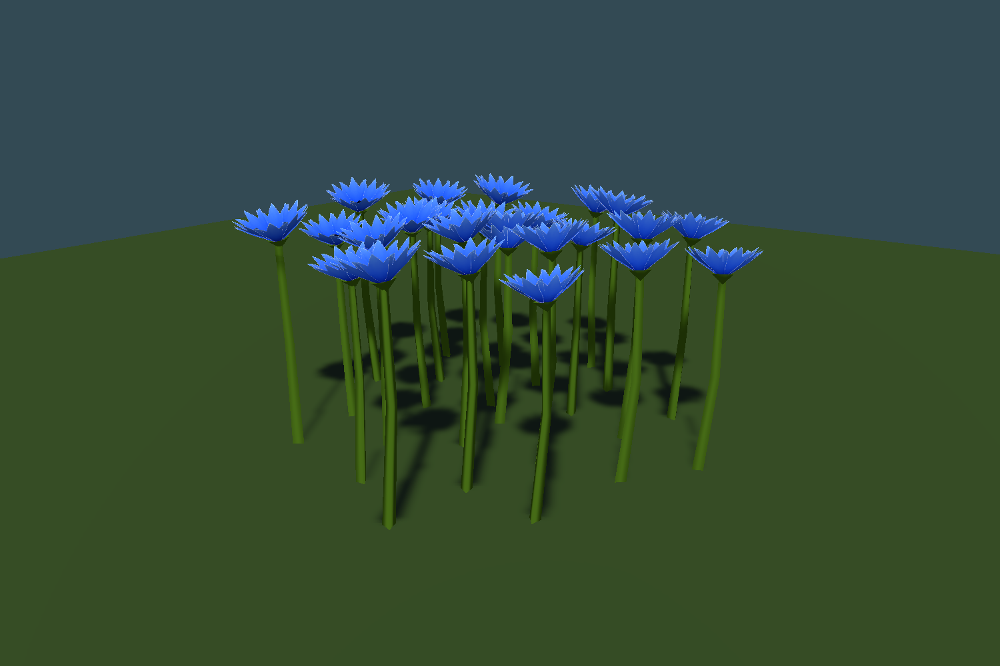

# Simplified blue cornflowers

Cornflowers are enabled in `Assets/Scenes/SmearScene.unity` under **Flowers → Cornflowers**. Restart Play mode after import to rebuild generated foliage. They follow the approved poppy art direction: a wide plain green stem (base radius 0.035 m before instance scaling), no extending leaves, and broad colors with very subtle gradients. The blue head uses eight upward-flaring outer florets with three broad tips each and a simple dark indigo center. After review, the extra cornflower cupping was halved: colored depth along its flower axis is now 0.1535 m before scaling, between the original 0.071 m head and the stronger 0.236 m cup. Stem geometry, UVs/colors and triangle topology remain unchanged. The approved deep poppy model is unchanged.

## Art and rendering

One plant uses **76 vertices / 68 triangles**: eight outer florets (32 triangles), the same simple three-sided stem construction as the poppy (12), a small indigo center (16), and a plain green calyx (8). There are no modeled stamens, leaf geometry, branches, or detailed bract patterns. Height is approximately 1.30 m before the independent 0.46–0.62 instance scale, producing plants about **0.60–0.81 m tall**.

The single blue floret texture was generated with the built-in ImageGen tool, used intact, and imported at 512 px with coverage-preserving alpha mipmaps. The builder measures its alpha bounds for UV placement. Its three broad tips provide the fringed silhouette with little geometry; the surface has no veins, brush strokes or fine botanical detail. The Blender source packs the same atlas. [Generation prompt](TexturePrompt.md).

Cornflowers use their own `M_Cornflower` material and the existing `Custom/PoppyPainted` shader. Sharing the painted-flower shader retains two-sided matte lighting, shadows, fog, night ambient-floor dimming, instance tint, rooted wind sway, and consistent forward/shadow/depth/normal passes. The material supplies the indigo center and blue atlas. Mesh coordinates are explicitly baked into Unity Y-up; the root prefab has identity transforms, one mesh, one material and no collider. World rendering uses the existing instanced flower pipeline, without per-plant GameObjects.

## Generation

`CornflowerSettings` is independent of `PoppySettings`; both inherit the common `MeadowFlowerPatchSettings` controls and use the same deterministic drift worker. Existing serialized poppy field names/defaults are preserved. Their separate seed offsets prevent matching patch layouts.

| Setting | Cornflower | Poppy |
| --- | ---: | ---: |
| Candidate cell spacing, terrain samples | 34 | 32 |
| Spawn chance before noise | 0.34 | 0.32 |
| Noise scale / threshold | 0.022 / 0.47 | 0.024 / 0.48 |
| Candidates per patch | 24–56 | 20–48 |
| Radius, terrain samples | 3–6.5 | 4.24–8.49 |
| Seed offset | 86000 | 72000 |

At SmearScene's 0.3 world scale, cornflower cell spacing is 10.2 m and nominal radii are 0.9–1.95 m. The cornflower candidate count was doubled while retaining its patch radius for fuller patches. Poppy candidates were also doubled, with radius multiplied by sqrt(2) to preserve their existing relative spacing. Actual populations are reduced by noise, internal grassy gaps, uneven-edge thinning and surface exclusions. The maximum slope is 32 degrees. Cornflowers obey the existing grass surface, meadow/forest transition, moss and planned tree/bush/rock clearance rules. Their additions do not clear or rearrange existing flower families or suppress grass.

World-space cell hashes, neighboring-cell reach and half-open chunk ownership keep drifts consistent across positive and negative chunk boundaries. Managed discovery yields per cell or 128 candidates and retains the existing terrain/revision cancellation checks. Cornflowers are the fifth flower publication group; the existing 128-instance publication slices and 1,023-instance batches, render statistics, excavation suppression and insect flower hotspots apply. They share the Flowers render distance, currently three chunks.

## Assets and tools

- Prefab: `Assets/Prefabs/Cornflower.prefab`
- Runtime mesh: `Assets/Models/Grass+Flowers/Cornflower_Painted_Runtime.asset`
- Exchange mesh/blueprint: `Cornflower_Painted.fbx` and `.json` alongside the runtime mesh
- Material: `Assets/Materials/M_Flowers/M_Cornflower.mat`
- Texture: `Assets/Textures/Flowers/T_Cornflower_Painted_Floret.png`
- Shared shader: `Assets/Shaders/S_Grass/PoppyPainted.shader`
- Editable source: `ArtReferences/Cornflowers/Cornflower_Painted.blend`
- Geometry builder: `Tools/BuildCornflowers.py`

Run Blender with `--background --python Tools/BuildCornflowers.py`, then **Tools → Foliage → Cornflowers → Build Assets** in Edit mode. **Assign To Selected World Manager** assigns only that manager's cornflower enable/prefab fields. SmearScene is already configured.

`Tools/ValidateCornflowers.ps1 -BuildAssets` builds and installs these assets in an isolated Unity flora fixture. `Tools/ValidateCornflowers.ps1 -Render` runs checks and saves front/back/overhead/patch and four level side views here. The script reuses `.utmp/poppy/unity-project` and its warm package cache; do not run the two flora validation scripts simultaneously. Cornflower logs are separate under `.utmp/cornflower`.

## Verification

Unity **6000.4.8f1** compiled the runtime/authoring code. **5,383 cornflower checks and all 5,549 poppy regression checks passed**. Coverage includes mesh/UV/normal/triangle validity, independent bindings, seed determinism, positive/negative chunk seams, grounding, size/tint, biome/slope/surface/moss/rock exclusions, disable/missing-prefab/zero-frequency behavior, cancellation, preservation of existing flora including poppies, inherited settings deserialization, mixed five-family publication, 1,040-cornflower batch splitting, geometry statistics, no per-flower objects, and excavation removal. Actual URP instanced front/back/overhead/patch and four level side views passed visible-blue-pixel checks and all shader passes compiled without errors.

The previews use a plain plane to expose the silhouette. They are not a live-world density or FPS benchmark. [Mesh dimensions and UV report](mesh-report.json). Validation/render log: `.utmp/cornflower/render.log`.
