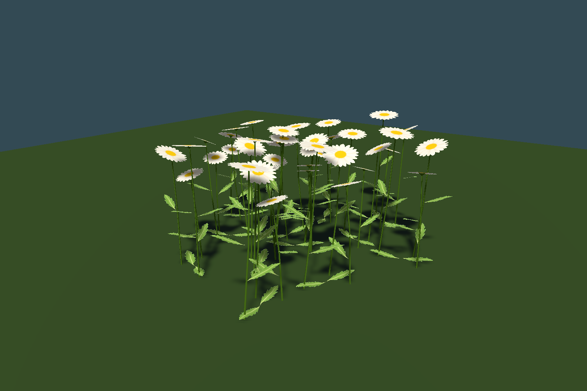

# Painted daisy weed replacement

The active `Assets/Prefabs/daisyWeeds.prefab` is now a standalone three-stem daisy clump, replacing the previous whole-plant card model and violet recolor shader. It uses ivory-white flower heads, flat golden centres, simple meadow-green leaves, modeled curved stems, small calyxes and tilted flower heads. The style follows the game's bright meadow and painted rock surfaces.

The current atlas simplifies the initial painted version: centres are smooth yellow discs, petals have only faint cream gradients, and leaves use a mostly uniform green fill, a simple midrib and gentle gradient. Seed detail, secondary leaf veins and realistic baked petal shadows were removed. This texture revision preserves the model, UVs, atlas GUID, shader and instance batching. The editable Blender source packs the updated atlas. The isolated Unity render and all 529 asset checks passed again after replacement.

The existing prefab GUID `ff0e8ff02b583064abb831387de61597`, root file ID `8896480132052262351`, and material GUID were preserved. Existing SmearScene and recovery-scene references therefore resolve to the replacement without scene edits. Original source assets remain available for comparison; the live prefab no longer references them.

| Item | Replacement |
| --- | --- |
| Geometry | 132 vertices, 119 triangles, one submesh |
| Parts | Three flower heads, three curved stems/calyxes, eight leaves |
| Runtime height in current SmearScene | Approximately 0.62–0.78 m |
| Runtime width | Approximately 0.33–0.42 m before wind padding |
| Material | One shared instanced `M_DaisyWeeds.mat` |
| Texture | Painted transparent RGBA atlas, imported at 512 px with coverage-preserving mips |
| Shader | `Custom/DaisyWeedsPainted`; diffuse sun/ambient, shadows, fog, nighttime ambient dimming, two-sided lighting and gentle sway |
| Rendering | Existing flower instance batches; no GameObject or collider per generated plant |

The previous Unity mesh had 12 vertices and six triangles. Real stems, individual leaves and flower-head parallax increase geometry, while using tighter cutout parts rather than a large mostly transparent plant card. Stems and calyxes use vertex metadata for opaque color; leaves and flower heads sample the atlas once per surface lookup. Petal tint metadata from the existing generator provides restrained ivory variation. Patch density, generation rules, range, seed and scale settings remain.

The new asset also resolves independently of clover: daisy mesh/material lookup was moved out of the clover-enabled branch. The runtime no longer loses daisies when clover is disabled. All shader passes use the same sway and alpha silhouette. The Forward+ main-light variant and screen-space/cascaded shadow coordinates are supported.

## Assets and rebuilding

- Prefab: `Assets/Prefabs/daisyWeeds.prefab`
- Material: `Assets/Materials/M_Flowers/M_DaisyWeeds.mat`
- Atlas: `Assets/Textures/Flowers/T_DaisyWeeds_Painted_Atlas.png`
- Baked mesh: `Assets/Models/Grass+Flowers/DaisyWeeds_Painted_Runtime.asset`
- Exchange mesh and baked authoring data: `DaisyWeeds_Painted.fbx` and `.json` in the same model folder
- Editable source: `ArtReferences/DaisyWeeds/DaisyWeeds_Painted.blend`
- Builder: `Tools/BuildDaisyWeeds.py`

The atlas was generated with the built-in ImageGen tool; [the current simplification prompt](SimplificationPrompt.md) records the latest edit, and [the original prompt](TexturePrompt.md) records the initial layout. `Atlas_Detailed_v1.png` preserves the initial detailed version for comparison. The current atlas is used intact. Blender analyzes the two separated alpha silhouettes to place UV islands. JSON provides explicit Unity Y-up coordinates, so the instanced path does not depend on a prefab child transform or FBX unit conversion.

Run Blender with `--background --python Tools/BuildDaisyWeeds.py`, then use **Tools > Foliage > Daisy Weeds > Build Replacement** in Unity. `Tools/ValidateDaisyWeeds.ps1 -BuildAssets` builds in an isolated project under `.utmp/daisy`; copy the resulting prefab, material, mesh and imported texture metadata into the main workspace only after successful completion. Restart Play mode to refresh cached mesh/material references.

## Verification and cost

The validator checks persistent prefab identity, standalone root/identity transform, the assigned mesh/material/texture, metre scale, all vertex/UV/normal streams, triangle validity, semantic metadata, 1,040-instance batching and lookup with clover disabled. Production instanced rendering is inspected from the front, back, overhead and as a meadow patch. Forward, shadow, depth and depth-normal shader passes compile successfully.

A separate native Unity benchmark uses 1,024 plants at the same positions, yaw, scale 0.575, lighting and 1280 × 720 camera target, comparing old cards and new clumps. It renders one request per actual editor frame, with 24 warm-up and 80 measured frames per stage in the order none → old → new → new → old → none.

| Path | Median camera-render wall time, first/repeat | p95, first/repeat | Flower submission mean |
| --- | ---: | ---: | ---: |
| No plants | 0.386 / 0.379 ms | 0.490 / 0.453 ms | 0 ms |
| Legacy cards | 0.702 / 0.714 ms | 0.858 / 0.811 ms | 0.019 / 0.020 ms |
| Painted 3D clumps | 0.836 / 0.792 ms | 2.144 / 1.002 ms | 0.019 / 0.019 ms |

The geometry upgrade added about 0.08–0.13 ms to median camera-render wall time in this dense synthetic comparison; the first new stage had higher tail timings, as recorded above. This is an isolated editor render, not a GPU timestamp or full-game FPS measurement. It retains two instanced submissions for 1,024 plants and does not increase generation density. Full-game performance still depends on foliage density, shadows and other scene work.

Reproduce with `Tools/ValidateDaisyWeeds.ps1`, `-Render`, or `-Benchmark`. Logs and the native cost report are in `.utmp/daisy`; `mesh-report.json` records geometry and atlas UV bounds. Runtime/editor compilation uses the existing `Tools/ValidateBuildingPrototype.ps1 -CompileOnly` workflow.

