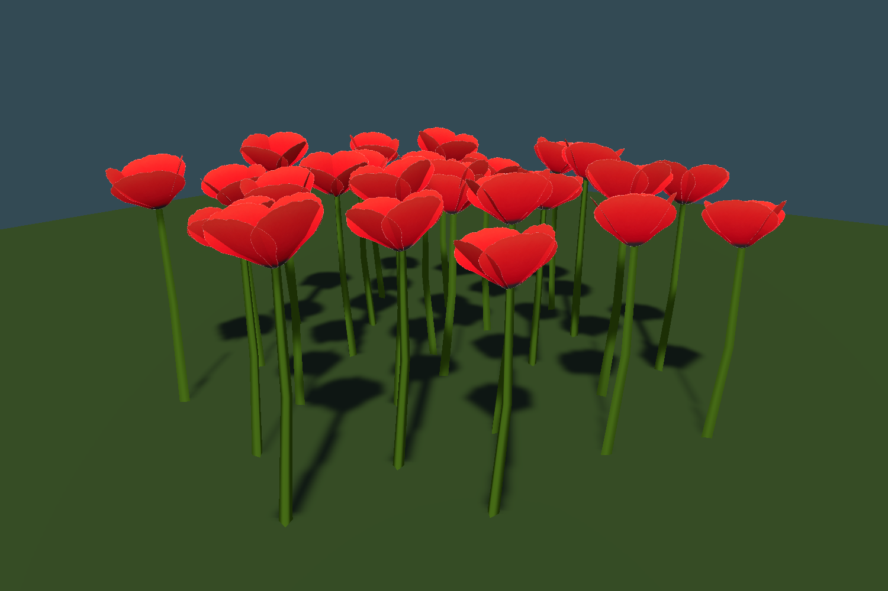

# Simplified scarlet poppies

Poppies are enabled in `Assets/Scenes/SmearScene.unity` under **Flowers → Poppies**. Restart Play mode after importing to regenerate the flower caches. They share the Flowers render range (currently three chunks), discovery/publication budgets, excavation suppression, render statistics and insect flower hotspots.

The latest review keeps the flower head, removes all extending leaves, and uses a wider plain green stem. The user approved this leafless silhouette and the thicker stem before cornflower authoring.

The user's art direction is deliberately simple: broad nearly flat colors, subtle gradients, no visible brush strokes, petal streaks, wrinkles, or secondary leaf veins. The initial detailed atlas is retained as `Atlas_Detailed_v1.png` for provenance; the active texture is the simplified version. See [the ImageGen prompts](TexturePrompt.md).

## Geometry and shader

One plant has **59 vertices / 61 triangles**, one mesh and one shared instanced material: four overlapping deeper cupped petals (32 triangles), a wider bent three-sided stem (12; base radius 0.035 m before instance scaling), a dark six-sided flower center (12), and a small calyx (5). There are no per-plant GameObjects or colliders in world generation. The model is approximately 1.48 m tall before scaling; the independent 0.46–0.62 scale range produces plants approximately **0.68–0.92 m tall**. Mesh bounds include sway padding. Petal overlap avoids the pinwheel gaps caused by tapering both geometry and the cutout texture.

The 512 px imported RGBA atlas contains a red petal and an unused green leaf island. The leaf island is retained so the approved petal texture/UVs remain untouched; no geometry samples it. The original generated PNG is used intact; the authoring script only measures the alpha bounds for UVs. The editable Blender source packs the simplified atlas. The runtime mesh uses explicit Unity Y-up coordinates, so the renderer does not depend on FBX/prefab child transforms. Vertex metadata identifies textured petals (alpha/red), dark centers (blue), and subtle shade (green). The stem uses a solid shader color.

`Custom/PoppyPainted` follows the existing painted-daisy shader: two-sided matte lighting, alpha cutout with coverage-preserving mips, main-light shadows, fog, shared nighttime ambient-floor dimming, subtle per-instance petal tint and gentle rooted sway. Forward, shadow, depth, and depth-normal passes share the deformation and alpha handling. Center and stem colors are shader properties. Additional local lights follow the existing flora shader's limitations.

## Placement decisions

The starting configuration was chosen against the current SmearScene flora, rather than the legacy flower defaults:

| Family | Cell spacing, samples | Spawn chance before noise | Candidates per patch | Radius, samples |
| --- | ---: | ---: | ---: | ---: |
| Dandelions | 18 | 0.45 | 3–12 | 1.8–5.5 |
| Painted daisies | 36 | 0.28 | 8–16 three-head clumps | 3.5–7 |
| Small lupine drifts | 42 | 0.18 | 16–26 | 7–10 |
| Large lupine meadows | 80 | 0.25 | 150–250 | 18–28 |
| **Poppies** | **32** | **0.32** | **20–48 single plants** | **4.24–8.49** |

At the scene's 0.3 world scale, poppy candidate cells are 9.6 m apart and nominal patch radii are 1.27–2.55 m. The noise threshold is 0.48 at scale 0.024. Noise, uneven-edge thinning, grassy internal gaps, and surface filters reduce the actual count; 0.32 is not a chance per chunk. Poppies provide scarlet accents between larger pastel drifts. The candidate range was increased from 10–24 to 20–48 and both radius bounds were multiplied by sqrt(2), giving broader, more populous patches at the existing expected density. The approved poppy art is unchanged. They do not clear or rearrange existing flowers or suppress the grass beneath them.

The independent `PoppySettings` lives inside `FlowerSettings`. It exposes enable/prefab, patch frequency/noise/radius/count, edge irregularity, gaps, scale, slope, clearances, seed and two subtle multiplicative tints. Maximum slope is 32 degrees; tree clearance is 1.1 world metres, with the existing planned tree/bush/rock footprints applied. Poppies require grass surfaces and the existing meadow membership policy, taper into forest transitions, and avoid dense moss. They are appended after the existing flower families with their own seed offset (72000). World-space cell identities, neighboring-cell reach and half-open ownership preserve patches across positive and negative chunk boundaries. New managed discovery yields per cell or 128 candidates and checks terrain/revision invalidation after each yield. Publications retain the existing 128-instance slices and 1023-instance batch limit, with poppies as the fourth flower group.

## Assets and rebuilding

- Prefab: `Assets/Prefabs/Poppy.prefab`
- Material: `Assets/Materials/M_Flowers/M_Poppy.mat`
- Atlas: `Assets/Textures/Flowers/T_Poppy_Painted_Atlas.png`
- Shader: `Assets/Shaders/S_Grass/PoppyPainted.shader`
- Runtime mesh: `Assets/Models/Grass+Flowers/Poppy_Painted_Runtime.asset`
- Exchange/authoring mesh: `Poppy_Painted.fbx` and `.json` alongside the runtime mesh
- Editable source: `ArtReferences/Poppies/Poppy_Painted.blend`
- Geometry builder: `Tools/BuildPoppies.py`

Run Blender with `--background --python Tools/BuildPoppies.py`, then **Tools → Foliage → Poppies → Build Assets** in Edit mode. The separate **Assign To Selected World Manager** command changes only that manager's poppy enable/prefab properties and marks its scene dirty. SmearScene is already assigned.

For isolated builds and validation, run `Tools/ValidatePoppies.ps1 -BuildAssets`, then `Tools/ValidatePoppies.ps1 -Render`. The script waits for Unity, reports failures, installs successfully built poppy assets and saves successful previews here. Plain `Tools/ValidatePoppies.ps1` runs nongraphics checks. The scratch project and logs are under `.utmp/poppy`.

## Verification

Unity **6000.4.8f1** compiled the runtime and authoring code. The leafless/stem revision preserved the original head. The later head-depth revision raises the petal rims into a fuller cup: colored depth along the flower axis increases from 0.096 to 0.282 m before scaling (2.94×). The approved stem, petal UVs/colors and triangle topology remain identical. **5,549 checks passed**, covering mesh/UV/normal/triangle validity, seeded placement, positive and negative chunk subdivision, bilinear grounding, scale, biome/slope/surface/moss/rock exclusions, enable/missing-prefab/zero-frequency behavior, cancellation after invalidation, unchanged legacy flower placement, a mixed four-family publication with 1,040 poppies, 1,023 splitting, render statistics, no per-plant objects, and excavation suppression of the new family. Actual URP instanced front, back, overhead, patch and four level side captures passed visible-red-pixel checks and compiled all shader passes without errors. The test views use a plain ground plane for readable geometry; they are not a live-world density or frame-rate benchmark.

The render log is `.utmp/poppy/render.log`; saved views are `poppy-clump.png`, `poppy-back.png`, `poppy-overhead.png`, and `poppy-patch.png`, plus `poppy-side-front.png`, `poppy-side-back.png`, `poppy-side-left.png`, and `poppy-side-right.png`. [Mesh dimensions and UV report](mesh-report.json).
