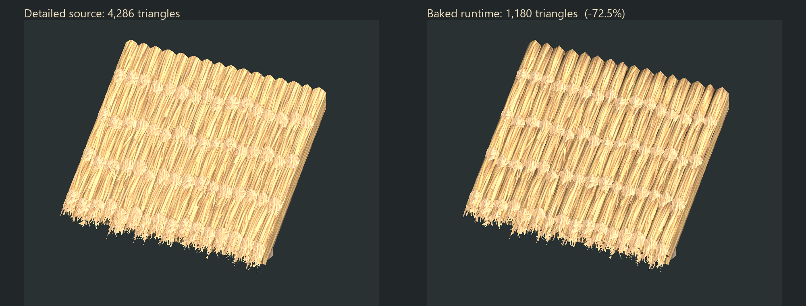

# Baked runtime roof

The installed roof now uses **1,180 triangles**, down from **4,286** (72.5%).
Its clipped uphill visual uses **1,164 triangles**. The original detailed
`../LayeredThatchRoof.blend` remains the source for rebaking.



The reduction removes all 192 small solid straw stalks, simplifies the closed
bundle surfaces, and reduces the 64 fringe strips from four quads to two apiece.
It retains four courses, 64 bundles, the eave fringe, closed inner shell, timber,
woven underside and structural endpoints. Decimation is clamped to the original
X=0/4 m side planes and +2 m run plane so adjacent modules still meet.

The source normals and short-range occlusion are baked onto a unique second UV
set. The original colour/alpha atlas and UV0 are retained. One new 1024² linear
RGBA texture packs octahedrally encoded **Unity object-space normal in RG** and
**ambient occlusion in B**. A is unused. This adds approximately **5.33 MiB**
with mipmaps, uncompressed. The map is specific to this mesh and is not a generic
tangent-space normal map. The shader transforms the decoded normal per instance,
so rotated roofs receive matching lighting without mesh tangent storage.

An optional `_THATCH_BAKED` variant of the shared matte shader samples this detail
in the forward and depth-normal passes. AO attenuates ambient light only; direct
sun, flame light and cast shadows remain live. Other materials retain the
existing path with no bake-texture samples. Reused timber, underside weave and
fringe use a neutral reserved UV1 corner. The common mesh importer preserves
UV1, and uphill clipping interpolates both UV sets.

## Rebuild and evidence

```powershell
blender --background --python Tools/BakeThatchRoof.py
blender --background ArtReferences/ThatchRoof/Redesign/Baked/BakedThatchRoof.blend --python Tools/RenderLayeredThatchRoof.py
./Tools/ValidateLayeredThatchRoof.ps1 -Install
```

`BakedThatchRoof.blend` contains the reduced construction, hidden detailed bake
source, review material and joined export. `normal-bake.png` and `ao-bake.png`
are intermediate Blender bake outputs; only `Assets/Textures/Buildings/Wood/
thatch-roof-detail.png` is the packed runtime texture. `DetailedReference.fbx`
is an independently exported detailed reference used only by isolated comparison
tests, outside runtime Assets.

The matched Unity captures compare the original detailed mesh, the reduced mesh
with its bake, and the reduced mesh without its bake. The silhouette intersection
over union is **0.992789** (99.3%) in this view. Disabling the bake changes
**119,837 pixels** by more than six combined RGB byte values, verifying that the
actual shader uses it. These are visual checks, not performance measurements.
Single-view silhouette agreement does not establish identical appearance from
every angle. Gable, underside, ridge, sideways, uphill and distant views are
also retained here for inspection.

Isolated Unity checks cover shader compilation, both UV sets, geometric/UV areas,
all eight placement headings, side/ridge/uphill joins, eave restoration, two thin
colliders and off-screen roof shadows. The current modular-building regressions,
including 192 actual motor stair walks, also passed. The catalog, physical shape
and saved world scenes are retained. Live-world frame time remains unmeasured.

Final validation: **23,788 roof assertions** and **28,311 modular-building
assertions** passed. Geometry and comparison metrics are recorded in
`bake-report.json`, `layered-roof-validation.json` and `roof-bake-comparison.json`.
