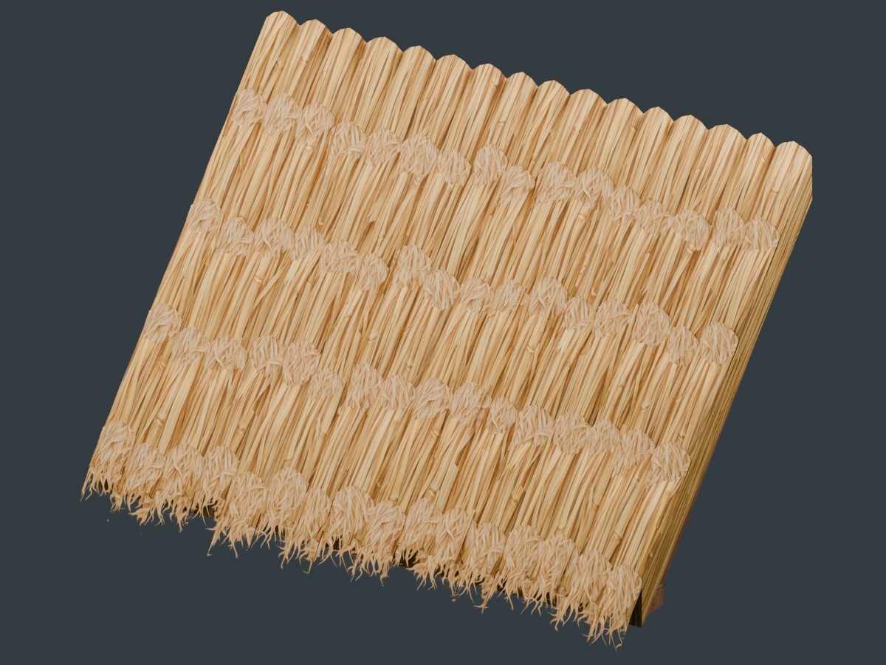

# Layered thatch roof — detailed first pass

**Current runtime:** the detailed source has now been baked to **1,180 triangles**
(72.5% fewer), with a 1024² normal/AO detail map. See the
[baked model, comparison and rebuild guide](Baked/README.md). This page records
the preserved 4,286-triangle source pass.

This replaces the flat thatch prism with four overlapping courses, 64 gently
rounded straw bundles, 192 modeled straw tips, and 64 curved cutout fringe strips.
The target is the warm, dry, orderly thatch in the supplied limestone homestead
illustration, with loose edges and depth inspired by Valheim.



The editable source is [LayeredThatchRoof.blend](LayeredThatchRoof.blend). It keeps
the six named roof construction objects separately editable. The thatch object
contains disconnected bundle and straw components, so linked selection can
isolate individual bunches. The existing timber and woven substrate were reused.
The original shared `BuildComponents.blend` was read to bootstrap this file and
was never saved over.

## Direct inspection of Valheim

On October 17, 2026, the locally installed Steam build **25730771** was inspected
read-only with UnityPy 1.25.4. These are measurements of that installed build,
not guesses from screenshots or claims about every release.

The `wood_roof_45` prefab's `New` child uses `wood_roof_45_new`, with **352
render vertices, 238 triangles and three submeshes**:

| Material slot | Triangles | Observed role |
| --- | ---: | --- |
| `woodwall` | 220 | Timber and boarding |
| `straw_roof` | 2 | Main straw sheet |
| `straw_roof_alpha` | 16 | Lifted, folded fringe sheets |

The latter two materials share **64×64** straw colour and normal textures.
The fringe material has `_Cull=0`, `_Mode=1`, `_Cutoff≈0.69` and
`_TwoSidedNormals=1`; its colour texture contains transparent strand endings.
The shallow `wood_roof_new` mesh has 361 vertices and 246 triangles.

The visible card positions and material assignments establish that much of the
loose straw comes from a very small number of lifted cutout sheets, rather than
individual modeled stalks. The exact contribution of runtime shader deformation
was not measured. No game was launched or modified. Inspection exports remain
in ignored `.utmp/roof/valheim-inspection`; no Valheim mesh, texture or material
is used by First Settlers. Its [public generated mesh registry](https://valheim-modding.github.io/Jotunn/data/prefabs/mesh-list.html)
also lists these asset names; the counts above come from the local files.

## Geometry and material

| Property | Detailed first pass |
| --- | --- |
| Structural module | 4 m width, 2 m rise, 2 m run, 45° |
| Main visual | **4,286 triangles**, one atlas/material/submesh |
| Uphill joined visual | **3,898 triangles**, clipped at the seam |
| Core | Closed opaque sloped shell |
| Surface | Four courses, 16 rounded bundles per course |
| Loose tips | 192 closed triangular straw prisms |
| Fine fringe | 64 lifted strips, four quads each, two-sided alpha cutout |
| Occupancy | Existing two thin convex volumes; empty attic retained |
| Unity visual bounds | X 0…4; Y −0.137035…2.497750; Z −0.476035…2 |

Bundle crowns rise gently across and along the slope. Course lips taper so they
do not read as sawn blocks. Uneven ends and fine cutouts break the eave silhouette.
The most distant tips are transparent, so the rectangular mesh envelope extends
slightly beyond the visible straw. Gable edges remain on the 4 m repetition plane.
Opposing slopes meet at the ridge; this pass does not add a separate ridge roll
or the illustration's external binding battens.

The existing 2048² atlas retains timber/weave in its upper left, packs the new
opaque straw across the lower half, and uses the previously spare upper right
for fringe. Generated source artwork and its exact prompts are retained here.
The shared matte shader already supports two-sided cutouts, so no shader changes
or additional material submissions are needed. Timber colour synchronization
continues to use the active wood atlas.

Uphill continuation now clips triangles, interpolating UVs and normals, instead
of flattening the frayed geometry against the seam. Removing the lower neighbour
restores the full exposed eave through the existing visual selection logic.

## Rebuild

From the repository root, using Python with Pillow/NumPy and Blender 5:

```powershell
python Tools/PrepareThatchAtlas.py ArtReferences/ThatchRoof/Redesign/straw-generated-source.png
python Tools/PackLayeredThatchAtlas.py
blender --background --python Tools/BuildLayeredThatchRoof.py
blender --background ArtReferences/ThatchRoof/Redesign/LayeredThatchRoof.blend --python Tools/RenderLayeredThatchRoof.py
./Tools/ValidateLayeredThatchRoof.ps1 -Install
```

The builder regenerates thatch deterministically, keeping the source file's
timber/substrate. Back up manual thatch edits before running it. The old
`BuildThatchRoof.py` is the historical flat-roof repair and should not be used to
rebuild this design. Unity's **Tools → Building → Link or Rebuild Thatched Roof**
rebakes the exported FBX without changing the Blender model.

## Validation and later reduction

Blender checks closed opaque components, the intentional card boundaries,
nonzero triangle/UV areas and atlas bounds. The isolated Unity checks inspect
both imported visuals, normals, UVs, all eight headings, side/ridge/uphill
connections, eave restoration, two physical colliders, real instanced renders,
and fixed-point roof shadows while moving/turning the camera. Current installed
modular-building regressions also run before installation: **63,198** roof
assertions and **28,311** modular-building assertions passed. Evidence is saved
beside this file. Saved world scenes, the catalog, shader and original modeling
source are retained. Live-world FPS and a normal/AO bake have not been measured.

This is the detailed source pass. Once the shape is accepted, retain course
silhouettes and exposed tips while baking the shallow crown relief and smaller
stalks into normal/AO maps. Build a simpler course shell and fewer fringe strips
for the runtime model and distant LODs. Alpha coverage and shadow stability need
to be rechecked at each reduction; triangle reduction alone will not reduce
overdraw from overlapping cutout cards.
