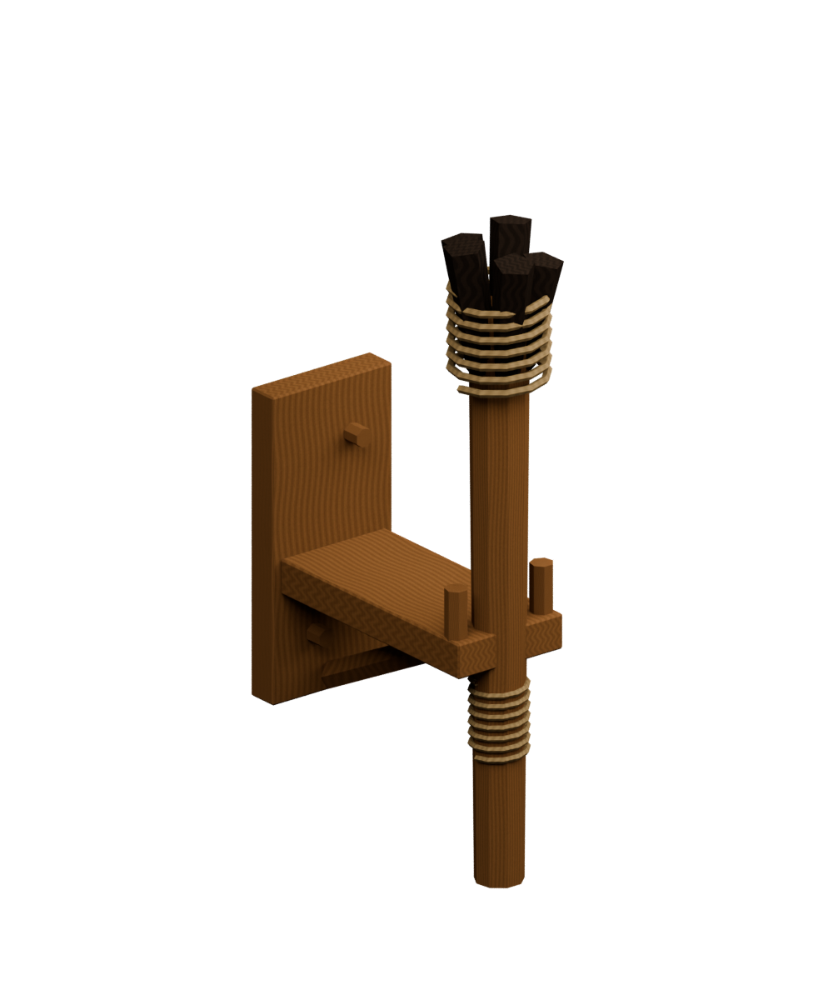

# Fibre-bound torch and wooden wall holder

Installed in the building catalog as **Lighting → Mounted torch**, content ID `build.lighting.wall-torch`. Press **T** in ordinary gameplay for the development carried variant. See [runtime behavior, budgets and measurements](../../Documentation/LOCAL_FLAME_LIGHTING.md).

The installed mounted body now uses `MountedTorch_Baked.fbx`: **280 triangles**, with 512-pixel colour/AO and normal maps. The 1,996-triangle export below remains the detailed authoring/bake source. Current comparisons and validation are in [baked furnishings](../../Documentation/BAKED_FURNISHINGS.md) and `../BakedFurnishings/`. The hand model and flame animation are retained.

The model follows the game's flexible British Iron Age inspired direction. It uses a split wooden handle, a small cluster of darkened fuel splints, plant-fibre binding and a pegged wooden wall holder. This exact object is an authored proposal, not a replica of an excavated British torch. A protected lantern remains separate content; the [British Museum's first-century Roman lantern](https://www.britishmuseum.org/collection/object/G_1856-1226-670) is an ancient reference with a different regional/period context.




## Files

- `TorchKit.blend`: editable individual parts, packed atlas, export copies and studio camera.
- `torch-models.json`: actual model bounds, emitter/animation anchors, part and triangle counts.
- `unity-validation.json`: installed asset and placement check result.
- `../../Assets/Models/Buildings/Lighting/MountedTorch.fbx`: 1,996 triangles / one material submesh.
- `../../Assets/Models/Buildings/Lighting/HandTorch.fbx`: 1,792 triangles / one material submesh.
- `../../Assets/Textures/Buildings/Lighting/TorchAtlas.png`: 512 × 512 wood, cord and charcoal columns, with complete model UVs.
- `../../Assets/Resources/Lighting/TorchFlameAtlas.png`: 36 alpha frames with four-pixel cell gutters, generated with periodic temporal harmonics.
- `flame-loop.gif`: enlarged atlas animation preview on a neutral background; the world flame also has frame blending, tip motion and light/size flicker.

The solid mounted model occupies roughly 0.16 × 0.734 × 0.387 m. Its gameplay envelope reserves 0.25 × 0.75 × 0.5 m for placement. The flame begins at local `(0, 0.715, 0.32)` and its stable emitter is `(0, 0.91, 0.32)`; changing flame silhouette does not move that emitter. The holder rear face is at local Z = 0 and faces outward along +Z.

Reproduce the model with Blender 5:

```powershell
& 'C:/Program Files/Blender Foundation/Blender 5.0/blender.exe' --background --python Tools/BuildTorchKit.py
```

Generate the deterministic flipbook with a Python environment containing NumPy and Pillow:

```powershell
python Tools/GenerateTorchFlame.py
Tools/ValidateLocalFlame.ps1 -InstallTorch
```

Use **Tools → Building → Install Mounted Torch** in the Unity editor for an explicit in-project reinstall. The validated command above uses an isolated project and preserves unrelated catalog entries. Torch import forces a 2D texture shape and checks actual atlas bindings, avoiding a white rectangular fallback flame.
