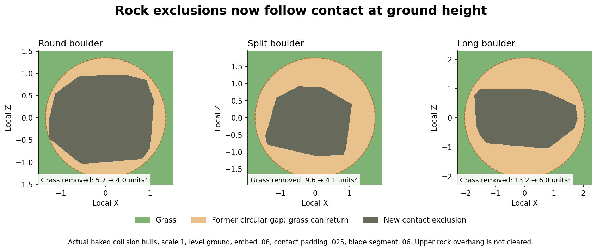

# Rock and clover grass exclusion profiles

Edit the ScriptableObjects in `Assets/ScriptableObjects/FoliageExclusions`.
Each rock and clover prefab references its profile through its root **Foliage
Exclusion Zone** component. Select a prefab with Gizmos enabled to see its nominal
rock contact contour or clover core/fade circles. Restart Play Mode or regenerate
the world after editing a profile or its prefab reference.

Rocks now use **convex collision-hull contact at the actual grass root height**.
The profile stores baked hull planes and bounds; the snapshot applies the same
rotation, scale and vertical embed as the rendered rock. Each grass candidate's
short vertical blade segment is clipped against that hull. A wide upper rock
silhouette therefore does not remove grass around its narrower base. The full
projected bounds only accelerate filtering; they do not define the exclusion.

`rockContactPadding` defaults to **0.025 prefab-local units** and slightly expands
the hull. `rockContactHeight` defaults to **0.06** and tests a short segment above
the root to keep blades out of the contact edge. Both scale with the instance.
Bare, moss and snow finishes share their rock shape's baked profile. The gizmo
draws the nominal contact with level ground; runtime tests use actual terrain
height and the generated terrain-aligned rotation.

`grassRadius` remains the circle radius for clover and unbaked rock profiles, in
local units at scale one. An explicit zero disables that circle. Prefabs without
profiles retain their legacy fallbacks. Configured rocks use the hull settings
instead. Terrain `worldScale` is not applied to instance dimensions a second
time. Rock placement spacing, low-plant placement filters and terrain substrate
blending remain separate controls.

| Clover prefab | Core radius | Fade padding |
| --- | ---: | ---: |
| CloverClump_v02_A | 0.60 | 0.20 |
| CloverClump_v02_B_Flowering | 0.62 | 0.20 |
| CloverClump_v02_Edge | 0.42 | 0.15 |
| CloverSingle_v02 | 0.08 | 0.04 |
| CloverClump / CloverClump_v01 | 0.65 | 0.65 |

Clover scales both core and fade padding per instance. `CloverSettings.grassDensityInsidePatch` still controls grass retention inside the core (0 removes
all grass there). Rocks use a hard exclusion. Prefabs without profiles keep the
legacy radius/fade settings. Existing low-plant placement filters are separate
from these grass suppression zones.

Both grass job paths consume numeric snapshots, with no ScriptableObject access
inside jobs. Tile filtering uses each instance's reach. Rock and clover prefab
builders preserve existing tuning values and rebake hull geometry when rebuilding
assets. Use **Tools → Foliage → Set Up Grass Exclusion Profiles** to restore missing
bindings or rebake the six rock shapes after editing their collision hulls.

Run `./Tools/ValidateRocks.ps1 -Exclusions` for isolated Unity validation. The log
is `.utmp/rocks/exclusions.log`; success prints `FOLIAGE_EXCLUSION_PASS`. It checks
all 24 prefab bindings, tapered/actual hull contacts, scaling/rotation/embed,
fallback/zero circles, tile-edge overlap, parity between tiled and whole-chunk
grass discovery, compacted clover selection, and clover suppression with
per-instance fade. It also runs shore-width, near/distant tree habitat and global
water regression checks; look for `SHORE_HABITAT_PASS` and the global-water pass.

## Tree distribution

The active planner now uses habitat-driven world-space stands and cross-chunk
competition. Edit `Assets/Resources/Foliage/TreeDistribution.asset`. Species cards
still supply the placement radii; their sum is enforced across chunk boundaries.
`distantTreeDensity` only thins rendering. See [the current stand guide](TREE_STANDS.md)
for density figures, size checks, controls and validation.

The [earlier shore and tree-distribution analysis](WORLD_DISTRIBUTION_AND_SHORES.md)
records the previous chunk-based model for comparison.
