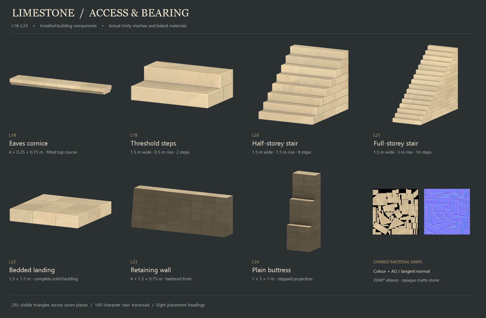

# Limestone L18–L24

Seven installed building options complete the masonry section of the limestone catalog. Open **B → Walls, Stairs, Floors or Posts** after Unity finishes importing, and restart Play mode if it was already running.

| Part | Menu | Dimensions / detail |
|---|---|---|
| L18 eaves cornice | Walls | 4 × 0.25 × 0.75 m; shallow chamfer, 0.125 m projection on each face |
| L19 threshold steps | Stairs | 1.5 m wide; 0.5 m rise over 1 m; two 0.25 m risers and 0.5 m treads |
| L20 half-storey stair | Stairs | 1.5 m wide; 1.5 m rise over 2 m; eight 0.1875 m risers and 0.25 m treads |
| L21 full-storey stair | Stairs | 1.5 m wide; 3 m rise over 4 m; sixteen matching steps |
| L22 limestone landing | Floors | 1.5 × 1.5 m, 0.25 m deep; origin at its upper walking surface |
| L23 retaining wall | Walls | 4 × 1.5 × 0.75 m; front recedes 0.25 m at the top, rear stays vertical |
| L24 plain buttress | Posts | 1 m wide and 3 m high; projection steps from 1 to 0.75 to 0.5 m; flat rear |

The seven visible meshes total **292 triangles**. Individual blocks, shallow joints and chamfers are baked into a shared 2048² colour/AO map and tangent normal map. Silhouette, tread steps, retaining-wall batter and buttress setbacks remain geometry. The material is opaque, matte and instanced.

## Cornice fitting

Aim L18 at a compatible full-height wall. It automatically aligns with the wall and occupies local Y=2.75…3.00 m. The wall's visible mesh and physical solids are clipped to 2.75 m; removing L18 restores the original mesh, UV variant and collision. The wall's canonical origin and 3 m storey sockets stay fixed, so gables and roofs retain their original datums.

Validated limestone hosts are L01, L02, L07, L09, L10, L11 and L12. The fitting rule requires a full 4 m bay, 3 m wall height, 0.5 m thickness and a continuous solid upper band. L03 is only 2 m wide; L17 is triangular. Neither accepts this full-width cornice. A shifted, partial or floating cornice is rejected. Its matching wall must remain supported; adjoining pieces cannot make the cornice a bridge after that wall is removed.

This implements the masonry course only. L36's timber bearing plate remains a catalog proposal. The existing roof and half-gable attachment rules still govern roof placement.

## Access and bearing

L19–L21 ascend along local +Z. Their visible and occupied masonry extends down to the base beneath every tread. Independent filled triangular walking hulls provide continuous character movement, following the established stair system. These pieces attach to supported building surfaces or matching flight endpoints; terrain alone cannot anchor a stair. Aim at a floor's underside or edge to attach a descending flight. L20 and L21 share the existing 0.75 pitch.

L22 needs continuous supported foundation or solid paving coverage beneath its **whole underside**, at walking height minus 0.25 m. Timber floors and contact with a wall or stair endpoint do not supply bedding. For a turn at 1.5 m, build solid support up to 1.25 m, then seat the landing at 1.5 m. Multiple aligned footing strips may supply the area together; removing one required strip removes support. The slab cannot be used as a cantilevered balcony.

L23 can seat on terrain or supported construction. L24 automatically seats its rear plane against an aimed wall face at that wall's base; it also needs terrain contact or complete foundation/solid paving bedding beneath its 1 × 1 m footprint. Raising it off its bedding does not let the wall carry it in midair. Both terrain pieces reject floating placements.

No handrail has been added for the 1.5 m flights. Existing narrower timber rails are separate pieces with their own dimensions. The retaining wall does not excavate terrain or simulate soil pressure, and the buttress grants no numerical strength bonus. Health remains the catalog's 100-point placeholder.

## Source, material and checks

- [Editable Blender source](../ArtReferences/LimestoneBuildKit/Access/LimestoneAccess.blend)
- [Native Blender preview](../ArtReferences/LimestoneBuildKit/Access/access-blender-overview.png)
- [Manifest, dimensions and source hash](../ArtReferences/LimestoneBuildKit/Access/access-models.json)
- [Shared colour/AO atlas](../Assets/Textures/Buildings/LimestoneAccess/Access_ColourAO.png) and [normal atlas](../Assets/Textures/Buildings/LimestoneAccess/Access_Normal.png)
- [Original limestone/timber trim proposal](../ArtReferences/LimestoneBuildKit/Textures/README.md)
- [Unity validation evidence](../ArtReferences/LimestoneBuildKit/Access/unity-validation.json)

Rebuild sources with `Tools/BuildLimestoneAccess.py` in Blender, then run `Tools/ValidateLimestoneAccess.ps1 -Install`. Validation uses an isolated Unity project. The installer appends the seven definitions and copies only their owned assets; it does not save a world scene or regenerate unrelated definitions.

Checks include asset bounds, UVs, tangent bases, watertight convex collision, actual menu thumbnails, URP and instanced rendering; 56 cornice/host combinations across eight headings; 160 real character stair traversals; landing coverage and removal; buttress bearing on both wall faces; and 16 terrain placements. The installed courtyard, timber/infill, L01–L03, L04–L09, ordinary stone and modular timber suites run afterward.

All L01–L24 masonry designs are now implemented. The remaining limestone-family proposals are **L26, L29, L30, L32, L34 and L36**.
