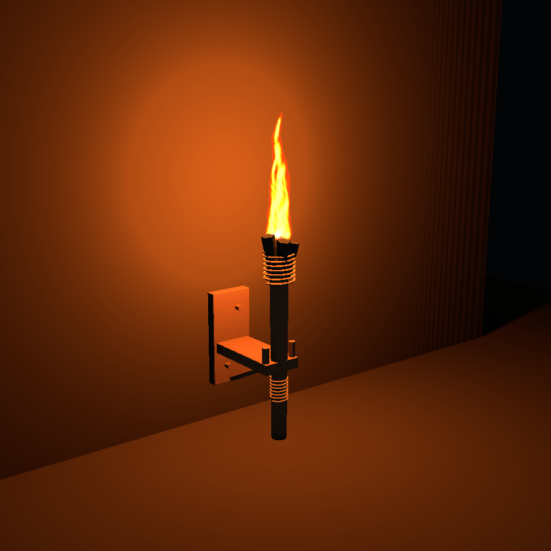

# Historical local flame lighting baseline

Historical snapshot before surface caching; see [the current implementation](LOCAL_FLAME_LIGHTING.md). Implemented October 16, 2026. The earlier [investigation](LOCAL_FLAME_LIGHTING_PLAN.md) is historical; this document describes the installed implementation.

## Playing

- Restart Play mode after Unity imports the new scripts/assets.
- Open **B → Lighting → Mounted torch**. Aim at a supported wood/stone wall or post. Rear contacts use the existing furniture placement/support policy at all eight headings. This is a non-structural furnishing; it cannot support other construction or mount directly on raw terrain.
- Press **T** outside menus/building/sculpt mode to equip or put away a carried torch. This is a development offhand shortcut while inventory ownership is unimplemented. The carried emitter retracts at solid walls and suppresses its light/flame if there is insufficient clearance.
- **F3** includes active/registered sources, stationary/dynamic refreshes, pending work, last lighting-update CPU time, managed allocations and shadow draw submissions.

The torch is session content under the existing building lifecycle. Fuel consumption, recipes, saved inventory/builds, weather/water extinction, smoke, sound and multiplayer ownership were not added. `LocalFlameSource.burning` controls the visible flame and illumination together.



## Lighting architecture

`LocalFlameLighting` owns at most **8 active point emitters**, **32 selected flame visuals**, and one pair of **256-pixel, 48-slice R32 float arrays**. Each slot owns six radial-depth faces for stationary geometry and six for moving geometry. The arrays allocate on first use and contain **24 MiB of raw GPU texture payload**, separate from the terrain derived-data cap. They have no readable CPU pixel copy. Registry metadata, command buffers and bounded reusable working lists add overhead beyond that payload.

The project retains its existing URP Forward+ renderer for ordinary scene lighting. These emitters use a custom shared HLSL direct-light contribution and their own depth arrays, rather than trying to retain URP's transient additional-shadow atlas. They do not create duplicate Unity point lights. Supported receiver shaders evaluate a bounded eight-slot loop, reject samples outside the light radius before shadow sampling, then combine normal-facing diffuse, smooth finite-range attenuation and four visibility comparisons. Default range is **6 m** and intensity/color are art controls. There is no per-fragment density ray marching or camera-wide brightness adjustment.

The custom contribution is added separately from cave ambient and directional shadow/horizon tint. Existing sky access is not retraced when a source moves, flickers or changes color. Terrain, shared wood/stone/furniture materials, loose rocks, near grass/fern/clover and shared near-tree lighting receive the contribution. Arbitrary stock URP materials and other custom character/decoration shaders require explicit integration with `LocalFlameLighting.hlsl`; they do not automatically receive these custom lights.

Stationary depth records the nearest opaque/cutout blocker along each direction from a stable point, using two-sided rasterization and minimum radial distance. Source color/intensity, camera movement and flame animation reuse it. Moving sources redraw their environment depth each frame. Nearby moving occluders are rasterized into a separate array and combined with the stationary result, so a moving door/actor does not rebuild the terrain/building cache. The decorative torch itself is excluded from its own emitter's shadows to avoid a large fuel-head shadow; it remains an occluder for other lights. Walls, roofs and terrain are retained.

## Registration, invalidation and bounded work

- `LocalFlameGeometry` indexes resident immutable mesh/matrix references in **16 m cells**. Build-session resolution registers actual placed/resolved meshes and attachments, not collider boxes or placement ghosts. Chunk runtimes register original/replacement terrain independently of camera-frustum visibility. Rock sets register their resident visuals. The standing-tree provider queries authoritative nearby tree records independently of visible draw submission.
- Add/remove/replacement and pose changes invalidate overlapping lights using both the old and new bounds. Identical mesh/matrix/material references do not invalidate. Health-only item changes do not invalidate. In-place mesh or alpha-mask changes must call `LocalFlameOccluder.GeometryChanged()` explicitly; changing vertices inside an existing mesh cannot be inferred from its reference.
- `LocalFlameOccluder` handles authored scene props and moving actors/doors. Initial discovery runs once per scene. Runtime spawners should add this component. Static unchanged transforms skip geometry rebuilding. It refreshes after ordinary movement/held-prop updates, before camera rendering.
- Selection runs about **10 times per second**, using nearby source buckets, influence bounds, carried-source priority and hysteresis. A flame can remain visible without consuming an illumination slot. Selected-source positions and flicker update every rendered frame; a source behind the camera can still illuminate visible receivers.
- The default stationary refresh admission is **one complete six-face light per frame**. Repeated invalidations coalesce into one dirty flag. Dirty lights suppress illumination until the complete replacement is submitted; they never fall back to leaking unshadowed light. Reassignment fades remain within the eight-slot cap. Moving lights are a separate recurring cost, so the current gameplay fixture equips one carried source.
- Placed/held sources consult the existing edited-terrain coverage guard. Unpublished or unavailable edited geometry suppresses their lighting until current coverage is ready. Terrain/build mesh publication notifies actual geometry ownership changes. A newly published terrain chunk can conservatively invalidate lights across its whole mesh bounds.
- Effects near the player are pooled by the build bridge under a stationary root in the owning scene; the solid models stay in existing building instance batches. `BuildWorld` lives on the moving player, so mounted effects must not inherit its transform. Both flame bases and emitters use the placed record's world pose, including after pool reuse. Player movement/rotation/scale leaves their pose and stationary cache intact. World disposal destroys the effect root and pool. Removal, pooling, extinguishing, world disposal and play teardown release source/geometry registration. GPU arrays/material/command buffer are released when their manager is destroyed.

The cache is nearest-source residency, with evicted slots rebuilt on return. It is not a persistent world light bake. Finer partial-face updates, many simultaneous carried lights, per-room selection and automatic static-shadow caching of every distant settlement light are future optimization choices.

## Flame and model

The visible flame uses a shared **6 × 6 / 36-frame / 768 × 768** alpha atlas at **24 fps**, frame blending, premultiplied transparency, depth testing and an anchored billboard. The card tilts toward overhead views, with mild tip bending. Matching seeded smooth sine components drive up to **8%** intensity/size flicker without moving the shadow origin. Each instance has a separate phase. There are no per-particle lights, per-instance material copies, dense smoke or required bloom.

The authored mounted model has **3,960 imported vertices / 1,996 triangles**, one submesh and a 512-pixel wood/cord/charcoal atlas. The hand model has **1,792 triangles**. The logical mounted envelope is **0.25 × 0.75 × 0.5 m**; the flame extends above it. Rear support uses three real wall contacts and compound collision. The model is an Iron Age inspired art proposal rather than a claimed archaeological reconstruction.

Editable source, FBXs, procedural atlas generator, animation preview and renders are documented in [the torch art guide](../ArtReferences/Torch/README.md). `build.lighting.wall-torch` is the stable catalog ID. Rebuilding the original modular catalog preserves an installed torch definition.

## Benchmark

The durable [baseline report](Benchmarks/LocalFlameBaseline.json) comes from a standalone **Unity 6000.4.8f1 / D3D11 / 1920 × 1080** off-screen fixture on **Ryzen 7 9800X3D / RTX 5090 / Windows 11**. Each case has at least **1 second warm-up**, then **3 seconds and 360 frames minimum** of sampling. The fixture has 256 opaque cubes and uses the same depth resolution, receivers and source positions for both paths. Counts 1, 2, 8 and 32 are registered sources; 32 still selects at most 8 lights.

The baseline disables stationary reuse in **this implementation**, redrawing the same six radial-depth faces every frame. It is not a comparison against Unity's native point-shadow pass. The measured lighting CPU scope includes selection, flicker, geometry queries, shadow-command recording/submission and global uploads; it excludes the rest of the game. Frame time is the overall benchmark player loop with explicit off-screen rendering.

| Registered (active) | Redraw CPU p95 | Cached CPU p95 | Cached + moving occluder CPU p95 | Redraw / cached frame p95 |
| --- | ---: | ---: | ---: | ---: |
| 1 (1) | 0.551 ms | 0.010 ms | 0.058 ms | 1.083 / 0.580 ms |
| 2 (2) | 1.105 ms | 0.016 ms | 0.077 ms | 1.662 / 0.573 ms |
| 8 (8) | 4.582 ms | 0.048 ms | 0.152 ms | 5.146 / 0.602 ms |
| 32 (8) | 4.278 ms | 0.070 ms | 0.148 ms | 4.837 / 0.609 ms |

All warmed cases reported **0 recurring managed bytes within the lighting-update scope**. Static cached cases submitted no stationary shadow redraws during their samples. The moving-occluder cases retained the stationary cache while updating dynamic shadows.

**GPU-only timings were unavailable**: Unity returned zero frame/profiler GPU timing samples in the tested hidden-player D3D11 and D3D12 runs. The report records unavailable GPU values as `-1`, not zero. The table's frame times are not GPU-only measurements. This small high-end-PC fixture does not establish live-world FPS, the proposed 1 ms GPU target, final flame-overdraw cost, or performance on lower-end hardware. Those require a representative streamed-world GPU capture.

## Validation and reproduction

- Runtime/editor C# compilation and a standalone Windows player build passed.
- **66 local-light graphics/resource checks**: warm colored light, 3 cm off-screen blockers on all six cubemap directions, removal/reopening, moving occluders, finite range, camera/color/intensity reuse, moving-source invalidation, extinguishing, terrain illumination, budget overflow, allocation checks and exact cached/baseline image agreement. Sealed receiver mean was **0**, versus **0.3010** illuminated, in the controlled wood fixture; these are image means, not physical units.
- **21 Play-mode integration checks**: real catalog placement, cached settling, health-only updates, removal, pooled reuse, carried equip/unequip/re-equip, near-wall suppression and teardown. The camera is parented to the player-owned `BuildWorld` as in gameplay; moving/turning/scaling that owner must leave the mounted flame base, emitter, rotation and scale fixed, without spawning a held torch or rebuilding stationary shadows. Pool reuse is checked while the owner has a nonidentity transform, and teardown must destroy the detached root. This regression reproduced the mounted light following the player before the ownership fix and passed afterward.
- **4,007 torch asset/placement checks**, plus catalog rendering at 720p, 1080p, 4K and 4:3. They include real 2D atlas bindings, mesh/UV checks and wall contacts on both faces at eight headings. The Unity proof and actual catalog icon were visually inspected.
- Existing terrain suite: **50 graphics checks / 98 terrain shader variants**, including cave ambient, direct-sun shafts, weakened sun/moon shadow correction, building shading, roof occlusion and resident GPU grass/fern.
- Existing furniture/catalog suite: **13,124 checks**, retaining the six furniture meshes and their support/collision behavior alongside the new lighting entry.

Run from the repository in PowerShell:

```powershell
Tools/ValidateLocalFlame.ps1
Tools/ValidateLocalFlame.ps1 -PlayChecks
Tools/ValidateLocalFlame.ps1 -BuildBenchmark -Benchmark
Tools/ValidateLocalFlame.ps1 -InstallTorch
Tools/ValidateTerrainSculptingWorld.ps1
Tools/ValidateFurnitureKit.ps1
```

Unity runs in isolated `.utmp` projects. The install command copies only torch assets/import settings, thumbnail and catalog after successful checks, and rejects a concurrently changed main catalog. No saved gameplay scene or existing day/night setting is modified. The Play-mode log can contain an unrelated Unity SearchDatabase startup-indexing exception; the lighting integration checks themselves completed.

## Remaining visual boundaries

This is direct lighting with bounded shadow-map resolution, not bounced global illumination, volumetric smoke lighting or physically sized area-light penumbrae. Very thin/grazing geometry still has the usual shadow-bias/resolution limits. Cutout caster alpha is supported; custom GPU vertex deformation and skinned cutout-material details are not reproduced by the generic capture shader, so moving foliage uses its rest geometry for these shadows. Nearby leaves receive light, but wind motion does not force stationary terrain/building caches to rebuild. Dynamic opaque meshes/skinned actors use the separate moving contribution. More complicated moving cutout/deformation cases need dedicated visual fixtures before relying on them.
