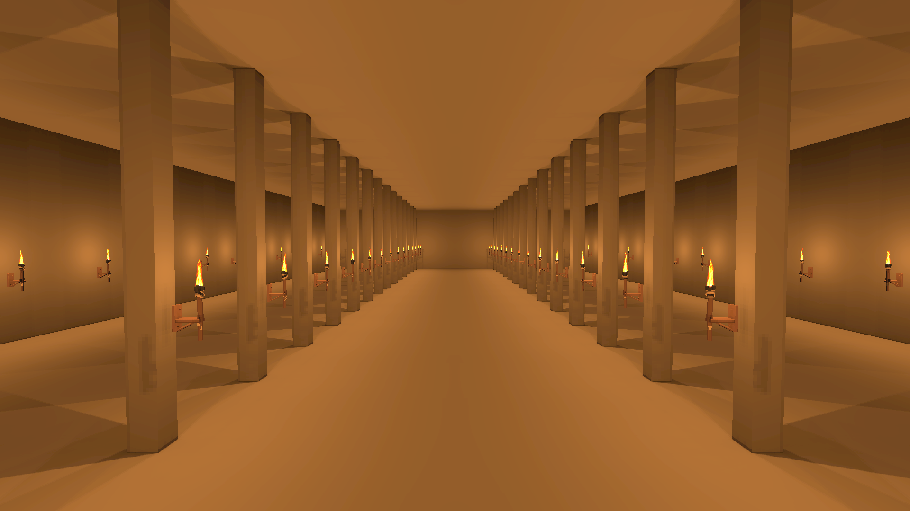
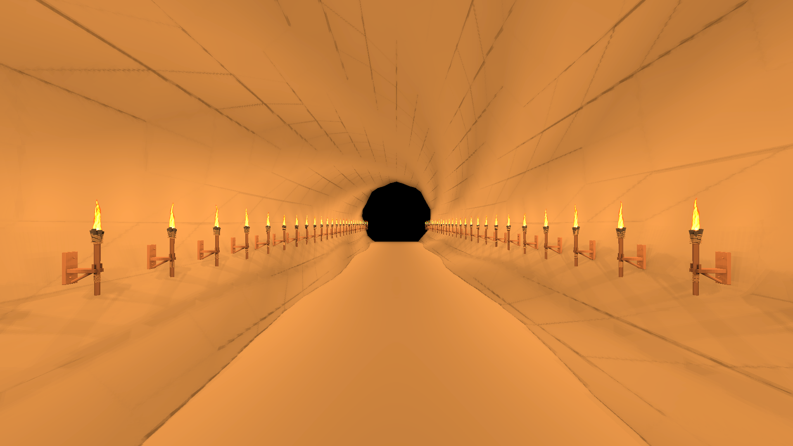

# Surface illumination cache trial

Implemented and benchmarked October 16, 2026. **Surface caching remains opt-in after the measured comparison; spatial direct lighting with cached stationary shadows is the default.** See [architecture and controls](LOCAL_FLAME_LIGHTING.md).

The surface cache is a runtime irradiance atlas with world-aligned charts, not a pre-authored Unity lightmap bake. Its purpose is to retain illumination from many stationary torches across a visible hall/cave without repeatedly evaluating every source on every static receiver. It reuses the existing blocking geometry and stationary shadow cache. Carried sources, changing visibility and cache misses retain live spatial evaluation.

## Functional evidence

The controlled GPU suite passed **45 checks**. Actual pixel probes distinguish cache hits from live fallback and verify a coarser level is sampled. Mean absolute direct/cache difference in the white planar HDR fixture was **0.00753**, compared with mean direct illumination **1.4453** (about **0.52%**). This is one controlled image comparison, not a universal error bound.

A grazing-plane analytical comparison has **0.0327% mean relative error** after snapping receiver-plane comparisons to actual shadow texel centres. This specifically covers the banding that axis-aligned containment tests missed.

A new 3 cm blocker suppresses stale cached illumination immediately and remains blocking after the cache settles. Removing it restores illumination. A dynamic door shadows cached receivers without rebuilding stationary shadow/surface data. Nearby parallel surfaces and dynamic receivers reject inappropriate cache samples. All 64 registered sources can illuminate; removing/extinguishing/dimming sources updates the result. Viewing the same surface from 60 m farther away preserves its illumination.

Four distance levels are generated with plane/normal and illumination-discontinuity checks. A rejected coarse level uses finer data. Memory is explicitly bounded at 192 cells and 64 light records: approximately 126 MiB raw textures plus buffers/metadata. A warm unchanged controlled update reported zero recurring managed allocations.

## Comparison protocol

The standalone player uses the production receiver shader, flame atlas and torch models, with a 24 × 48 m hall (four rows of mounted sources and interior posts) and a 48 m curved tunnel. Counts 8, 32 and 64 are actual source counts. Each mode warms for at least 1.5 seconds and until admitted caches are ready, then samples at least 3 seconds and 180 frames. Every frame explicitly renders a 1920 × 1080 HDR target, because a hidden batch player may skip automatic window rendering.

Modes: lights off; eight-light reference using the new attenuation; spatial direct lighting with cached static shadows; forced surface illumination; adaptive surface illumination; adaptive surface illumination with moving door; native URP Forward+ point lights. Native lights request 256-pixel shadows in a 4096 atlas. Their intensity is 12 versus custom 5 because the attenuation functions differ. Comparisons are practical lighting workloads, not proof of equal energy or identical images. Inactive custom textures remain allocated during native runs.

Lighting CPU scope covers this manager's selection, shadows, uploads and surface updates. Render-submission CPU includes manual camera rendering. Frame timing covers the player loop. GPU timing is reported only when Unity supplies valid samples; `-1` is unavailable. Native URP work occurs in camera rendering, so its manager-only CPU scope is not a fair comparison with custom manager CPU.

The report also measures frame counts and elapsed time to settle surface lighting after a wall is added/removed and a torch removed/restored. Those figures depend on configured per-frame admission and frame rate; safe direct fallback or temporary source suppression is used during rebuilding.

## Visual and performance boundaries

This trial adds no indirect bounce, fuel simulation or inventory ownership. The 96 m placed-effect distance and 64 illuminating-source budget remain finite. One layer per orientation/cell cannot cache every overlapping surface; unmatched points use direct lighting. Coarse dynamic shadows and cube seams need representative gameplay review. High source overlap and moving blockers can legitimately reduce the benefit of surface caching because affected pixels use the exact live path.

The optional adaptive path samples surface illumination when at least two stable averaged sources can affect a receiver. Cheap single-source cases, nearby flickering-only cases and moving contributions use live spatial lighting. The forced mode remains available to measure raw cache overhead. Surface caching is not assumed to be faster in every scene.

## Measured result and default decision

The standalone comparison completed **42 measured cases** plus six cache-coverage probes and 24 edit-recovery runs on **Ryzen 7 9800X3D / RTX 5090 / D3D11 / 1920 × 1080**, Unity 6000.4.8f1. The durable [raw comparison report](Benchmarks/LocalFlameComparison.json) retains every mode and case.

The values below are **whole fixture player-loop frame p95**, not isolated GPU time and not live-world FPS:

| Fixture | Sources | Spatial direct | Forced surface cache | Adaptive surface cache | Native URP reference |
| --- | ---: | ---: | ---: | ---: | ---: |
| Hall | 8 | 0.53 ms | 0.55 ms | 0.55 ms | 1.16 ms |
| Hall | 32 | 0.64 ms | 0.66 ms | 0.78 ms | 3.25 ms |
| Hall | 64 | 0.84 ms | 0.83 ms | 0.81 ms | 3.80 ms* |
| Cave | 8 | 0.51 ms | 0.59 ms | 0.51 ms | 1.19 ms |
| Cave | 32 | 1.63 ms | 1.91 ms | 1.91 ms | 3.13 ms |
| Cave | 64 | 1.58 ms | 1.97 ms | 2.09 ms | 4.76 ms* |

*Native URP dropped **128 shadow slices** at 64 point lights. The installed non-structured shadow-matrix path caps slices at 256, whereas 64 point lights request 384. The corresponding warning appeared in the actual player log and matches `AdditionalLightsShadowAtlasLayout.cs` in the installed URP package. Those 64-light timings are a configuration reference with **different shadow coverage**, not equal-quality comparisons. Native and custom attenuation also differ. The `active` field counts custom-manager slots and is zero in native mode; native enabled count is `sources`.

All modes reported zero recurring managed allocation in the measured custom lighting scope. Static warmed cases rebuilt neither stationary shadows nor surface pages. At 64 lights, spatial lighting CPU p95 was approximately **0.14 ms in the hall / 0.12 ms in the cave**. Native work lives in camera rendering, so its near-zero custom-manager CPU counter is not a native lighting cost measurement.

Unity supplied **no valid GPU timing samples**; the report records `-1` rather than zero. These small high-end-PC fixtures do not establish a GPU budget or performance in the streamed game world. Small timing differences should not be treated as guaranteed gains.

**Decision: keep spatial direct lighting with cached stationary shadows as the default.** Surface caching is implemented and functional, but it did not consistently improve frame time. The small 64-light hall advantage does not outweigh the cave regression and extra texture storage. Forcing it on would contradict the performance goal. Adaptive and forced modes remain available for further experiments and inspection.

After the comparison, surface textures were made lazy: default lighting uses **102 MiB raw shadow textures**; opting into the surface cache adds approximately **24 MiB**. This allocation-only change was verified by the graphics suite. The timed comparison retained the surface allocations across modes, so the raw report notes that it predates lazy allocation; the measured shader/update modes are unchanged.

Across the synthetic edit tests, surface recovery took **12–46 frames / 9.1–67.8 ms** in the uncapped benchmark, with maximum observed lighting-update CPU during recovery **2.68 ms**. At 60 FPS those frame counts correspond to roughly **0.20–0.77 seconds**; do not assume the uncapped millisecond figures transfer to a capped game. Correct fallback/suppression applies during that queue. Heavier live-world meshes can take more time.

Adaptive cache-hit fractions among visible fixture pixels were **0/22/24% in the hall** and **0/18/19% in the cave** for 8/32/64 sources. The near surfaces that need flicker or moving-shadow correction use live evaluation. A high theoretical chart coverage alone does not imply a cache performance win.

## Visual proof

These are synthetic lighting fixtures using the production receiver shader and torch assets, with plain receiver material to make lighting defects visible. They are not screenshots of a saved gameplay build. PNGs encode the linear HDR target to display gamma. The 64-source cases deliberately stress overlap and are much brighter than a normally spaced torch layout. The curved tunnel still shows some facet/seam artifacts that need representative visual review; the planar grazing banding is covered by the analytical regression.





The [optional surface-cache tunnel capture](Images/LocalFlameCaveSurface64.png) is retained for comparison.

## Reproduce

```powershell
Tools/ValidateLocalFlame.ps1
Tools/ValidateLocalFlame.ps1 -SurfaceChecks
Tools/ValidateLocalFlame.ps1 -PlayChecks
Tools/ValidateLocalFlame.ps1 -Comparison
Tools/ValidateTerrainSculptingWorld.ps1
```

`-Comparison -ComparisonBuildOnly` builds without running, allowing performance sampling to be separated from other editor/graphics checks. Final sampling was run by itself after the terrain suite completed. The existing 67 direct/resource checks, 45 surface checks, 21 Play-mode checks and 50 terrain graphics checks / 98 terrain shader variants passed. The 67th direct check verifies that disabling the surface cache does not allocate its unused atlases.
