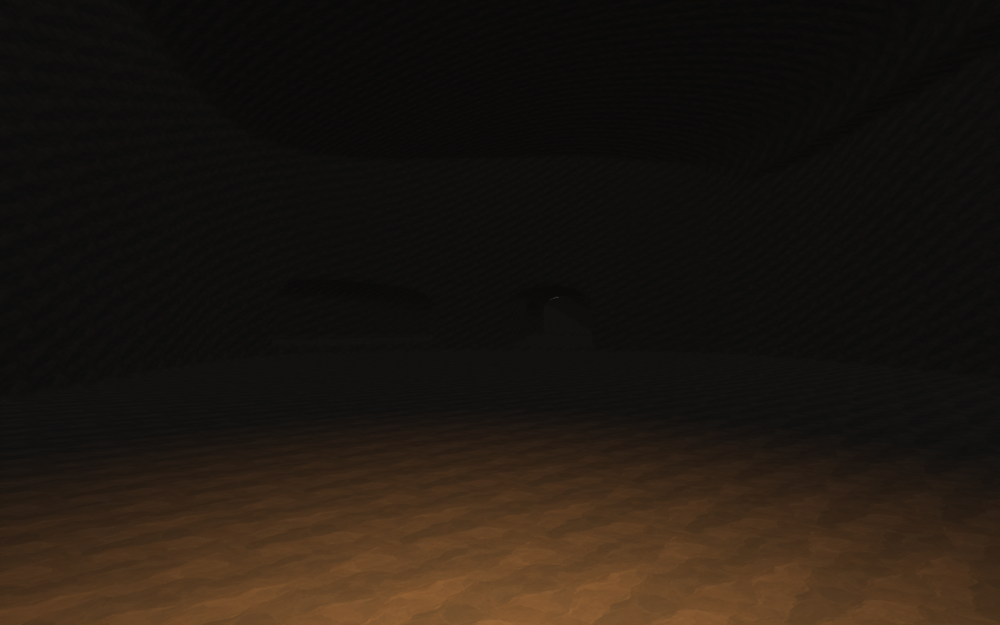

# Procedural caves

**Paused after playtest.** Cave generation is disabled in SmearScene. The planned paths felt unnatural in play. The preferred direction is standalone caverns, including fully enclosed ones discoverable by mining. The sections below record the prototype and its validation. See [the Phase I handoff](CAVE_PHASE_I_HANDOFF.md).

Authorized November 6, 2026. Execute and validate each phase, then record its result here and summarize it in chat. Existing terrain, building, sculpting and lighting behavior remains the reference for integration.

## Phases

1. **Representative cave and geometry.** Immutable room/passage descriptions, smooth floors, bounded density composition, a cliff entrance and a sloping ground entrance. Validate final extracted geometry and real character collision.
2. **Streaming and exterior integration.** Bounded three-dimensional mesh regions, shared worker/cooking admission, original terrain replacement at entrances, movement/light readiness, excavation over the natural baseline and bounded residency. Natural caves must not use the excavation distance fade.
3. **Regional generation.** Stable world-cell ownership, terrain/geology eligibility, route and cover checks, deterministic entrances and connected room graphs. Expose authoring controls and a way to locate a cave.
4. **Lighting and presentation.** Natural-cave sky-cache discovery and conservative fallback, torch receivers/blockers, readable ambient, geological wall/floor variation, representative graphics checks and documented playtest instructions.

## Design contracts

- Scene scale: 0.3 m terrain samples, 38.4 m source chunks, 1.8 m standing player, 0.4 m capsule radius, 0.3 m step offset.
- Main passages approximately 6–10 m wide and 5–8 m high; side passages 3–5 m wide; ordinary rooms 20–45 m across. Large rooms are explicit landmarks, not a consequence of multiplying noise amplitude.
- Cave descriptions regenerate from stable seed/cell identifiers. Density overrides represent player excavation only. Normal play remains session-only for edits.
- Negative density is stone; nonnegative density is air. Original surface height remains separately available for materials, entrance integration and vegetation support.
- Main-route floor gradients and clearances are constrained before geological detail. Render and collision derive from the same final field.
- Start with dry caves above the global water plane plus clearance. No fluid simulation, ore economy, creatures or production persistence is implied.
- Preserve existing bounded worker admission and main-thread publication. Record measured limits rather than claiming performance from design targets.

## Checkpoints

### Phase 1 — complete

Immutable floor-controlled cave spans and connected layouts compose with the original landscape through `TerrainCaveDensityGenerator`. The representative layout spans over 200 m, includes a 36 m-wide chamber, a loop, cliff approach and sloping ground exit. Natural density allocates no edit bricks; subsequent cuts use existing sparse overrides.

`Tools/ValidateProceduralCaves.ps1` compiles runtime/editor/player sources and runs an isolated Unity editor. The final P1 run passed **45,816 checks in 0.49 s**: final-field route clearance, floor gradients, conservative bounds including interior features, both entrance endpoints, retained floor/roof, native mesh normals, actual character-controller traversal across negative/positive tile coordinates and floor grounding. This is a geometry/physics fixture, not a complete streamed-world or graphics result. Full entrance publication and visual review follow in P2/P4.

Log: `.utmp/terrain-sculpting/cave-validation.log`. The sandboxed editor could not initialize local IPC; the fixture ran with desktop access. Preparation now retires obsolete scripts in the generated test-project copy before running Unity.

### Phase 2 — complete

Natural shells publish in **19.2 m 3D tiles**. Only surface apertures use the existing heightfield replacement pipeline; their collars retain buried passage contours and join volume tiles. Render and collision share the same seam-preserving, normal-guarded planar simplification. Player-edit neighborhoods remain unsimplified. Natural geometry does not use excavation's density fade. Walking during initial work no longer continuously cancels immutable shell generation; collision membership refreshes afterward.

The final streamed representative fixture passed entrance/roof/floor physics, real motor traversal from an exterior patch into a volume tile, movement during generation, excavation, stable residency, retirement and return. Final residency was **44 volume tiles, 8 exterior chunks, 688,938 render triangles and 87.3 MiB derived**, with sky access disabled in this CPU/physics fixture. The complete lifecycle fixture took **24.69 s**, including multiple initial/reconstruction batches, not one edit's latency or a production frame time. Earlier overly broad entrance footprints used 156 MiB; the final footprint selection removes that overhead. Live main-scene and GPU cost remain to be measured.

The normal 128 MiB excavation-only cap is unchanged. Cave-enabled worlds expose a **256 MiB derived cap** to allow larger systems, lighting and simultaneous old/new publication. This is an explicit cave feature budget, not measured memory usage or an increase to the 64 MiB authoritative edit cap. Geometry publication still uses shared worker/cooking admission and the shared frame allowance.

### Phase 3 — complete

`TerrainCavePlanner` owns one seeded candidate per 768 m world cell, with a bounded 64-cell immutable-plan cache. It evaluates canonical/native terrain, geology, dry-floor limits, route gradients and rock cover. Main routes, two broad chambers, eligible side loops and two terrain-intersecting approaches regenerate independently of chunk order. Influence remains inside the owning cell. Settings and the cave generator identity are included in the world fingerprint.

Nine eligible fixture systems across three seeds and signed coordinates passed reversed-order identity and final route-clearance checks. The bounded search in **current scene seed 1** found an entrance at approximately **(1030.40, 578.73, -528.51)** in **0.34 s**, with **619 m of routes and 15 spans**. Actual `ChunkManager` composition with sculpt controls disabled then published the cave and completed a collision-ready underground teleport. That fixture reported **139 volume tiles, 10 exterior chunks, 1,261,116 render triangles and 116.4 MiB derived including the sky reservation**. These measurements predate the final P4 wall detail/support-mask changes; final measurements follow below.

SmearScene enables caves while preserving its existing generation settings. World Manager exposes the Procedural Caves controls and a **Find and travel to nearest cave entrance** button. Discovery runs through shared worker admission, searches at most three planning-cell rings and prepares collision before relocation. F3 reports tile/cache residency and discovery status. New WorldManager components keep caves off until configured.

### Phase 4 — complete

Natural caves supply sky-cache candidates and producer-computed conservative height bounds. The GPU page table dims a known underground region before tracing or when a page is capacity-omitted. Natural ambient has a separate live setting, initially tried at 0.06 and tuned to **0.10 after rendering**; the existing excavation ambient remains 0.025. A restrained hemispherical response keeps floors brighter than ceilings without altering direct light or outdoor shading. Surface-support suppression includes natural openings and preserves vegetation on intact roofs.

Runtime/editor/player compilation and the existing full density/mesh/streaming/performance/world-consumer suite passed after integration: 8,565 P1 checks, 610,512 mesh checks / 16 real motor traversals, asynchronous transaction/ownership checks, growing-room performance fixtures, 232 sky-cache checks and 295,356 P6 consumer checks. The final CPU cave run passed **46,688 geometry checks**, the streamed lifecycle/support-mask fixture and all regional checks. It reported **95.9 MiB derived / 818,973 triangles** for the representative fixture and **111.6 MiB including sky / 1,187,203 triangles** for the native scene cave after final geometry detail.

The URP cave fixture passed **19 graphics checks**, including actual GPU lookup before an atlas page exists, independent ambient, exterior preservation, intact-ceiling sunlight occlusion, floor illumination from a carried source, moving-source shadows and both entrance views. Linear-HDR central image means were ordinary 0.0485, cave ambient 0.0048, carried torch 0.0060; the nearby walking-floor region is checked separately because a 12 m source cannot illuminate the whole chamber. These are fixture image values, not physical light units or live-world FPS.

This exposed a real shader integration fault: underground-only tiles have no exterior control maps, so normalizing an empty outdoor weighted normal produced NaNs before stone blending. Fully exposed stone now bypasses outdoor material evaluation, and empty weighted normals fall back to the geometric normal. Direct/cached flame probes and the real terrain receiver now agree. The material branches share one final lighting call to avoid duplicating shader lighting work.

The complete existing URP suite passed **52 graphics checks and 98 shader variants**, retaining exterior, directional light, building, grass and fern regressions. The persistence backend separately passed **444,621 checks**, including generator/profile mismatch handling; normal play still writes no terrain saves. A final native bound check also integrates surface contact on spans that were not tagged as entrances, so a narrow canonical gully missed by coarse planning cannot leave an invisible blocking heightfield above a breakthrough.

Final logs: `.utmp/terrain-sculpting/cave-validation.log`, `cave-graphics.log`, `cave-legacy-regression.log`, `p6-graphics.log` and `validation.log` (the separate persistence run). All four implementation phases are complete. The remaining checkpoint is user review in the actual gameplay scene and representative frame-time profiling; these isolated results do not establish a live-world FPS target.

## Cave travel follow-up

The first gameplay report exposed inadequate progress reporting and a distant-terrain handoff failure. The original inspector stayed on "Preparing cave entrance" throughout background extraction and could later label a failed request as ready. Preparing a destination covered by already loaded coarse far-terrain patches also expanded those entire patches into source chunks, exceeding the existing 64-source preparation limit.

Far coverage now descends to smaller aligned leaves around pending and published surface replacements. Coarse outgoing terrain stays attached until its normal/far replacements are ready. Destination mesh resolution and collision remain pinned during preparation, so ordinary viewer-distance streaming cannot undo that work. Inspector/F3 status includes worker stages, completed mesh counts and elapsed time; memory shows live and reserved charges separately. Teleport failures retain their reason even when ordinary coverage immediately starts another worker.

`Tools/ValidateProceduralCaves.ps1 -TravelChecks` exercises the actual discovery-to-travel path from the starting region with one prior surface edit, the scene's 100-chunk view and 5-chunk collision distances, and distant terrain already loaded at both entrances. It also checks signed/nonoverlapping far-leaf refinement, the 64-source preparation bound and cancellation without false arrival reporting. The final run passed **185,020 checks**, reached the native cave in **53.10 s** (an earlier fixed run took **44.86 s**), and peaked at **32/64 prepared source chunks**, with **139 cave tiles** and **10 published source chunks**. A first cold mesh build still prepares the connected shell; these fixture timings are not a live-gameplay FPS or latency guarantee. Log: `.utmp/terrain-sculpting/cave-travel-validation.log`.

Runtime/editor/player compilation passed. Existing terrain regressions passed **8,565 density checks** and **3,609,257 transaction/streaming checks**, including ordinary teleport, immutable far mesh ownership, collision readiness, failure and shutdown behavior. Log: `.utmp/terrain-sculpting/cave-travel-integration.log`. The full cave geometry/streaming/regional suite also passed again: **46,688 geometry checks**, the representative collision/motor/edit lifecycle, deterministic planning and the native cave host/underground teleport. Native residency remained **111.6 MiB / 1,187,203 triangles**. Log: `.utmp/terrain-sculpting/cave-validation.log`.

## Gameplay review — open issues

The gameplay review called for both naturally exposed caves and fully enclosed systems discoverable by strip mining. The priority integration repairs came first. The Phase I natural formation pass below implements the generation changes.

The November 6 gameplay review is still pending acceptance. The implementation and isolated fixtures establish a structural foundation; they do not establish a finished, defect-free cave experience. The native-world screenshot near **(1044.78, 575.18, -512.46)** shows a bright discontinuity around a passage cross-section, consistent with a geometry gap. Its exact mesh ownership/boundary cause remains to be reproduced. Other reported alternating-corner lighting artifacts need separate isolation after geometry continuity is checked.

The same screenshot reports **140.2 MiB live / 0 reserved**, zero cache-pressure retries, and a ready terrain runtime. This does not show a derived-memory admission failure. The reported brief movement block is consistent with the movement guard waiting for collision coverage, but the blocking moment was not captured. Collision membership changes currently rebuild affected tile mesh data as well as preparing collision, which can delay readiness.

Underground excavation is intended to work and is enabled in the saved scene. The failed gameplay attempt remains unresolved; the existing synthetic backend excavation test did not exercise this user's native-world F6 interaction. The sculpt panel's precise status is needed to distinguish missing input/mode, the 6 m aim limit, collision readiness, a busy reconstruction or a rejected transaction.

Approve the structural direction using passage/room scale, journey length, floor comfort, entrance transitions and route variety. Separately require continuous geometry, stable lighting, uninterrupted ordinary walking and successful wall/floor excavation before accepting the gameplay integration. Richer formations, more varied chamber composition and decorative dressing remain a further presentation pass.

### Priority repairs

The reported native seam reproduced as **203 unmatched underground edges** within 45 m of the screenshot position. Simplification preserved the 19.2 m tile planes but could move duplicated vertices independently at entrance collars one sample inside those planes. Open topological boundaries are now pinned as well. The native shared-edge check passes with **zero unmatched edges** in that region; representative and regional cave checks also pass.

All **19 cave graphics checks** passed after the boundary repair, including ambient, daylight exclusion and moving torch shadows. The screenshot's open-gap light leakage is addressed geometrically; the separately described alternating-corner artifact still needs a gameplay recheck and is not claimed resolved by the fixture.

Natural collision preparation now reaches **96 m ahead**, and prepared body-tile collision remains available while its connected shell is resident. A native test traverses 400 steps along a main passage at ordinary walking speed without a movement-guard rejection. Representative derived residency increased from 95.9 to **109.4 MiB**, within the existing 256 MiB cave-enabled cap.

Cave excavation may now supersede an ordinary background coverage refresh after aim/collision validation. Active edits and teleports keep exclusive ownership. Native tests use a real camera raycast and the sculpt controller to cut both floor and wall while coverage work is pending. Those checks pass. This addresses a concrete busy-state restriction; raw F6/input activation still needs the user's panel status if interaction remains unavailable in gameplay.

Evidence lives in `.utmp/terrain-sculpting/cave-priority-fixes.log` and the cave graphics run log.

Final runtime/editor/player compilation and the existing terrain density/transaction/streaming regressions passed after the interaction change, including the ordinary far-terrain teleport handoff. Regression log: `.utmp/terrain-sculpting/cave-priority-regressions.log`.

## Phase I natural formation pass

Generation schema 2 starts with an underground network. The planner varies junction positions, branch connections and chamber placement across seeds. Curved routes connect overlapping chamber lobes and maintain a walking band. Coherent width, strata and roof variation give passages different cross sections. Granite profiles use more angular roofs. Limestone deposits and boulders occupy room edges and use the same density field, collision and excavation as the surrounding rock.

Nearby hillsides can receive short curved connections where the terrain and grade permit an opening. Enclosed networks retain an intact roof and carry no surface entrance metadata. Their mesh preparation starts within 96 m. The entrance finder selects exposed mouths, and the mining fixture physically breaks into a sealed system without changing the original surface above it.

The final CPU suite passed nine deterministic networks across three seeds, enclosed mining, formation collision and removal, native seams, walking clearance and wall/floor excavation. The seed 1 native fixture has 1,210 m of routes across 72 spans. It publishes 190 volume tiles and four source chunks, with 1,832,322 triangles and 154.1 MiB of derived use including the sky reservation. The entrance moved to approximately **(958.33, 388.53, 274.49)** under the new generation schema.

The final loaded-terrain travel regression reached that cave in **117.22 s** with one previous excavation. It used **64 of 64** available source preparation chunks. Graphics validation ran concurrently with that fixture. Whole-shell meshing remains the main cold arrival cost. Existing terrain density, transaction, streaming and teleport regressions passed as well.

The cave URP suite passed **47 checks**. It rendered chambers, passages and formation close-ups for three seeds, plus the seed 1 hillside opening. Terrain torch shadows now use a camera-relative receiver plane and up to 25 mm of normal-space tolerance on exposed stone. In the full suite's curved receiver fixture, **0 of 26,736** lit samples lost more than 20% of their direct torch light to self-shadowing. Thin stepped shadows remain visible along some wall-to-floor and wall-to-ceiling transitions, and the native entrance still reads as a regular arch near the mouth. Review both in gameplay.

Unity flagged persistent allocations at batch shutdown. The editor fixture now explicitly tears down its local flame instances. The focused rerun exited without the allocation warning and recorded **0 of 26,744** significant light losses. The teardown change only affects the validation harness. The cave logs are `.utmp/terrain-sculpting/cave-graphics.log` and `cave-receiver-validation.log` in the same directory.

The shared terrain URP regression passed **52 checks** and compiled **98 shader variants**, covering daylight occlusion, independent cave ambient, exterior terrain, building shading, grass and ferns. See `.utmp/terrain-sculpting/cave-phase-i-world-graphics/validation.log`.

The multi-seed schematic is [NaturalNetworkPlans.svg](Images/ProceduralCaves/NaturalNetworkPlans.svg). Current runs and remaining validation are recorded in [the Phase I handoff](CAVE_PHASE_I_HANDOFF.md). Cell ownership remains independent, with cross-cell connections and volume mesh LOD as future work.

## Playtest

1. Restart Play Mode in SmearScene. Select World Manager and use **Find and travel to nearest cave entrance**. Discovery, entrance and shell meshing, collision and terrain handoff run asynchronously. Inspector/F3 shows the active stage, completed counts and elapsed time. Arrival appears after successful relocation. The larger seed 1 system took nearly two minutes to prepare in the cold regression fixture.
2. Walk the approach and both directions of the main route. Check entrance lips, floor comfort, standing clearance, chamber scale and side-loop navigation. Use **T** for the existing carried torch; mounted torches remain in **B → Lighting**.
3. Select `Assets/Resources/TerrainSculpting/CaveLighting.asset` to adjust **Natural Cave Ambient Multiplier** live. Keep outdoor daylight visible in an entrance test. The existing excavation brightness control remains independent.
4. Use F6 excavation if desired. Leave/return to a cave and regenerate/restart: natural caves return from the seed, while player edits retain the existing session-only lifecycle.

## Current limits

- A nearby connected system is prepared as a complete shell using 19.2 m mesh tiles. Uniform density extraction and conservative planar simplification preserve topology; portal culling and multiple volumetric mesh resolutions remain future optimizations. This deliberately avoids closing visible tunnels with a distance fade.
- The 256 MiB cave-enabled derived cap is admission accounting, not a full process/GPU memory figure. F3 separates live usage from reserved pending-build capacity. Existing local flame shadow atlases use their separate budget. Representative main-scene frame-time, collider-cook spikes, live cold-arrival latency and dense overlap still need a live playtest/profile.
- Caves are dry and respect the global water datum. No flooding, ore economy, creatures, navigation bake, structural collapse or production save migration is added.
- Grass and small decorations follow lost surface support. Existing tree/large-rock placement state is retained, matching the excavation policy; a tree or boulder can still need clearing at a natural entrance.
- Sky probes remain a bounded 2 m approximation without bounced GI. Conservative missing-page lighting can be darker near complex entrances until their probes finish; very large systems can omit distant probe pages without restoring outdoor ambient below a proven solid roof.

Generated evidence lives in `Documentation/Images/ProceduralCaves`. It is rendered with production shaders/lighting against a synthetic landscape, not a screenshot of the saved gameplay scene.
