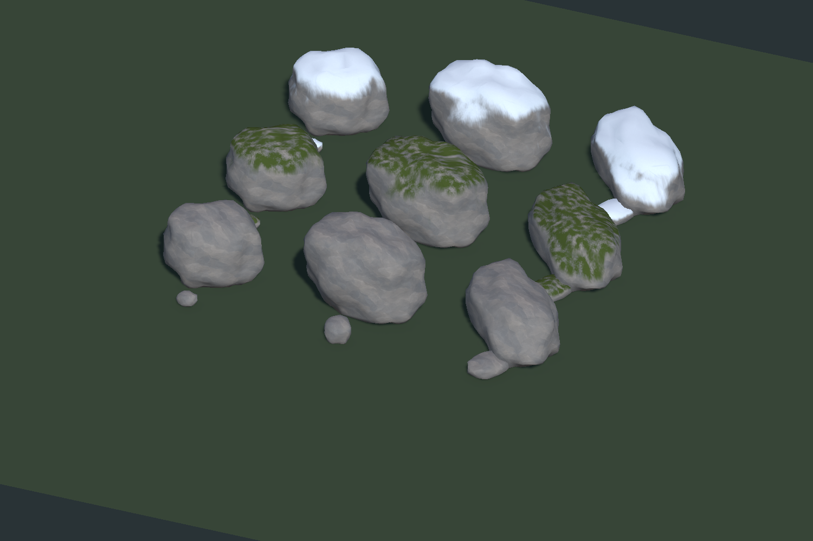

# Rock presets and streamed physics

SmearScene assigns the new Blender-authored shapes: six moss variants in forests, three small bare stones and three bare boulders in grassland, and the corresponding snow variants in snow biomes. The old centimetre-scale placement multipliers were replaced with approximately 0.8–1.4 scale ranges for these metre-scale meshes. Existing rock assets remain available.

| Preset | Unity width × height × depth (m) | Visual triangles | Convex hull triangles |
| --- | --- | ---: | ---: |
| Pebble | 0.65 × 0.36 × 0.50 | 320 | 64 |
| Fieldstone | 1.05 × 0.65 × 0.76 | 320 | 66 |
| FlatStone | 1.45 × 0.47 × 1.00 | 320 | 68 |
| RoundBoulder | 2.80 × 2.15 × 2.35 | 768 | 64 |
| SplitBoulder | 3.65 × 2.65 × 2.60 | 768 | 58 |
| LongBoulder | 4.20 × 1.80 × 2.25 | 768 | 62 |

All shapes use smooth imported normals, broad rounded fractures and an embedded, flattened base. `ArtReferences/Rocks/RockPresets.blend` retains the editable geometry and separate hulls. `Tools/BuildRockPresets.py` regenerates the source, FBXs, seamless procedural texture and Blender preview. FBX scale is exported with `FBX_SCALE_ALL`; the Unity meshes are baked into the prefab's coordinate system with a ground-height origin.

## Surface finishes

`Assets/Textures/Rock/Presets/PaintedStone_Albedo.png` provides broad painted mineral patches, imported at 512 × 512. `Custom/WeatheredRock` uses world-space triplanar color sampling and smooth geometry without noisy surface relief. The original `WeatheredStone_ColorHeight.png` is retained independently as the snow/moss alpha-control map, preserving the approved snow distribution. Moss coverage is fuller. Its diffuse sun, ambient, shadow, fog and nighttime lighting follow the game's matte wood/tree lighting. The forward, shadow, depth and depth-normal passes support instancing. See the [art source and generation prompt](../ArtReferences/Rocks/README.md).

The 18 prefabs in `Assets/Resources/Rocks` share six near meshes, six distant meshes, six hulls and three materials. Bare stone has a muted grey mineral surface; forest moss adds broken olive patches to upward-facing areas; snow adds a broad cool-white crown. The coatings use the world-space surface normal, so turning or tilting a rock does not put snow on its underside. Coatings add no meshes or draw passes. Snow is a shading coat rather than extra snow-shell geometry, and it is selected by the generation biome rather than the season system.

## Placement and runtime ownership

Both full and sparse world-feature generation use the same deterministic snow candidates and preset selection. Snow rocks require `BiomeType.Snow`, Snow/Rock surface, slope at most 38 degrees and river mask at most 0.12. The default budget is six rocks per chunk, with small stones and occasional larger boulders. Snow variants were appended to the feature enum, preserving existing IDs. Rock placements share existing feature exclusion rules, sample the terrain height, align their base to the terrain gradient and retain the planned yaw/pitch variation.

`RockRenderSet` owns a chunk's world matrices and metadata. Publication builds staging data incrementally and swaps atomically. `RockWorldRenderer` groups shared meshes/materials across all chunks, culls individual bounds, selects distant detail and submits reusable batches of at most 1,023. Small rocks switch to 58-vertex/112-triangle meshes at 30 m; boulders use 136-vertex/268-triangle meshes beyond 60 m. Removing unnecessary UV seams leaves 162 near vertices per small rock and 386 per boulder. Cancellation creates no rock GameObjects and retains the previous publication. The historical rock geometry debug bucket now counts culled visible LOD geometry. See [performance investigation](ROCK_PERFORMANCE.md).

`RockColliderPool` belongs to `FoliageManager`, with an independent world-space hierarchy. Chunk/frustum renderer hiding does not disable collision. Nearby bodies contain convex collision and `RockQueryTarget` metadata, without renderers or prefab gameplay scripts. Bare/moss/snow prefabs sharing a hull share their body pool. Legacy custom prefabs copy their physical collider shapes into a separate template pool.

Small stones cast shadows within 45 m; large boulders retain the 140 m range, both capped by the active pipeline's shadow distance. This avoids distant tiny shadow-map submissions while preserving nearby and offscreen shadows. These distances are authored on `RockPreset` independently of LOD and physics.

SmearScene defaults activate within 28 m and release beyond 36 m, with nearest-first candidates, at most eight activations per frame, a 0.5 ms activation budget, 256 active bodies and 64 retained free bodies. Only the needed nearby physics bodies are GameObjects. Releases disable bodies immediately and invalidate query snapshots; rebinding also invalidates the old identity. Unloading/replacing a chunk unregisters its records, and disposing the world destroys pool resources. This preserves the existing generated query metadata; it does not add persistent mining/destruction saves.

## Rebuild and validation

Run Blender with `--background --python Tools/BuildRockPresets.py`, then use **Tools > Terrain > Build Rock Preset Assets** in Unity. The editor setup preserves existing asset GUIDs while refreshing meshes, materials and assigned prefabs. It does not rewrite scene settings. Restart Play mode after importing to regenerate cached terrain/features.

**Tools > Terrain > Validate Rock Presets and Pooling** covers all 18 assignments, geometry/import budgets, dense/sparse deterministic placement across 12 seeds, terrain height and slope seating, water/cliff/river/steep rejection, zero density, 1,040-instance publication, collision activation/hysteresis/reuse, cross-coating hull reuse, bounded pool capacity, renderer independence and query identity invalidation. It also runs existing incremental foliage-publication and query regressions. **Render Rock Finish Preview** exercises actual Unity instanced pixels and shader passes.

`Tools/ValidateRocks.ps1` prepares and launches a hidden isolated Unity project under `.utmp/rocks`. Its `-BuildAssets` option builds into that isolated project; copy its generated Rocks resources and updated importer metadata back only after successful completion. Default mode runs correctness checks; `-Render` captures the preview. Runtime/editor compilation uses the existing `Tools/ValidateBuildingPrototype.ps1 -CompileOnly` workflow.

Validation logs are in `.utmp/rocks/{compile,validation,render}.log`. The Unity finish preview and Blender geometry overview were visually inspected. The isolated native render A/B and saved-spawn geometry investigation are documented in [the performance report](ROCK_PERFORMANCE.md). Live-world FPS and a full route through the main saved scene remain unmeasured.
