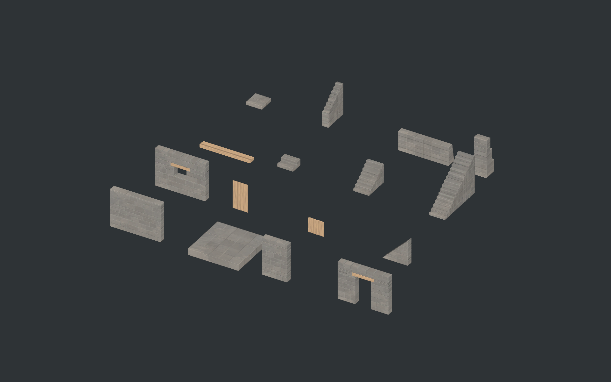

# Remaining ordinary-stone catalog

This pass adds sixteen selectable entries and the opposite S15 gable slope. The existing S02/S03/S04/S06/S07/S12 masonry remains intact. S13 reuses the thatch roof, S14 reuses the timber floor and its fitted stairwell representation, and S22 reuses the W24 timber handrail. These do not gain duplicate menu tiles.

Doors and windows have no open/close behavior. S09 is a fixed clear doorway; S11 is a fixed clear window with no glass or shutters. S10 and the additional S12 gate leaf are static, removable blockers. Placing a closed leaf blocks passage until the player removes it.

## Installed designs

Dimensions below are the authored visual envelope in metres. The ordinary-stone family retains its 0.5 m wall thickness, 4 m full span, 2 m short span, 3 m storey, quarter-metre placement increments and eight yaw headings.

| ID | Part | Dimensions | Menu |
| --- | --- | --- | --- |
| S01 | Rubble wall | 4 W × 3 H × 0.5 D | Walls |
| S05 | Rubble footing | 4 × 4 footprint; 0.5 deep | Foundations |
| S08 | Narrow rubble wall | 2 W × 3 H × 0.5 D | Walls |
| S09 | Timber-lintel doorway | 4 W × 3 H × 0.5 D; clear opening 1.25 × 2.25 | Walls |
| S10 | Static plank door | 1.2 W × 2.2 H × 0.08 D | Furniture |
| S11 | Open window wall | 4 W × 3 H × 0.5 D; clear opening 1 × 0.75, sill at 1.25 | Walls |
| S12 accessory | Static yard gate | 1.2 W × 1.15 H × 0.08 D | Furniture |
| S15 | Stone half-gable | 2 run × 2 rise × 0.5 D; rising/falling | Roofs |
| S16 | Timber wall plate | 4 L × 0.25 H × 0.5 D | Posts |
| S17 | Threshold steps | 1.25 W; 0.5 rise; 1 run | Stairs |
| S18 | Half-storey stair | 1.25 W; 1.5 rise; 2 run | Stairs |
| S19 | Full-storey stair | 1.25 W; 3 rise; 4 run | Stairs |
| S20 | Stone landing | 1.25 square; 0.25 deep | Floors |
| S21 | Stepped stone stair guard | 0.5 W × 2.5 overall H × 2 run | Stairs |
| S23 | Retaining wall | 4 W × 1.5 H × 0.75 maximum D | Walls |
| S24 | Rubble buttress | 1 W × 3 H × 1 maximum projection | Posts |

S10/S12 leaf geometry and collision retain their natural dimensions inside quarter-metre logical envelopes. Their physics never expands to fill that envelope. All other runtime mesh envelopes match the table exactly.

## Placement and geometry

The current free-building policy applies. These pieces do not add structural support restrictions, collapse rules, excavation or soil simulation. Legacy bearing descriptions in the original concept catalog express appearance rather than current placement eligibility.

Walls start at a lower span endpoint on their thickness centreline. Footings and landings extend downward from their top datum. Stairs ascend along local +Z; the low walking datum is their origin. Retaining walls and buttresses have a flat rear at local Z=0. Align or embed them against prepared terrain; they do not cut terrain.

S09/S11 use occupied solids around their real openings. Their timber lintels are part of the baked wall asset. Static leaves fit matching apertures when the player aims at the opening's wall or wings, retaining nominal edge clearance; ordinary free placement and rotation remain available. They have no Animator, Rigidbody, custom door component, interaction prompt or changing collision state.

S15's mirrored triangular volumes preserve the empty attic corners. Select its opposite slope with R. Stone walls do not gain generated timber corner posts.

S16 is a top-datum beam. On a matching full 4 m stone wall it replaces Y=2.75..3.00, leaving the eave at 3 m. Removing the plate restores the original wall mesh and collision. Narrow walls and gables do not receive this full-span course fitting. Roof placement uses the plate's top datum. This is the section proposed as L36 too; no second copy is authored.

S17 has two 0.25 m risers. S18/S19 have eight/sixteen 0.1875 m risers and 0.25 m goings, matching the existing stair pitch. Detailed step-shaped occupied volumes retain the filled masonry body; a separate convex walking hull supplies smooth movement. S21 sits outside the walking strip and follows that pitch, keeping its stepped top 1 m above the corresponding treads. Use one segment on each side of S18 or two per side of S19. Existing W24 rails remain an alternative.

S05 is a closed stone mass. For a separate paving layer, place the paving underside at its top datum to avoid coplanar surface layers. Existing timber floor fitting remains available for mixed construction; no new floor-opening design is introduced here.

## Authoring

[StoneCompletionKit.blend](../ArtReferences/StoneBuildKit/Completion/StoneCompletionKit.blend) retains individual source stones and timbers alongside the runtime solids. [BuildStoneCompletionKit.py](../Tools/BuildStoneCompletionKit.py) reproduces the models, shared 2048² colour/AO and tangent-normal maps, Blender overview and [manifest](../ArtReferences/StoneBuildKit/Completion/stone-completion-models.json).

The shared baked material keeps detailed masonry off runtime geometry. Individual walls and footing use 12 triangles; the doorway/window use 72/84; each gable uses eight. The full stair uses 132. Source texture artwork is reused without modification.

Use **Tools → Building → Install Remaining Ordinary Stone Kit** for scoped import, or the full-span kit rebuild when the source assets exist. Restart Play mode to reload the catalog. IDs and definition GUIDs survive reinstallation.

`Tools/ValidateStoneCompletionKit.ps1 -Install` compiles the code, validates in an isolated Unity project, runs existing stone/wood/access regressions, then copies the new assets and appends their missing catalog references. Saved world scenes are not opened or rewritten. See the reports in the completion reference folder for actual results.

## Validation results

The installed pass completed [6,400 new checks](../ArtReferences/StoneBuildKit/Completion/unity-validation.json), including eight headings, 160 real CharacterMotor stair traversals, doorway/window collision clearance, static-leaf fit and reversal, filled stair bodies, guard segments, reversible wall-plate fitting, asset identity on reinstall and instanced rendering. Runtime/editor compilation passed with existing obsolete-API warnings.

Existing [ordinary-stone](../ArtReferences/StoneBuildKit/Completion/stone-regression.json), [wood](../ArtReferences/StoneBuildKit/Completion/wood-regression.json) and [limestone access](../ArtReferences/StoneBuildKit/Completion/access-regression.json) regression suites passed. The older access assertion for rejecting offset cornices was aligned with the current free-placement policy; the original cornice fitting/restoration checks remain.

The Unity overview and opening, stair and guard close-ups were visually inspected. Front/reverse captures of every selectable part also receive blank/error-pixel checks. These isolated checks do not establish live-world performance.
