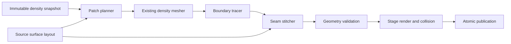

# Steep-surface excavation and stable terrain shading

Status: implemented November 5, 2026. Generated cliffs, broad floors, the density
profile and current gameplay settings are preserved. The notes below distinguish
delivered behavior from further validation/performance targets.

## Implementation notes

* `TerrainMeshBoundary` retains oriented extraction-window edges with canonical
  global lattice-edge identities. Cached assembly remaps shading vertices without
  using their normals as connectivity identities. No positional welding joins
  separate surfaces. `TerrainBoundaryTracer` follows adjacency, preserves vertical
  runs, and rejects branches, disconnected components, reversed winding and actual
  horizontal folds. Failures identify the clipping face and graph size.
* `TerrainSeamStitcher` reverses the volume half-edge for each seam triangle. Tied
  horizontal parameters remain valid. Corner fans have nonzero horizontal area
  and retain the existing upward source orientation.
* `TerrainSourceSurfaceLayout` separates spacing, boundary sampling, collar width
  and guard width. The live adapter supports the current zero-origin AC-diagonal
  full-resolution source. Batches validate the immutable layout and derived
  reconstruction version **3**. Nearby render and collision share authoritative
  extraction, then own separate Unity meshes with identical positions/indices.
  Standalone step-8 fixtures retain explicit legacy support.
* `TerrainSculptPatchPlanner` preflights relevant groups on the pending snapshot.
  Insufficient collars expand conservatively by one brick on all sides, rather
  than minimal face-specific expansion. New overlaps merge before extraction.
  There are at most two replans. Vertical envelopes include source heights and
  edited bounds. Each source window visits at most **65,536 bricks** and admits
  at most **2,000,000 candidate cells**. Uniform stone/air is skipped before
  extraction. This is bounded sparse brick traversal; it still visits intervening
  uniform bricks to prove them empty. Memory/output limits, cancellation and
  atomic publication remain in force.
* Exposure comes from the **encoded baseline on the same extraction edge**,
  replacing vertical height-error classification. Untouched clamped steep walls
  receive zero excavation blend. Actual removal receives the existing independent
  stone appearance, including floors and ceilings.
* `TerrainSurfaceFrame.hlsl` interpolates camera-relative position and computes
  differentials before material branches. Absolute coordinates remain available
  for anchored materials, climate, lighting and shadows. There is no new texture,
  render pass or interpolator. The excavation normal path is preserved.
* Nonlighting fixtures explicitly opt out of fallback cave-lighting resources;
  production live lighting toggles retain their existing behavior. Disposed
  runtimes report zero reserved/live derived bytes. The saved scene seed,
  custom settings and unrelated water/fog work are preserved. No density save
  migration or generator identity change was required for this fix.

The maintained fixture is `Assets/Editor/TerrainSteepExcavationValidation.cs`.
Run `Tools/ValidateWorldLandforms.ps1 -Excavation` for the complete suite, or
`-ExcavationWorld` for world consumers/native graphics only. Saved-scene and
fingerprint fixtures now read the nested landform settings.

The core run passed 48 untouched/sphere/repeated-box slope cases (including the
previous 82–85-degree failures), oriented topology, signed coordinates,
repeatability, four-cut entrances at positive/negative chunk boundaries, actual
capsule traversal, published render/collision equality, guard expansion/merging,
and existing foundation, mesh/motor, transaction/streaming, persistence,
interaction and sustained-edit suites. World-consumer checks also passed (295,356
assertions), along with cached sky access, 98 shader variants and 52 native URP
graphics checks covering stone projection, roof shadows, vegetation, live cave
lighting and building shading. The production-shader GPU regression at
2048x1152 measured **0 degrees maximum normal error** in the relative-coordinate
variant at both signed distant sites. The old absolute-coordinate variant had
about **7.15 degrees RMS** and over **1.8 million pixels above 1 degree** at each
site. This establishes behavior on the tested platform, not cross-platform
bitwise equivalence.

See [validation](Images/SteepExcavation/validation.txt),
[suite results and performance observations](Images/SteepExcavation/suite-results.txt),
[entrance overview](Images/SteepExcavation/SteepWall_Entrance.png) and
[close view](Images/SteepExcavation/SteepWall_Close.png). Overview camera:
`(7,7,-12)` toward `(12,9,1)`; close camera: `(11.4,2.4,-2.3)` toward `(12,2.3,3)`.
Synthetic cliff: `height = 1 + clamp(9*z, 0, 32)`. Four 1.55 m sphere cuts:
`(12,2.3,z)` for z = 0.35, 1.3, 2.2, 3.1.

Full-resolution collision costs more derived geometry/publication work than the
old coarse reconstruction. Sustained-room fixtures remain inside existing caps
and retain cache reuse, but large edits still have measurable main-thread costs.
The 36-room fixture's final 2 m cut took 221 ms end-to-end, including 139 ms on the
worker and 48 ms in publication/commit, with 231,548 render and collision
triangles each. These isolated measurements are not live walking FPS.
Live-world FPS/p95 and arbitrary large-coordinate transform precision remain
separate gates. The checklist below describes broader design goals; it does not
claim every combination was exercised in this patch.

The existing cliff-edge suite also passed all 43 checks at LOD steps 1/2/4/8,
including native seed-43 ice/rock views with shadows. Gentle-ground normals were
unchanged in those comparisons. See [edge results](Images/TerrainEdges/validation.txt).

## Required behavior and scope

Support mountain-side entrances, connected tunnels, retained roofs, separate
rooms at different heights and edits crossing brick/source-chunk boundaries.
Visible surfaces, collision and authoritative density must remain consistent.
Snow, ice, desert and other terrain share the geometry contracts: no seed or biome
gets a special meshing workaround.

Keep excavation-only brushes, dry excavation, session-only normal play and current
building-support rules. Terrain collapse, new brushes, ore, fluids, generated
caves and multiplayer transport are separate features. Features below the density
grid resolution are not promised.

## Evidence

Three isolated Unity probes establish the starting point:

1. At spacing 0.3 m and band 1.2 m, untouched slopes 7, 10 and 12 (81.87, 84.29
   and 85.24 degrees) reproduce the seam exception with both current collar steps.
   Band 3.6 m makes those particular probes pass.
2. The failing boundaries are connected, unbranched open chains. A slope-7 west
   boundary has 420 edges, two endpoints, one component and 120 vertical segments
   with equal horizontal parameter. `Curve()` sorts horizontally and rejects those
   ties, incorrectly describing them as disconnected edges/multiple floors.
3. A uniform cliff close-up at world `(12000,400,-11000)` produces 19.82 degrees
   RMS normal error with absolute-position derivatives, versus zero in the
   camera-relative probe. The origin case is clean in both modes.

Probe reports currently live in `.utmp/excavation-seam-probe.txt`,
`.utmp/seam-boundary-design-probe.txt` and
`.utmp/cliff-normal-precision-probe.txt`. Promote these to maintained fixtures.
The maintained fixtures above now cover these failure mechanisms.

At diagnosis, ordinary terrain collision used `ColliderMeshGenerator.RuntimeStep
= 1`, while excavation assumed step 8 for its baseline/collar. The adapter now
consumes the captured source layout.

## Core decisions

* Preserve the 0.3 m lattice, signed 16-bit samples, band 1.2 m, brush CSG and
  canonical heightfield interpolation. A globally wider band changes precision
  and profile compatibility without removing the geometric assumption.
  Slope-normalizing stored density is a separate semantics/migration change.
* Represent boundary connectivity independently of horizontal sorting, material,
  vertex-normal splits and biome.
* Require verified unchanged terrain at the external collar. Full 3D cave
  interiors/internal chunk faces do not have a single-floor restriction.
* Separate source boundary sampling, collar width and edit guard width. The
  current `outerStep` conflates these concepts.
* Nearby render and collision use the same authoritative reconstruction.
  Distant visual fades never change density or gameplay collision.
* Retain immutable snapshots, atomic publication and bounded work/memory.

## Modules

| Module | Responsibility | Integration |
| --- | --- | --- |
| `TerrainSourceSurfaceLayout` | Immutable origin/lattice, chunk bounds, triangle diagonal and render/collider boundary sampling; separate collar and guard settings. | Capture before worker dispatch. Current defaults reflect full-resolution source collision. |
| `TerrainBoundaryTracer` | Extract oriented boundary edges, build connectivity, classify and trace chains/loops. | Replace horizontal sorting in `TerrainSculptPatchBuilder.Curve`. |
| `TerrainSeamStitcher` | Join volume and source boundaries, preserving vertical runs and winding. | Replace `Join` and upward-only corner logic. |
| `TerrainSculptPatchPlanner` | Plan unchanged collars, vertical guards, source windows and bounded sparse extraction; return replan requests. | Used by `TerrainSculptBatchBuilder`; runtime remains transaction owner. |
| `TerrainSurfaceFrame.hlsl` | Stable relative differentials and explicitly separate absolute coordinates for materials/world fields. | Shared by terrain, cliff correction and excavation shading. |

These are small pure geometry/data modules and a shader utility. Retain the
density world, brush commands, six-tetrahedra extractor and publication lifecycle.
Add interfaces at actual source/provider boundaries, not for every helper.



## Boundary tracing

1. Identify oriented half-edges without an opposite incident triangle. Partition
   by actual clipping face; reject non-manifold ownership rather than steepness.
2. Use canonical geometric identities derived from global lattice edges and the
   existing exact-zero endpoint rule. A shading-normal/UV split must not create a
   new geometric component. Do not weld unrelated surfaces with a large epsilon.
3. Build adjacency and trace from known source-corner endpoints. An external
   heightfield face requires one open chain: endpoint degree 1, interior degree 2,
   every relevant edge visited once. Use stable edge ordering, not dictionary
   iteration order, to make any choices.
4. Allow equal horizontal parameters when the 3D segment has nonzero length.
   Keep both ends of vertical segments. Classify backward/folded chains,
   disconnected components, branches and missing corners separately.

Carry compact boundary provenance through extraction and caching. Prefer metadata
for extraction-window boundary vertices/edges, not a large identity payload on
every interior vertex. Internal brick boundaries cancel by canonical geometric
edge identity; shading attributes remain separate. Account for metadata inside
the existing derived budget.

The tracer can describe closed loops/multiple components. The initial heightfield
adapter does not guess which cave floor matches an external heightfield border.
An edit touching that collar requires footprint expansion/merging. Internal chunk
faces can contain multiple openings; they join through shared volume identities.
A future volumetric baseline can provide another boundary adapter without
changing this representation.

## Seam stitching

The heightfield adapter supplies a shared source-edge parameter. Both chains are
nondecreasing in it, with vertical runs allowed as ties. Advance the connected
inner chain through ties while retaining its 3D geometry. Tie rules must always
advance an index and be deterministic.

Orient new triangles so their shared half-edges oppose the existing volume
surface, and verify source-boundary orientation. Do not use only an upward vector:
a valid vertical triangle has zero upward dot product. Corner fans use the same
oriented-edge contract and canonical corner identities. Reject truly degenerate
3D triangles and folded/self-intersecting strips before publication. Zero XZ
projected area alone is not a degeneracy test for a vertical triangle.

## Source layout and collision

Workers receive immutable layout data, not Unity renderers/colliders. Add a layout
token to staging/currentness checks so a changed source representation cannot
receive a stale patch.

For the current world, nearby replacement render and collision use the same
canonical 0.3 m source lattice and AC diagonal. Use matching one-cell collars and
the authoritative field wherever collision is required. Remove the hardcoded
step-8 excavation collision assumption. The unchanged replacement baseline must
also use the source layout, not merely its outer edge.

When field, domain and layout match, share an immutable geometry result or verify
identical positions/indices if Unity assets remain separate. UV/exposure data is
a render concern. Maintain clear ownership and conservative staging charges;
shared arrays/assets must not be freed twice or undercounted. A legacy coarse
layout can be tested through an explicit adapter, without silently lowering the
current world's gameplay collision detail.

## Planning and failures

Start with changed density owners and existing group rules. Include an unchanged
collar plus interpolation/normal dependency guards. Derive guard size from these
dependencies and layout, not brush radius alone.

If a guard is insufficient, return required faces/bounds. Expand in aligned brick
increments, merge overlapping groups and recompute with the same staged edit and
snapshot. Allow at most two guard replans per request; budget/cancellation can
stop earlier. Do not restage the brush repeatedly or add an unbounded stroke queue.

Separate the enclosing AABB from work requiring extraction. Tall cliff skins,
long tunnels and separate vertical rooms use an ordered set of bounded
mesh-brick/source-window tasks: edited boundaries, baseline exterior skin, collar
dependencies and collision pins. Conservatively proven uniform stone/air can be
skipped; unknown/detailed regions are sampled. Avoid dense columns of intervening
stone. Keep the existing simple bounded path for small patches. Bound planning
visits, admitted candidate work, metadata and output allocation.

| Outcome | Action |
| --- | --- |
| `Complete` | Validate, stage and publish. |
| `NeedsHorizontalGuard` / `NeedsVerticalGuard` | Bounded deterministic replan. |
| `InvalidBoundaryTopology` | Retain old state; record graph diagnostics. |
| `UnsupportedSourceLayout` | Retain old state; identify incompatible layout. |
| `BudgetExceeded` | Existing bounded recovery/backpressure; no partial publication. |
| `Cancelled` / `Stale` | Discard/rebuild through existing revision rules. |

Use typed outcomes instead of parsing exception text. Unexpected exceptions
remain failures. Player text stays short, such as “Unable to complete this cut;
existing terrain was kept.” Development diagnostics record seed, brush, failed
face, component/degree counts, bounds, profile/layout/reconstruction versions,
revisions, cache use and peak charge. An unchanged failing request must not
silently consume repeated workers.

Resolve guard requests before heavy extraction where possible. An invalid graph
does not trigger blind footprint growth. Failed-attempt metadata and successor
cache entries remain unpublished; account for temporary ownership during any
replan rather than assuming garbage collection has already reclaimed it.

## Stable shader coordinates

At the vertex stage, subtract the active camera origin from final world position
before interpolation. Reuse the current position varying slot, explicitly named
`positionRWS`. At fragment entry construct a surface frame:

```text
positionRWS = interpolated camera-relative position
dpdxWS     = ddx(positionRWS)
dpdyWS     = ddy(positionRWS)
positionWS = positionRWS + camera origin
viewWS     = normalize(-positionRWS)
distance   = length(positionRWS)
```

Normals and explicit texture gradients use stable differentials. Seeded
geography, world-anchored UVs, sky access, local lights and shadow/cascade APIs
continue receiving absolute coordinates. Update sand/rock/ice/grass and excavation
derivative callers to use this frame; do not reconstruct absolute coordinates
and then differentiate them again. Preserve excavation's separate normal path
and shadow-caster geometry. Compute derivatives before divergent material branches.

No new texture, render pass or interpolator is needed. Camera movement updates
rendering only: no density changes, mesh invalidations or world-texture movement.
This fixes differential precision, not every Unity transform precision limit at
arbitrarily large coordinates.

## Transactions, caching and compatibility

Use one immutable edit/snapshot through planning, extraction and staging. Publish
density, source coverage, visible geometry and cooked collision through the
existing atomic transaction. Any failed/budget-rejected/stale request keeps the
old committed field and coverage. Consumer notifications remain after commit.
Preserve session-only play and existing building/foliage behavior.

Add a derived-reconstruction policy version. Extraction cache keys include its
applicable version and existing owner/field identity. Collar/assembly reuse also
includes source layout and guard/clip plan. Visual anchors affect only visual
cache identity. Camera origin never affects geometry/cache identity.
Process-local density-owner IDs validate cache entries only; they do not choose
geometry order or serve as future replication IDs.

Stored samples, brush semantics and procedural baseline stay unchanged, so this
fix needs no density save-format migration or landform-generator change.
Invalidate affected derived geometry instead. Future multiplayer compatibility
must compare reconstruction/physics policy as well as generator/settings/profile.
Use sorted global integer keys and stable traversal. Client LOD/visual fades do
not determine edits or collision. Cross-platform bitwise equality remains a
separate verification gate. Future density-semantics changes require explicit
compatibility decisions rather than being hidden inside meshing.
Keep the derived policy version outside the reflection-hashed generation fields
used by `TerrainEditIdentity`, or explicitly preserve that serialization contract.
Adding a derived-only field must not accidentally invalidate density saves.

## Validation gates

| Area | Required cases and acceptance |
| --- | --- |
| Tracing | Existing 82–85-degree failures; rotated/negative slopes; exact-zero lattice hits; vertical runs; corners; signed coordinates. Every valid chain visits all edges once. Invalid graphs fail specifically. |
| Geometry | Patch plus filtered baseline has no internal open edges, overlaps or T junctions. Winding is correct on walls/ceilings. External collar vertices match source. Measure interior error against the existing voxel reconstruction, including closest-surface/normal distance and vertical error where meaningful. |
| Collision/layout | Current full-resolution layout plus explicit legacy coarse fixtures. Nearby render/collider geometry agrees. Vertical, horizontal, angled and face-normal PhysX rays hit expected surfaces. |
| Gameplay | Sphere/box entrances, repeated cuts, joined tunnels, retained roofs, separate levels, shafts and exits on both mountain sides. Cross brick/chunk/collar boundaries and walk at 60/120 Hz without blocked entrances or falling through joins. |
| Planning/atomicity | Edited collars, merged groups, tall skins, sparse deep rooms, memory pressure, cancellation, stale generation/layout and streaming retirement. Bounded replans; failed requests change no committed state. |
| Determinism/cache | Worker batches, insertion order, cold/warm caches and loading order for the same snapshot. Compare canonical geometry/edges and field hashes. Incompatible policies cannot reuse cached geometry. |
| Rendering | Origin and signed distant positions including `(12000,400,-11000)`, close cameras through the 6 m dig range, movement and representative resolutions. Test the production shader, world-texture anchoring, fog/cascades, material variants and excavation walls/ceilings. Translating a uniform plane must not introduce noisy normals. |
| World regression | Saved-scene settings with seeds 43, 66, 67, 68 and current scene seed. Terrain, snow/desert, source collision and prior edge-gilling fixtures. Keep the saved seed unchanged. |
| Performance | Existing density/derived caps and bounded publication. Record extraction/tracing, staging/cooking, edit median/p95 and peak memory. No new idle or camera-motion meshing. Measure before claiming FPS. |

For the float-target uniform-plane regression, require maximum normal deviation
below 0.5 degrees and no pixels above 1 degree at the tested distant coordinates.
The maintained production-shader precision fixture passes this threshold.
Compare published PhysX intersections against the actual shared triangle surface
using the existing millimetre-scale tolerances; test baseline seam addresses in
canonical coordinates before conversion to Unity floats.

## Delivery order

1. Promote the three reproductions into maintained failing regression fixtures.
2. Deliver the independent shader surface-frame fix and precision/appearance tests.
3. Add source layout, tracing and oriented stitching; align nearby collision with
   the source. Gate on native steep entrances and actual movement/collision.
4. Integrate typed planning/replans, sparse extraction and cache versioning. Gate
   on long/multi-level tunnels, streaming and memory pressure.
5. Run existing excavation/world/terrain suites and native close/distant views;
   record costs and remaining resolution limits.

The shader patch stays independently reviewable. Excavation establishes a reusable
boundary contract without adding biome exceptions or replacing the density system.
