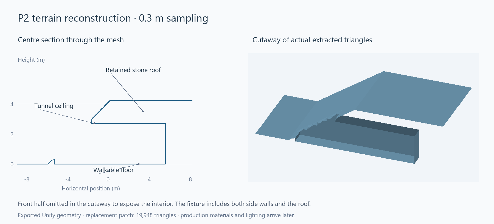

# Terrain sculpting checkpoint 2: meshing and collision adapter

October 15, 2026. P2 of the [approved implementation plan](TERRAIN_SCULPTING_PLAN.md) is implemented and validated in isolated fixtures. P1's density checks still pass. SmearScene is unchanged; live transactions, streaming and controls follow in later phases.



This preview is rendered from the fixture's exported triangles. Removing the front half for the illustration exposes the tunnel floor, ceiling and rear wall. The full tested mesh includes both side walls. These flat colours are geometry QA, not the final terrain material or lighting.

## Delivered behaviour

- `TerrainDensityMesher` extracts a surface with six consistently oriented tetrahedra per cell. One global diagonal, canonical edge identities, exact-zero endpoint handling and central-difference normals keep independently built brick boundaries consistent. Sampling remains 0.3 m on all three axes.
- `TerrainSculptMeshData` holds caller-owned derived positions, normals and indices. Double world positions are converted to Unity float positions relative to one common origin; adjacent objects must share that conversion origin. Meshes use 32-bit indices when necessary. Nonfinite geometry and degenerate triangles are rejected/removed.
- `TerrainSculptPatchBuilder` reconstructs the exterior surface **and** excavated interior inside a rectangular footprint. A buried cavity retains the surface above it. Original heightfield triangles are actually removed from the footprint; an old collider cannot silently block the opening.
- Explicit collars join the volume contour to original heightfield vertices and edge segments. The zipper triangulation accommodates the extra contour vertices produced by tetrahedral extraction without leaving T junctions. It does not hide seams behind overlapping surfaces or open skirts.
- Render collars join the original 0.3 m grid. Collider collars join the original 2.4 m grid (`colliderStep = 8`) while the excavated interior retains 0.3 m sampling. Both adapters use the original heightfield triangle diagonal.
- A pending edit can be captured as a stable meshing snapshot before committing authoritative density. The fixture prepares replacement geometry, commits the edit, and then replaces the old collision. This proves the adapter inputs; P3 still has to implement the asynchronous production transaction and publication lifecycle.
- Conservative uniform-region skipping avoids sampling each stone brick between a deep cavity and the exterior. The optional generator-bounds interface covers the complete queried region; it is not an eight-corner heuristic. The baseline adapter bounds every covering source height vertex. Uniform overrides contribute their explicit sign; detailed overrides force sampling. Generators without a bounds implementation fall back to sampling.

## Collar and patch constraints for P3

The outer seam must lie in unchanged baseline terrain. The builder checks lower solid and upper air guards and verifies that edits have not reached the collar. It also requires each inner seam to be a single connected height curve. Invalid envelopes/contours fail before producing a replacement; the caller must expand the footprint or vertical bounds.

`outerStep` is the collar width in source cells: one cell / 0.3 m for rendering, eight cells / 2.4 m for collision. Patches need a nonempty interior after both opposite collars are removed. A single 4.8 m-wide column is consequently too narrow for a collider patch; P3 must group columns into larger aligned footprints (at least 9.6 m on the 4.8 m column grid), then expand as needed to enclose the complete edit band and unchanged guard. Render and collision may use different collar widths within the same exterior footprint.

The current builder accepts rectangular footprints. P3 owns grouping, merging neighbouring footprints and preserving a safe outer collar as edits approach existing patch boundaries. Independently creating adjoining collared rectangles through an excavation is not a supported substitute for that grouping. Original baseline masks must agree with the published replacement footprint. The fixture tests both cross-brick/source-chunk volume seams and complete filtered-baseline/collar joins.

CPU output buffers are derived data, not save data. Individual builds enforce candidate-cell and output limits (two million candidate cells, 500,000 vertices and one million triangles). `PayloadBytes` reports final array payload; temporary lists, edge dictionaries, the 19-cubed halo, conversion buffers, Unity meshes and collision cooking add memory. These are not yet admitted under P3's shared 128 MiB derived-data budget. P3 must reserve the complete in-flight workload before dispatch and dispose rejected/stale outputs.

## Validation and reproduction

Run from the repository root:

```powershell
./Tools/ValidateTerrainSculpting.ps1 -MeshChecks
```

This compiles the complete runtime/editor/player source sets and runs the fixtures in the isolated Unity project. It does not open or modify the main scene. The installed editor's licensing service requires the same local IPC access documented at checkpoint 1.

| Check | Result |
| --- | --- |
| Complete runtime/editor/player C# compilation | Passed; existing project warnings only. |
| P1 regression | All 8,565 assertions passed, including 108 native SmearScene heights with zero discrepancy. Existing shared height-sampling concurrency/failure checks passed. |
| Complete P2 suite | 613,404 assertions passed across mesh topology, normals, field/mesh bounds, collars and physics. Assertion count includes per-edge and per-vertex checks; it is not a count of independent gameplay scenarios. |
| Closed cuts | Sphere, one-metre box and pending-edit meshes have consistent winding and closed topology; exact-zero surface handling and deterministic reconstruction passed. |
| Independent volume meshes | Shared positions/normals match across sample planes 0, +128 and -128, covering brick and positive/negative source-chunk boundaries. |
| Native baseline joins | The actual SmearScene profile passed both 0.3 m render and 2.4 m collider collar checks. Combined masked-baseline/replacement meshes had no internal open edges or T junctions. |
| Buried cavity / roof | Exterior ray still hits the retained roof; upward interior ray hits the downward-facing tunnel ceiling. |
| Tunnel breakthrough | Original separator blocks the ray before excavation; after the staged joining cut, the ray passes through. Original coarse baseline collision is physically filtered out. |
| Real movement | 16 actual `CharacterMotor` routes passed: 12 tunnel/entrance traversals across three lanes, both directions and 60/120 Hz; four additional routes cross the exterior slope and patch collars. Patch colliders use `WorldSolid` and carry `WorldGroundSurface`. |
| Deep sparse reconstruction | A cavity 100 m below an intact flat surface sampled 12 bricks and conservatively skipped 80. The combined geometry had no internal open edges. This deliberately tests the mesher beyond the planned live vertical window; it does not change the approved distance policy. |
| Invalid input | Edited collars, inadequate vertical guards, invalid/default footprints and nonfinite baseline heights are rejected. |

The tunnel fixture's replacement render patch has **19,948 triangles**; its separately collared collision patch has **14,236 triangles**. These are bounded fixture outputs, not a prediction of live-world scene cost or a default-brush triangle budget. The current mesher is managed CPU code; Burst/job optimization remains a profiling decision after production integration. There is no live FPS, edit-latency or collision-cooking performance claim at this checkpoint.

Evidence is under the ignored `.utmp/terrain-sculpting/` directory:

- `p2-command.log`: compilation and harness outcome.
- `validation.log`: P1/P2 results and existing height-sampling regression.
- `p2/tunnel-patch.obj` and `p2/masked-baseline.obj`: actual exported Unity geometry used in the preview.

After running the Unity fixture, regenerate the image with Python plus NumPy/Pillow:

```powershell
python Tools/RenderTerrainSculptingFixture.py
```

The image is retained in `Documentation/Images/TerrainSculptingP2.png`; OBJ exports and logs can be regenerated. The renderer performs a centre-plane intersection and a depth-buffered cutaway of those triangles, without substituting an illustrative model.

## Next checkpoint

P3 connects these adapters to bounded workers, stale-result rejection, resource ownership and complete transaction/coverage swaps. It also implements the approved horizontal 192/256 m and vertical 64/96 m visual transitions, preparation/release ranges, local collision readiness and destination guards. The live unedited walking/frame-time baseline remains a gate before scene activation.

File persistence remains P4, the F6 development tool P5, and material/shadow, foliage and building-support integration P6. No generated caves or ore were added. The feature remains disconnected from normal gameplay at this checkpoint.
