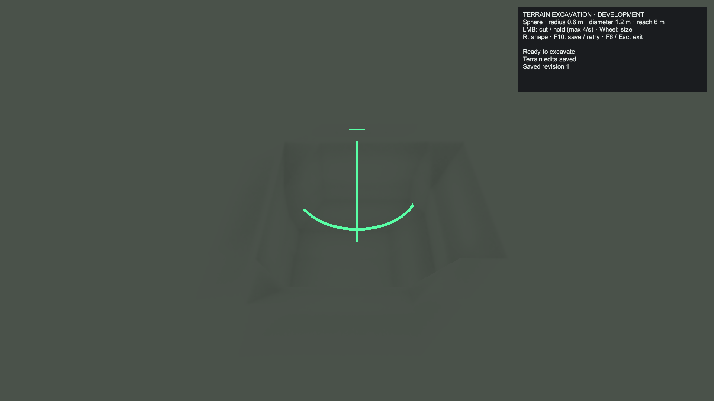
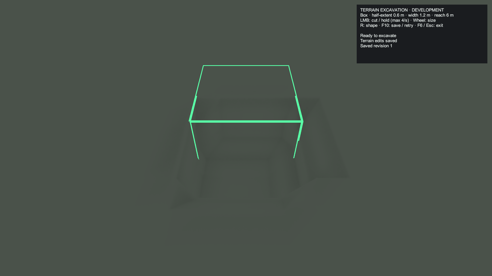

# Terrain sculpting checkpoint 5: development interaction

October 15, 2026. P5 adds the usable development sculpt mode to the existing P1–P4 backend. The [approved plan](TERRAIN_SCULPTING_PLAN.md) remains the reference. The saved SmearScene feature toggle remains **off**. Manual development testing can now be enabled explicitly; P3's live walking/performance gate and P6's foliage/building/material work remain outstanding.

## Try it in Unity

1. Open SmearScene outside Play Mode. On **WorldManager > Terrain Sculpting**, enable **Enable Terrain Sculpting**, then enter Play Mode. Changing this toggle during Play Mode requires restarting the world/Play Mode. The controller and its views are attached at runtime to the existing local player; no scene installation or prefab replacement is needed.
2. Focus the Game view and press **F6**. Aim at exposed dry terrain within 6 m. The HUD appears at the upper right and a wire brush appears at the target. Green means an excavation can be submitted; amber indicates backend work; red indicates a rejected preview. Hidden parts of the outline are depth-tested against the ground.
3. Click **LMB** for one scoop. Holding repeats at up to four accepted cuts per second, limited further by completion of the previous transaction. The default new-session sphere has radius 0.5 m / diameter 1 m. Its centre sits 0.25 m inside the hit surface, so the first cut removes useful terrain.
4. Scroll to resize or press **R** to switch sphere/box. Follow the HUD for pending state or rejection reasons. A backend failure leaves the old terrain intact and requires a fresh click to retry; holding cannot continuously retry failed allocations.
5. Press **F10** to request a save or retry a failed save. Wait for the saved-revision status before stopping if immediate durability matters. Normal saves also start after two quiet seconds, and orderly world shutdown flushes committed edits. A pending brush is not a saved cut; see [P4](TERRAIN_SCULPTING_CHECKPOINT_4.md).
6. Press **F6** or **Escape** to leave sculpt mode. Pressing **B** leaves sculpt mode and opens building. Inventory/other menus suspend sculpting; closing a menu leaves the mode available but requires a new mouse press. If inventory is open, Escape closes inventory first; a subsequent Escape exits sculpting.

In SmearScene the dry excavation floor is approximately Y = **14.7 m** (`GlobalWaterHeight + 0.3 m`). The **whole removal brush**, including its bottom, must stay above it. A default scoop into flat ground therefore needs a surface around Y = 15.45 m or higher. Increasing brush size increases the required clearance. This restriction applies equally to previews and the authoritative edit stage.

## Controls and P5 decisions

| Input / property | Implemented behaviour |
| --- | --- |
| F6 | Toggle development sculpt mode. Entering exits building and closes an open menu. |
| LMB | One cut on a fresh press; hold repeats at a maximum 4 Hz with one active transaction and no queued stroke positions. |
| Wheel | One event direction changes radius/half-extent by 0.1 m, clamped to 0.5–2 m. Raw scroll magnitudes vary between devices, so one event is not multiplied by its 120-unit value. |
| R | Switch sphere/box; the HUD shows the selected shape and full diameter/width. |
| F10 | Request save/retry for the committed field. F7 retains its existing performance-sample reset binding. |
| Escape | Close a menu first; otherwise leave sculpt mode. |
| B / Tab / focus | Building replaces sculpt mode; inventory/menus and focus loss suspend it. A held mouse click never resumes automatically across these transitions. |
| Reach | Nearest solid hit within 6 m, measured from the camera eye. The brush extends around its inset centre; the limit is target-ray reach, not a bound on the farthest point of the brush. |
| Box | World-axis aligned regardless of player heading. Size is the half-extent on all axes. |
| HUD | Passive keyboard-controlled development panel. Shape selection uses R rather than unlocking the mouse for a second settings menu. It displays size, reach, pending/failure state and saved/unsaved status. Detailed persistence errors remain in F3/Console. |
| Reset | No save reset/delete key or action is added. |

Resolution stays at 0.3 m. The wire outline describes the continuous brush; reconstructed terrain is its sampled approximation, so a box cut is not guaranteed to have perfectly sharp corners. Visible changes retain P3's full 192 m horizontal radius and 192–256 m transition, plus its vertical window. Moving beyond those ranges does not erase the persistent density.

## Input, targeting and resource ownership

`LocalPlayerInput` remains the hardware reader. It samples F6/F10 alongside existing button edges and routes a `TerrainSculptInputCommand`; the controller, HUD and preview do not poll devices or UI events. Shape/size commands are isolated from building's wheel/rotation/flip controls. Existing hotbar and movement controls remain available, subject to the normal menu policy.

`TerrainSculptController` consumes at most the current command in `LateUpdate`, after look and movement. It recasts from the current camera pose before submitting a cut. The closest `WorldSolid` hit must have terrain identity (`WorldGroundSurface` on the hit object, or a `TerrainCollider`). A building/prop in front blocks targeting. Query-only triggers, player colliders and preview geometry are excluded. The controller also checks edited-collision readiness before allowing a target.

Preview updates use collider queries and published readiness only; they never invoke terrain noise, height-map generation, SDF meshing or a density snapshot on the main thread. The development view owns one passive Canvas/Text HUD, a cloned preview material and reusable line renderers. It has no physical colliders, raycastable UI or shadow casting, and creates no GameObjects/materials per frame. HUD formatting still allocates small managed strings. Sphere geometry uses three rings; box geometry uses twelve edges. Its outline is independent of the player's rotation/scale.

Menu/focus transitions consume edges, disarm held digging and clear the pending command. Cursor capture suppresses input briefly, matching the existing look policy. A long frame can produce one accepted cut; missed intervals are not replayed. Busy holds keep no previous aim positions: after completion, the next eligible held cut uses the current aim. Leaving sculpt mode does not roll back an excavation already submitted to P3.

`WorldManager` binds the controller only when sculpting is enabled and a local input owner exists. Regeneration/world disposal unbinds it, hides/destroys owned views and leaves persistence shutdown to the existing runtime. Disabling the local input/controller also stops interaction and hides the preview. No authored scene or terrain material is modified for this phase.

## Captured Unity output

These are actual 1920×1080 Unity renders from the isolated native-input fixture, after a real excavation and save. The flat unlit fixture ground isolates the brush/HUD; it does not demonstrate P6's final exposed-stone material or underground lighting.

## Validation

- Complete runtime, editor and player compilation passed with existing project warnings.
- `Tools/ValidateTerrainSculpting.ps1 -MeshChecks -IntegrationChecks -PersistenceChecks -InteractionChecks` passed P1's 8,565 assertions, P2's 613,404 assertions and 16 actual motor traversals, P3's 1,925,008 assertions, P4's 446,934 assertions and **45 P5 interaction checks**. Async polling counts vary slightly between runs.
- P5's direct checks use actual colliders, raycasts, worker transactions and disk files. They verify useful scoops, first-solid obstruction, trigger exclusion, 6 m reach, 0.1 m adjustments and both size clamps, world-axis box geometry, full dry bounds, stale collision rejection, no procedural sampling during idle preview, four-per-second timing, no busy backlog, explicit failure retry, save status and view cleanup.
- `Tools/ValidateTerrainSculptingInput.ps1` passed **62 native input/render checks** in the final run. Native check counts vary with asynchronous save completion/shader messages. Real Input System Dynamic frames and the actual controller `LateUpdate` verify F6/R/wheel/LMB/F10/Escape, held-key edges, building replacement, inventory suspension, focus callbacks, capture suppression and durable excavation. URP shader compilation/support, rendered brush pixels and both HUD captures passed. A player-loop driver exists only in the isolated test project, copied from `Tools/Fixtures/`; it is not shipped in the game runtime.
- Existing `BuildingPrototypeInputValidation.RunBatch` and `InventoryUiValidation.RunInputBatch` regressions passed against the updated shared input owner. Building rotation/flip/confirmation, arrow repeat, menu/cursor handling, debug keys, inventory movement/look suppression and hotbar selection retain their existing behaviour. Evidence: `.utmp/terrain-sculpting/p5-building-input-regression.log` and `p5-inventory-input-regression.log`.

Main evidence: `.utmp/terrain-sculpting/validation.log`, `p5-command.log`, `p5-input.log` and `p5-input-command.log`. The native-input helper reuses the isolated `.utmp/building-prototype/unity-project` setup; it never opens the user's scene. Its fresh save slots are under `.utmp/sculpt-p5/`, not the actual development slot.

## Checkpoint limits and next work

The tool is usable for opt-in development testing. The native terrain workload still exceeds the provisional 150 ms warm edit target (approximately 223–380 ms for five subsequent scoops in the combined run). These fixtures are not a live SmearScene frame-time or walking benchmark; manual scene validation is still required before normal scene activation.

Grass/small-decoration suppression, building grounding updates, cut-surface stone shading and local ceiling shadows remain **P6**. Large props can remain unsupported as approved. No procedural caves, ore, filling, AI navigation, multiplayer or terrain-save migration/reset is added here. P7 retains final live performance/coverage validation and the finished operating guide.
