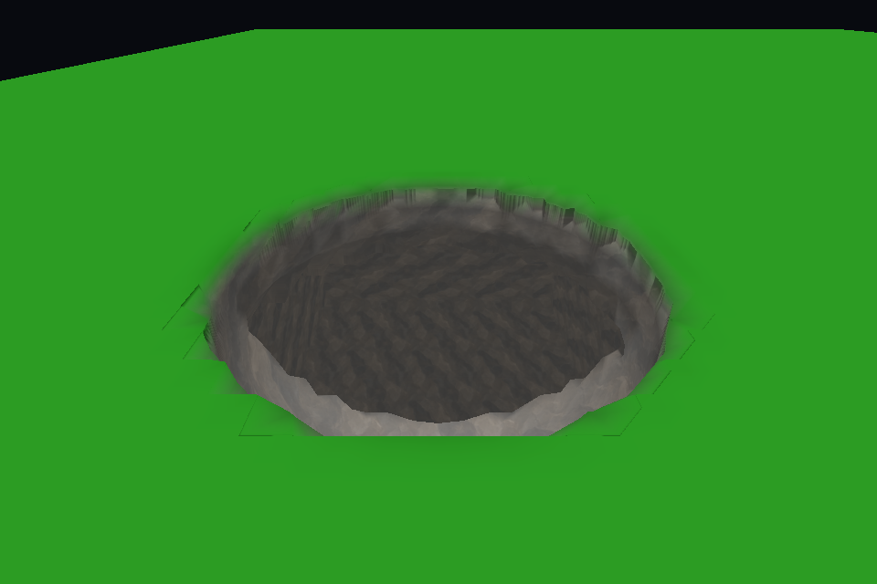
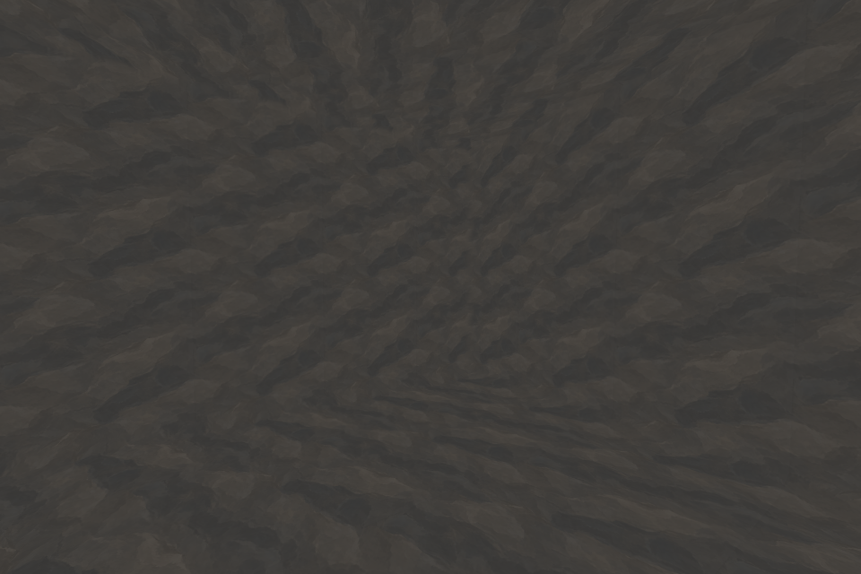

# P6 first checkpoint: stone, local shadows and vegetation

**Later policy update:** the active WorldManager now keeps terrain edits and vegetation suppression for the current session only, ignoring existing disk saves. The persistence/restart evidence below still describes the optional backend. See [session lifecycle and elevated-spawn fixes](TERRAIN_SCULPTING_SESSION_FIXES.md).

October 15, 2026. Implements the first two P6 checkpoints authorized by the user: surface/shadow rendering and grass/small-decoration suppression. Building grounding/support integration is intentionally deferred for a later options review. Cave ambient lighting/GI is deferred until after P6. Terrain generation, ore, filling, water behavior, the density profile, existing near distances and saved scene settings are unchanged.

## Excavation appearance

Newly exposed geometry has a derived UV1 exposure blend. A 0.03–0.3 m depth transition at the original surface blends into stone; fully underground floors, walls and ceilings use stone irrespective of slope. Unchanged baseline vertices keep zero exposure. Height comparison uses the canonical source triangle interpolation, including fractional edge vertices. Geometry/collision and the stored density format are unchanged; UV1 is regenerated with meshes after reload.

The landscape shader retains its original control maps/material for the exterior. A retained player-build variant adds independently sampled world-space triplanar stone with optional normal mapping. Signed side projections keep texture V along world up; metre-based tiling remains continuous across mesh/source-chunk boundaries. Excavation shading uses the existing ambient model. Baseline horizon occlusion is blended out on exposed underground geometry because a heightfield horizon cannot describe a cave ceiling.

Default settings: **`Assets/Resources/TerrainSculpting/ExcavatedStone.asset`**. Its initial albedo is the existing `Assets/Textures/Rock/Presets/PaintedStone_Albedo.png` used by bare stones. It has independent albedo, optional normal, tint, repeats per metre and normal strength. The initial tiling is 0.65 repeats/metre. A future texture replacement requires no code or terrain-save migration.

To replace it later:

1. Select `ExcavatedStone.asset`, replace **Albedo**, optionally assign **Normal**, and adjust **Repeats Per Metre**/tint. Use repeating texture wrapping; import normals as normal maps.
2. Alternatively create an appearance asset with **Create > First Settlers > Terrain > Excavated stone appearance** and assign it under **World Manager > Terrain Sculpting > Excavation Appearance**. An empty reference uses the default resource asset.
3. Restart Play Mode to apply settings consistently to all loaded representations. Existing saved caves reconstruct with the new appearance.

This does not change the exterior rock/cliff maps. The terrain material inspector exposes excavation shader inputs only as read-only runtime diagnostics and points to the appearance asset as the place to edit them.

## Local shadows

Edited terrain now has an opaque, two-sided shadow-caster pass. Inward-facing ceilings bias the caster toward the light while keeping their rendering normals unchanged. Camera-frustum culling switches the representation to shadows-only; an offscreen ceiling can still occlude light. Handoff-hidden/retired representations stop casting so outgoing geometry cannot leave duplicate shadows. URP's existing light shadow range and quality still apply; no scene lighting settings are altered.

During visual validation, cascade-boundary triangles showed dark streaks. Cascade selection now happens per fragment; interpolating coordinates selected from different cascades at vertices was invalid. Screen-space shadows use URP's appropriate vertex coordinate path.

The sealed-roof fixture measured mean floor brightness **0.5216 without terrain casting -> 0.2438 with casting**, using the same material/ambient/light. Ambient remains visible as planned; this is direct-light occlusion, not an underground ambient-light solution.

## Vegetation suppression

After the user's follow-up playtest, the worker checks support 0.05 m below the original landscape using the mesher's tetrahedral field interpolation. A change from solid to air marks a 0.15 m mask cell and adds 0.15 m circular padding. This replaces the original broad XZ projection and 0.6 m square margin: retained cave roofs now keep their grass and small foliage. See [surface foliage refinements and validation](TERRAIN_SCULPTING_FOLIAGE_REFINEMENTS.md).

Masks are immutable per committed density revision. New edits update only changed density owners; coverage-only rebuilds reuse the mask. The mask is published with the successful density/render/collider transaction. Rejected, cancelled or pending source handoffs cannot clear vegetation early. On restart, the same mask is reconstructed from the existing saved density, without brush history or a second authoritative save format.

Current consumers:

- Resident near/far grass, both GPU and CPU fallback: compact only changed resident slots and upload their changed source/count data. Future uploads filter against the latest committed mask. Cached generation candidates are retained unchanged.
- Flowers, tall flowers/daisy weeds, clover, dandelions and small shore plants: filter resident batches with matching transforms/attributes; filter pending publication too.
- Berry bushes: suppress affected resident objects/colliders and check staged objects before activation.
- Ferns and leaf clusters: filter resident/new generation tails, invalidate the derived CPU cache and refresh the affected resident GPU tile, including its old source/count metadata.

All loaded foliage runtimes receive an updated mask, including offscreen objects; newly created runtimes receive the current mask before publication. Trees, large rocks, registries and original biome/climate/ecology maps retain their existing behavior. No grass is generated on excavation surfaces. Grounding/support behavior is not changed.

The sparse mask has its own conservative cap of one eighth of the configured derived budget (**16 MiB by default**), within the existing **128 MiB** total admission limit. A refined tile stores 256 bits over 2.4 m square plus conservatively charged indexing/copy metadata. Staging is also admitted; failure preserves the previous complete terrain. Unlike render caches, the compact mask survives streaming retirement so vegetation cannot reappear over an excavation during the session. F3 reports tile count and charge. Density still has its existing separate budget; the optional backend's save format is unchanged.

Markers: `FS.Streaming.Sculpt.FoliageMask`, `.GrassSuppress`, `.SmallFoliageSuppress`. Required resident reconciliation is charged to existing streaming phases; stable frames reuse the same mask without repeated density scans or source uploads.

## Validation

Runtime, editor and player compilation passed, with existing unrelated obsolete-API warnings. The final isolated CPU run passed P1–P5, performance and P6 consumers:

- Canonical heights, density, seams, 16 actual motor traversals, native source/far handoffs, rollback, cancellation, coverage, memory admission, shutdown/restart and file recovery.
- Cached geometry/visual fade invariance, connected 80 m cave local reuse, and all nine sustained room edits.
- 293,981 P6 checks covering exposure on buried geometry/unchanged skin, negative and cross-brick footprint coordinates/margins, retained solid roofs, atomic publication, immutable mask revisions, resident/late grass and batch publication, resident/staged bushes, fern cache revisions, reload and streaming retention. The count includes per-vertex/per-sample checks.
- Existing persistence reconstruction tests passed with the derived exposure data; no authoritative save change was required.

The final Direct3D/URP run passed **24 graphics checks**, **98 forward/shadow variants**, the **133-property terrain inspector** regression and the existing **shared resident-grass GPU culling** suite (>1,023 instances, four channels, fallback selection parity, missing assets and partial-slot replacement). It checked independent texture binding, visible vertical texture variation, unchanged-exterior pixel comparison, real sealed-ceiling shadows, offscreen/handoff shadow state, GPU grass compaction, and actual fern culling after obsolete source removal. No terrain/grass/fern shader compilation errors remained.

Final CPU benchmark observations:

| Seeded connected room | Small cuts | Radius-2 m cut |
| --- | --- | --- |
| 4 excavations | 122–124 ms | 124 ms |
| 16 excavations | 171–188 ms | 295 ms |
| 36 excavations | 235–330 ms | 357 ms |

The native SmearScene-generator host measured a 186 ms cold scoop and five subsequent scoops at 91–110 ms. These are isolated measurements, not live-scene p95/FPS or GPU-shadow-cost measurements. Dense chunks still have roughly 36–39 ms indivisible commits; the existing P7 performance gates remain open.

Reproduce with:

```powershell
Tools/ValidateTerrainSculpting.ps1 -MeshChecks -IntegrationChecks -PersistenceChecks -InteractionChecks -PerformanceChecks -WorldChecks
Tools/ValidateTerrainSculptingWorld.ps1
```

Both tools use disposable projects under `.utmp`; Unity needs its existing licensing service. The graphics fixture uses the actual URP pipeline in an empty isolated scene and overrides lighting there only. Logs: `.utmp/terrain-sculpting/validation.log`, `p6-command.log`, `p6-graphics.log` and `p6-graphics-command.log`.

## Captures and manual checkpoint

These are real Unity renders. Flat green exterior ground is a fixture control material; it makes material preservation easy to compare. It is not the scene's final landscape texture.





The paired [caster disabled](Images/TerrainSculptingP6RoofCasterOff.png) / [caster enabled](Images/TerrainSculptingP6RoofCasterOn.png) images use the same sealed room/camera/light. A separate [vertical-projection reference](Images/TerrainSculptingP6VerticalMapping.png) verifies texture variation with height. The [original exterior](Images/TerrainSculptingP6ExteriorOriginal.png) and [replacement exterior](Images/TerrainSculptingP6ExteriorPreserved.png) pass the pixel comparison.

Next manual check: reopen the existing saved cave without resetting it; inspect floor/wall/ceiling stone, retained exterior ground, grass/small decoration removal including old excavations, and direct sunlight occlusion. Leave/return or restart to check suppression persistence. Compare F3 latency with the previous build. Tree/large-rock floating remains approved. Building support is the next options discussion; cave ambient lighting remains after P6.
