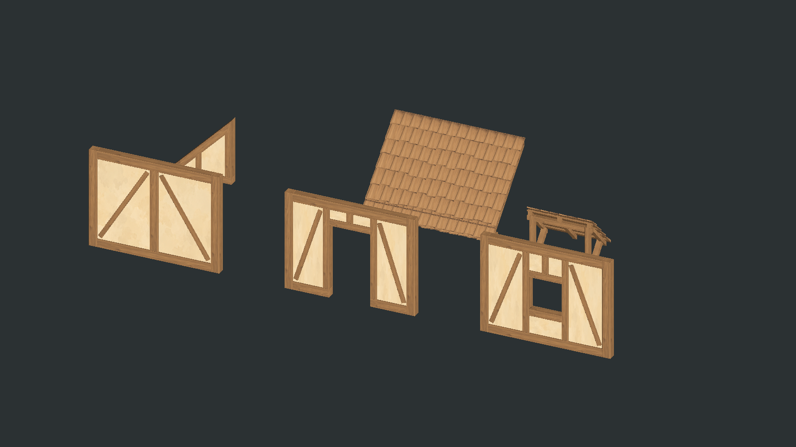
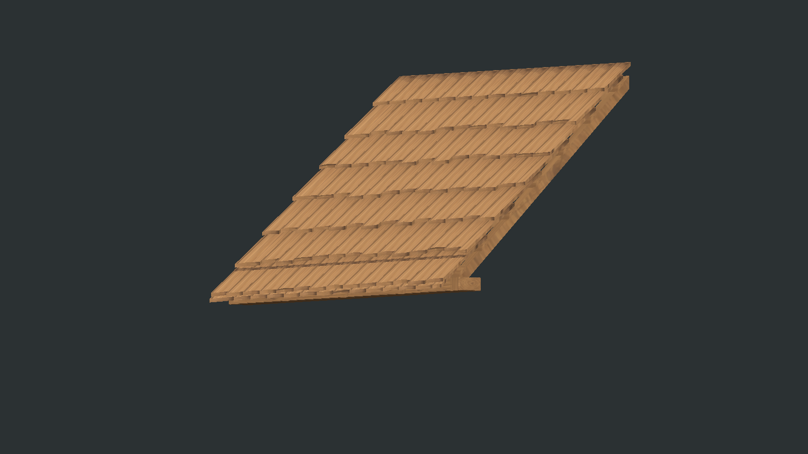
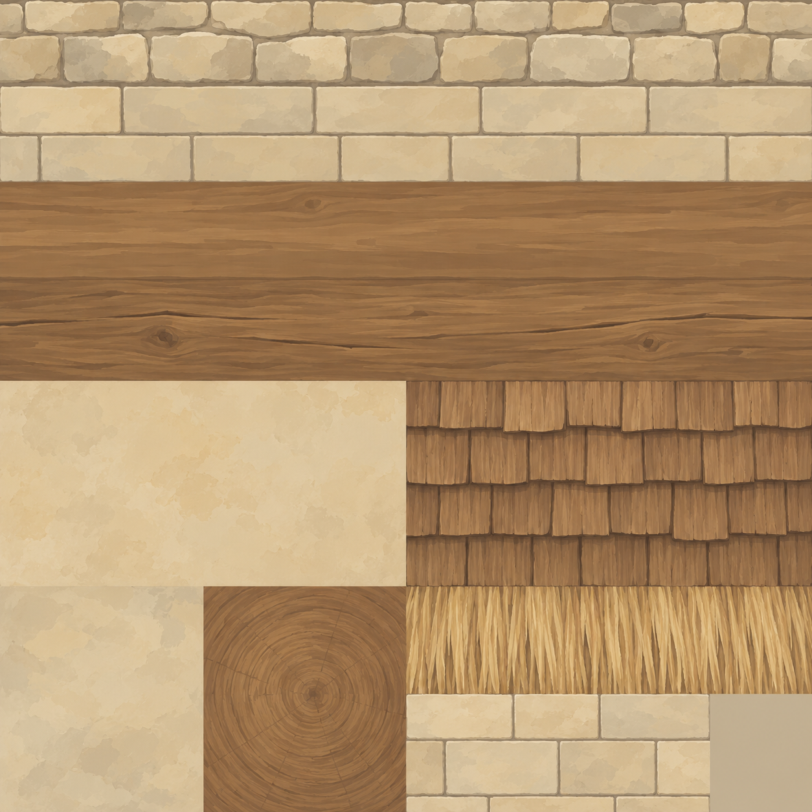

# L25, L27, L28, L31, L33 and L35

Six additions to the [limestone and timber catalog](../ArtReferences/LimestoneBuildKit/TIMBER_EXTENSION.md), constructed from the supplied house reference. Use **B → Walls** for L25/L27/L28 and **B → Roofs** for L31/L33/L35. Restart Play mode after importing to refresh a running catalog.

| Part | Native dimensions, metres | Runtime triangles |
| --- | --- | ---: |
| L25 framed daub wall | 4 wide × 3 high × 0.25 thick | 440 |
| L27 framed doorway | Same wall; clear 1.25 × 2.25 opening | 704 |
| L28 open window wall | Same wall; clear 1 × 1 opening, sill at 1 | 748 |
| L31 framed half-gable | 2 base × 2 rise × 0.25 thick | 152 per slope |
| L33 layered cleft-shingle roof | 4 ridge length × 2 run × 2 rise; 45° | 1,980 |
| L35 braced door canopy | 2 wide × 1 run × 1 roof rise, plus covering and brackets | 888 |
| **One of each selectable part** | Opposite L31 is an alternate mesh | **4,912** |

The native source is [TimberInfillKit.blend](../ArtReferences/LimestoneBuildKit/TimberInfill/TimberInfillKit.blend). It retains individual timber members, recessed infill, battens and solid shingles. The [manifest](../ArtReferences/LimestoneBuildKit/TimberInfill/timber-infill-models.json) records each FBX's dimensions, actual visual bounds, member/triangle counts and the packed source file's SHA-256. Seven FBXs supply six menu items; L31 flips with **R** and does not occupy a second menu tile.

## Walls and openings

Walls occupy X=0..4, Y=0..3, Z=−0.125..+0.125, stacking at exactly 3 m. Perimeter posts and rails sit inside that envelope. Infill is recessed 0.04 m on both faces; the main frame is 0.25 m deep. Grain follows the long dimension of posts, rails and diagonals. Each independent panel includes its own end posts, so neighboring full panels show paired timbers. Authored meshes are retained through floor and wall fitting; no additional timber bearing band increases their storey height.

L27's opening spans X=1.375..2.625 and Y=0..2.25, without a threshold across the passage. L28 spans X=1.50..2.50 and Y=1..2. **L28 has no shutter, glass, leaf, hinge or closed surface.** Meshes, occupancy and pooled physical colliders all retain these apertures. Three box sections surround L27; four surround L28. Renders from the rear are included for inspection.

L31's two orientations have real triangular infill and occupied prisms. Their empty upper halves do not block placement or physical rays. They share a 2 m rise/run with L33 and the existing roof sockets. Gable timber polygons meet at their cut edges; infill stays inside the frame.

## Roof depth and canopy attachment

L33 keeps the catalog's **cleft wood shingle covering**, with substantial layered construction comparable to the depth of the existing thatch. It does not substitute straw for shingles. Seven exposed courses plus a second starter course use individual closed boards with staggered seams, uneven butts and 0.035 m board thickness. Rafters, battens and an eave bearing remain modeled on the underside. This preserves depth and silhouette from side and underside views instead of painting all relief onto a plane.

Its structural origin is at the low eave. The nominal roof rises 2 m over a 2 m horizontal run; actual visual height reaches approximately 2.263 m. The occupied slope extends 0.34 m vertically above its lower plane (about 0.24 m normal thickness), alongside a shallow bearing strip. The attic remains empty. A cosmetic 0.22 m eave projection clips away automatically on uphill continuation and returns when exposed. Sideways, ridge and uphill joins use the existing 4 × 2 × 2 roof datums, including contact with the existing thatch family. L34 ridge trim remains unbuilt.

L35 slopes **down away from the wall**. Its origin lies on the rear wall face at the low-eave elevation, with X centred at zero. The nominal high rear edge is 1 m above that origin; brackets descend 0.75 m below it. Actual visual bounds are X=−1..1, Y=−0.75..1.263, Z=0..1.22. The conservative quarter-metre placement bounds extend to Y=1.50 and Z=1.25. Six convex colliders describe the roof, ledger, uprights and knee brackets, leaving the walking lane between them open.

Aim at a supported wall face and choose the attachment elevation. A typical installation puts the origin 2.50 m above the doorway floor and the rear roof edge at 3.50 m. This needs supported upper wall or gable material at the ledger. All four rear mounting points must contact real supported wall solids; an empty part of a triangular gable cannot carry a mount. Wall-mounted support now checks authored convex volumes as well as boxes, allowing a canopy to span a doorway wall and its gable. The canopy uses the existing one-way furnishing support path internally, appears under Roofs, and cannot ground itself on terrain or support another building piece.

## Shared trim sheet

The colour map is a byte-identical copy of the approved **1254 × 1254** [clean trim source](../ArtReferences/LimestoneBuildKit/Textures/limestone-timber-trim-source.png), stored as `Assets/Textures/Buildings/TimberInfill/TimberInfill_Colour.png`. UVs sample measured interiors of the timber, daub, end-grain and individual shingle regions, avoiding painted masonry joints and roof-row shadows. They do not assume the proposal's approximate band boundaries. The [labelled guide](../ArtReferences/LimestoneBuildKit/Textures/limestone-timber-trim-guide.png) is reference art only.

A 2048-square tangent-space normal map is baked in Blender from shallow material grain. Geometry supplies the substantial relief; the normal map supplies only fine surface variation. Colour alpha remains neutral rather than carrying baked directional lighting. One opaque instanced material uses the existing matte shader with live sun, night, fog, cave and local-flame behavior. Unity imports use BC7 colour and BC5 normals, mipmaps, trilinear filtering and 4× anisotropy. The colour importer retains Unity's nearest-power-of-two scaling; the original art remains at native resolution.

## Rebuild and evidence

Run `Tools/BuildTimberInfillKit.py` through Blender with `--background --factory-startup --python-exit-code 1 --python`. Regeneration replaces this kit's generated source and exports; preserve manual Blender changes first. Unity's scoped importer is **Tools → Building → Install L25 L27 L28 L31 L33 L35**. The general catalog rebuild includes these parts when their source manifest and exports are available.

`Tools/ValidateTimberInfillKit.ps1 -Install` compiles runtime/editor code, imports into an isolated Unity project, checks stable GUIDs on repeated installation, verifies unrelated definitions remain unchanged, and validates actual FBX bounds, winding, normals, tangents, UVs and apertures. URP captures include front/reverse views, eave/underside details and the actual instanced building-renderer path. Play-mode checks cover eight headings, wall stacks and support removal, sixteen CharacterMotor doorway walks, gable fitting and empty halves, thirty-two roof joins/interfaces and thirty-two canopy attachment cases across wall/gable solids.

The suite then validates installed L01–L03, L04–L09, ordinary stone and the original modular wood kit, including 192 real stair walks. It selectively copies only this family's assets and appends its six catalog references. Saved world scenes and existing roof maps are not regenerated.

Evidence: [new kit](../ArtReferences/LimestoneBuildKit/TimberInfill/unity-validation.json), [L01–L03](../ArtReferences/LimestoneBuildKit/TimberInfill/l01-l03-regression.json), [L04–L09](../ArtReferences/LimestoneBuildKit/TimberInfill/l04-l09-regression.json), [ordinary stone](../ArtReferences/LimestoneBuildKit/TimberInfill/stone-regression.json), [modular wood](../ArtReferences/LimestoneBuildKit/TimberInfill/modular-regression.json), [instanced render](../ArtReferences/LimestoneBuildKit/TimberInfill/timber-infill-instanced.png), [assembly study](../ArtReferences/LimestoneBuildKit/TimberInfill/mixed-limestone-timber-homestead-unity.png) and [roof underside](../ArtReferences/LimestoneBuildKit/TimberInfill/L33-underside-unity.png). The assembly is an art study at native part scale, rather than a saved playable world or resource-cost plan.

The final run passed **41,146 timber/infill assertions**, **1,406 L01–L03**, **3,374 L04–L09**, **3,550 ordinary-stone** and **28,311 modular-wood assertions**: **77,787 total**. Runtime/editor compilation passed with existing obsolete-API warnings. Front/reverse renders, the layered roof, open window, framed gable and mixed-material assembly were visually inspected. The installer retained the existing catalog entries and appended six stable references; L31's second slope remains a flip variant.
