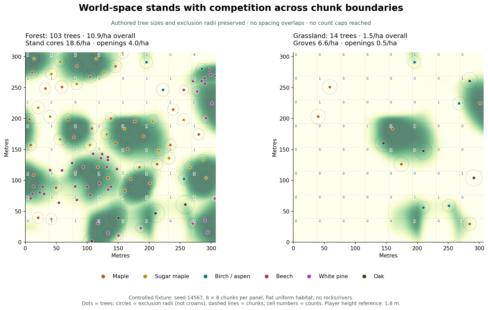
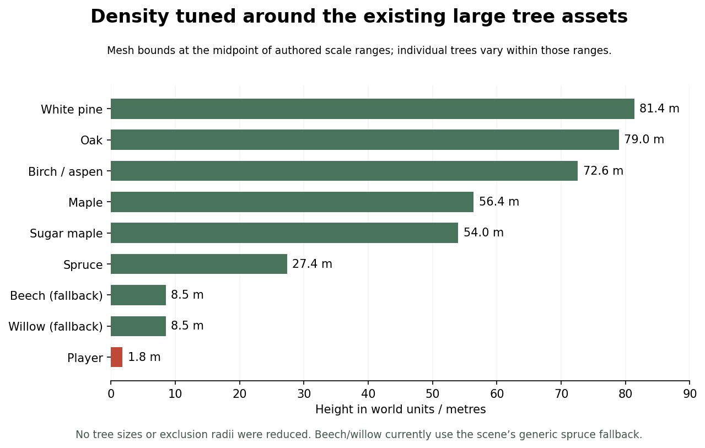

# Layered tree distribution

The active tree planner now generates habitat-driven stands, then individual
trees with deterministic competition across chunk boundaries. The scene points
to **Assets/Resources/Foliage/TreeDistribution.asset**. Other configured worlds
use that resource by default when `TreeSettings.distributionProfile` is empty.
Restart Play Mode or regenerate after changing the profile or tree datacards.

## Chosen tuning

All spatial profile values are world units, independent of chunk size. The
player's CharacterController height is 1.8 m. Existing tree visual scales and
species-card exclusion ranges are preserved.

| Control | Value |
| --- | ---: |
| Stand seed-cell width | 96 m |
| Stand major radius | 42–72 m |
| Minor/major radius ratio | .65–1 |
| Grassland stand seeds eligible as groves | 24% |
| Candidate grid spacing | 4.8 m |
| Bounded competition cohorts | 2 |
| Forest background / stand addition | 12 / 90 candidates per hectare |
| Grassland background / grove addition | .8 / 26 candidates per hectare |
| Snow stand intensity | 12 candidates per hectare before climate/treeline filtering |

These intensities describe **candidates before habitat filtering and competition**,
not retained tree counts. They are measured per hectare of horizontal ground.
Large species naturally retain fewer trees because their authored exclusion
radii are larger. Increasing candidate intensity eventually has diminishing
returns; the planner does not shrink spacing to fill a quota.

Controlled 8 × 8-chunk tests cover 307.2 × 307.2 m (9.437 ha), seed 14567,
worldScale .3, uniform flat habitat, authored species cards, no rocks or rivers:

| Habitat | Overall trees/ha | Stand cores | Openings/background |
| --- | ---: | ---: | ---: |
| Forest | 10.91 | 18.56 | 4.04 |
| Grassland | 1.48 | 6.58 | .51 |
| Taiga | 11.02 | 16.19 | 4.51 |
| Low snowy habitat | 2.97 | 7.50 | .24 |

Core means stand weight > .7; opening means < .2. These are repeatable fixture
measurements, not guaranteed densities on sloped, wet or mountainous terrain.
The forest core has approximately 23 m of area-per-tree spacing; sparse meadow
background has approximately 140 m. Actual nearest-neighbour distances vary
and always satisfy the sum of the two authored radii.

## Size checks

Mesh bounds were measured in prefab-root space, then multiplied by the midpoint
of each species card's scale range, matching instanced rendering. These are
bounding dimensions, not opaque crown coverage. Individual stand/instance
scales vary within the existing card ranges.

| Species | Height | Maximum horizontal span |
| --- | ---: | ---: |
| Maple | 56.4 m | 43.6 m |
| Sugar maple | 54.0 m | 42.7 m |
| Birch/aspen | 72.6 m | 42.0 m |
| Spruce | 27.4 m | 18.6 m |
| White pine | 81.4 m | 39.5 m |
| Oak | 79.0 m | 76.3 m |

These are large mature trees relative to the 1.8 m player. The chosen density
allows crown overlap in stand cores without packing trunks continuously across
the landscape. Maple centres must remain 18–21 m apart; oak centres 27–30 m,
using the existing .3 worldScale and authored ranges. No radii were reduced.

The scene's beech and willow prefab slots are currently unassigned, so the
existing generic spruce fallback is used. At those cards' smaller scale ranges,
it measures about 8.5 m tall and 5.8 m wide. Stand/species identities still differ,
but dedicated meshes are needed to distinguish those species visually.

## Generation layers

1. **Canonical habitat.** A lazy, cached world sampler provides the same terrain,
   climate, slope, biome and water rules to near and distant generation, including
   unloaded neighbours. Grass candidates also require the surrounding terrain
   samples to be dry. Alpine meadows, unsuitable slopes, tundra, cold snow and
   summits are excluded; snow retains its existing climate/treeline filters.
2. **Stand records.** World-space seed cells produce displaced centres, rotated
   elliptical extents and noisy boundaries. An independent broad clearing field
   opens the forest. Cached records avoid regenerating stand data at each point.
3. **Palettes and age.** Forest stands allocate 78% of candidate choices to their
   dominant species, 20% to an associate and 2% to birch/aspen. Overlap regions
   blend neighbouring palettes. In the fixture, accepted stands averaged 69%
   dominant species after competition. Grassland palettes use oak, maple and
   birch/aspen; suitably moist river edges support willow. White pine remains
   forest-only, including the grassland side of ecotones. Taiga and snow use spruce.
   Stand age biases visual size within the authored scale range; it does not
   change placement radii or simulate growth over time.
4. **Individual candidates.** A jittered world lattice samples the habitat/stand
   intensity. Cheap density rejection happens before terrain erosion/climate
   queries. Candidate locations do not clamp away from chunk edges.
5. **Finite competition.** Within a cohort, a conflicting lower-priority eligible
   candidate wins. Later cohorts also reject conflicts with accepted earlier
   cohorts. Recursion only descends through the fixed cohort count, so it cannot
   spread through an unbounded chain of chunks. Spatial cell bounds, early
   distance rejection and memoized candidate results limit work. Every comparison
   uses the sum of actual species-card radii.
6. **Output and understory.** Accepted trees belong to exactly one chunk using
   half-open bounds. Planned local boulder clearance is applied afterward. The
   stand field also supplies forest canopy intent, clearings and meadow grove
   fields; the existing actual-tree canopy/litter/ground-cover passes still run.

The overall count guard is 64 per chunk, with a separate grassland guard of 24
in SmearScene. Neither triggered in the density fixtures. The old grassland cap
is therefore no longer a target population control. Profile intensity and
competition determine population.

## Implementation and compatibility

- `TreeDistributionProfile` snapshots authored values on the main thread.
- `TreeStandField.Evaluator` caches cheap stand records in world coordinates.
- `TreeHabitatSampler` caches terrain and habitat samples for one worker request.
- `LayeredTreeDistribution` resolves candidates and bounded priority cohorts.
- Both `TerrainRequestManager` and `DistantTreePlacement` supply canonical world
  sampling to the shared planner. Neighbouring chunks do not need to be loaded.
- `WorldFeaturePlan.TreeDistributionStats` reports candidate, habitat-query,
  competition, cap and tree counts. Profiler marker: `FS.Trees.GenerateStands`.

The legacy planner remains available by disabling the profile, and raw
`WorldFeatureGenerationSettings.Default` retains that fixture compatibility path.
Direct synthetic/local-map callers can still use the map adapter; production
layered calls must supply canonical habitat sampling for cross-chunk guarantees.

Layered trees have a new `TreePlacementSource.Stand` identity namespace. Existing
tree identity/registry/gameplay APIs are preserved, but regenerating an old world
changes its population and IDs. Changes to visual scale alone do not alter IDs,
positions, species selection or exclusion radii.

## Performance and validation

Run `./Tools/ValidateTreeStands.ps1`. It prepares an isolated Unity project and
writes `.utmp/stands/validation.log`. The in-editor core check is **Tools → Terrain
→ Validate Layered Tree Stands**. Diagnostic JSON is exported to the isolated
project's `ValidationOutputs` directory.

On this editor CPU, the controlled flat sampler averaged approximately .2 ms
per forest chunk for placement itself, with 15 habitat queries and 116 cached
candidate records per chunk. A nine-chunk mixed/forest real-terrain comparison
measured **9.45 ms median** for the new distant path versus **46.14 ms** for the
legacy path. Real terrain uses fewer expensive samples because density rejects
most candidates first. This small benchmark includes four suitable forest cores;
it is not an FPS measurement or a worst-case performance guarantee.

The complete near feature-plan fixture, including understory maps, measured
**62.44 ms median** versus **50.72 ms** with the legacy fields. The extra roughly
12 ms is worker-side stand-field evaluation across the full map; it does not run
every frame. Nearby/distant generated representations still use existing
instancing, culling and streaming budgets.

Validation covers four habitats, all cross-chunk tree pairs in 64-chunk regions,
negative coordinates, corners, reversed worker request order, changed chunk
partitioning, full/sparse/worker agreement, snow-state/near conversion, radius
and visual-scale independence, boulder clearance, ecotones, habitat exclusions,
dominant species and density contrast. Existing tree registry, distant-tree
correctness and 37 tree-gameplay checks also pass. No post-change live scene
capture or full play-session rendering benchmark has been performed.
