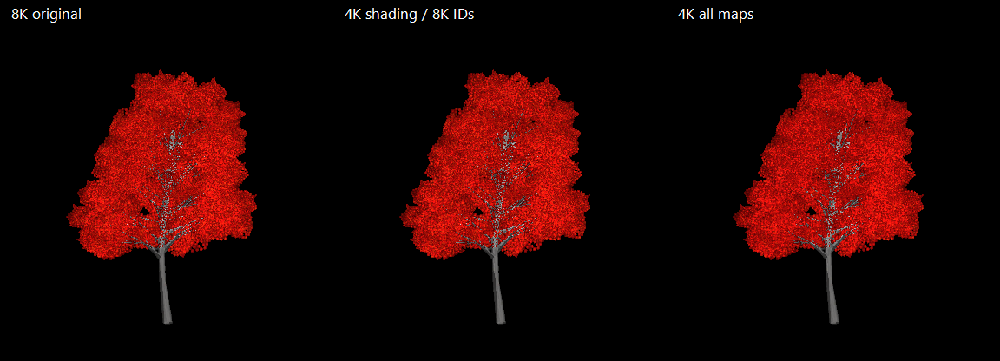

# Tree batching and billboard memory follow-up — 22 October 2026

Spatial batching is viable and is now enabled with **4 × 4 logical chunks per region**. It reduces near-tree draw submissions without changing tree detail, population, handoff distance or fading. The current 3D-tree LOD setup and billboard transition distance are unchanged, as requested.

Billboard textures have a substantial memory footprint, but smaller atlas variants did **not** establish a consistent frame-time improvement on the test RTX 5090. A mixed-resolution prototype demonstrates a promising 55% memory reduction while retaining the material-ID data that controls leaf/bark colours. That texture preset is experimental; the production imports remain at full resolution.

## Spatial batching implementation

`StandingTreeRenderer` queues the near trees for a frame, assigns their logical chunks to world-aligned regions, sorts by region while preserving submission order within each region, then flushes shared mesh/material/submesh batches at region boundaries. Negative coordinates use floor division. Each draw retains the existing 500-instance capacity and all per-instance leaf tint, bark tint, snow, shadow selection and fade values. Offscreen trees are still submitted for their shadows; Unity culls the resulting regional draw bounds.

The reusable queue is proportional to the peak near-tree population, with no cache of previously visited regions. Warmed submission allocated **zero managed bytes** in every measured stage, including the denser fixture. `BeginFrame` clears abandoned queued work, and a repeated `EndFrame` does not draw a second time.

Control: **WorldManager → Trees, Bushes and Rocks → Tree Settings → Standing Tree Batch Size Chunks**. The new setting and saved scene use **4**. Set **1** for per-chunk grouping; 2, 4 and 8 were benchmarked. In this scene a chunk is 38.4 m wide, so a four-chunk region is 153.6 m wide, plus the actual canopy bounds. Global batching was kept as a comparison, not enabled as the production policy.

## Render comparisons

The same production stand-generator fixture, prefabs, wind-disabled materials, shadow settings and 1440p camera were tested at eight headings, with normal meadow, normal forest and a forest stress case containing four times the original population. Each stage used 16 warm-up and 24 measured requests, with mode order reversed for the second pass. Timings include CPU submission and synchronized GPU completion through a one-pixel readback; they are **not isolated GPU timestamps or game FPS**. Values here average the pass medians across all eight headings.

| Grouping | Normal forest draws | Normal forest render | Four-times forest render |
| --- | ---: | ---: | ---: |
| Per chunk | 172 | 2.890 ms | 3.831 ms |
| 2 × 2 chunks | 96 | 2.487 ms | 3.616 ms |
| **4 × 4 chunks** | **54** | **2.201 ms** | **3.377 ms** |
| 8 × 8 chunks | 36 | 2.089 ms | 3.303 ms |
| Global, experimental | 10 | 1.672 ms | 2.744 ms |

The selected four-chunk grouping saved **0.689 ms** in the normal forest and **0.454 ms** in the dense fixture. It improved every tested forest heading: the paired savings ranged from 0.550–0.853 ms normally and 0.184–0.691 ms in the stress case. Eight-chunk grouping saved only a further 0.112 / 0.075 ms on average while making the regions much broader. Four is the more conservative compromise.

Sparse meadow gained little: 20 → 16 draws and 1.217 → 1.202 ms on average. One meadow heading was 0.114 ms slower with four-chunk groups. This is not a universal win for every sparse view, and the setting remains adjustable.

All modes submitted the same geometry: 420,768 vertices in the normal forest and 1,683,072 in the stress case. With shadows disabled, **all 240 records were pixel-identical to the per-chunk reference**. With shadows enabled, changes were confined to that rendering path: the normal forest's worst four-chunk comparison changed 9,933 of 3,686,400 pixels above the comparison threshold (0.27%), with normalized mean RGB error 0.00023006. Broader instance bounds affect shadow-caster culling and ordering; exact shadow pixels are therefore not guaranteed. There was no visible-tree coverage loss in the shadow-disabled checks.

Raw and summarized measurements: [spatial-batching.csv](../ProfilerCaptures/TreeBatchingAndBillboardMemory/spatial-batching.csv), [spatial-summary.csv](../ProfilerCaptures/TreeBatchingAndBillboardMemory/spatial-summary.csv), [shadow-disabled comparisons](../ProfilerCaptures/TreeBatchingAndBillboardMemory/spatial-batching-no-shadows.csv).

## Running-world verification

A 200-second saved-world capture settled each biome for 65 seconds, then compared per-chunk and four-chunk grouping in the **same process and view**, followed by camera turns and small movements. It used the existing meadow and forest sample points from the original investigation at 1280 × 720. The first ten records of each phase were excluded from these summaries to avoid including the setting-change boundary.

| Settled forest measurement | Per chunk | 4 × 4 chunks |
| --- | ---: | ---: |
| Near-tree draws | 142 | 56 |
| Submitted mesh parts / vertices | 218 / 379,072 | 218 / 379,072 |
| `FS.DistantTrees.Update` CPU median | 0.7455 ms | 0.5596 ms |
| `WorldManager.Update` CPU median | 1.3315 ms | 1.1259 ms |

This gives a **0.186 ms / 25% reduction** in the tree-update CPU marker at that forest sample. It is a different measurement from the 1440p synchronized render experiment; those savings must not be added together. The sparse meadow remained at 14 draws and changed from 0.3686 to 0.3673 ms in the tree marker, effectively unchanged. Camera turns and movement completed without exceptions or frames where the test torch lost its active light. This still does not reproduce the user's exact original view, build or resolution, so it is not a promise to recover a particular FPS number.

[World phase summaries](../ProfilerCaptures/TreeBatchingAndBillboardMemory/world-summary.csv). Full rows remain in `.utmp/vegetation-performance/world-spatial.csv`.

## Billboard memory measurements

The six unique HQ species use **30 textures**. Every texture already has Read/Write disabled and uses compressed BC7 or R8 where appropriate; there is no simple readable-texture flag left to turn off.

Summing each imported texture's actual graphics format and every mip level gives **2,084.13 MiB**, about **2.04 GiB**, of texture payload. Unity's Editor runtime-object memory estimate for those same textures is approximately twice that. The earlier 4.1 GiB figure should therefore not be described as dedicated VRAM usage.

The memory test retained all original textures and its reduced copies simultaneously. Unity estimated about 2.90 billion bytes of graphics-driver allocation for that fixture, consistent with the combined mip payloads plus overhead, on the GPU reporting 32,187 MiB of VRAM. This is not a measurement of the complete game's resident VRAM or a VRAM-pressure/cold-loading test.

| Prototype | Texture payload | Saving | Tested image behaviour |
| --- | ---: | ---: | --- |
| Original 8K shading and material-ID maps; original ambient | 2,084 MiB | — | Reference |
| All atlases reduced one mip, including ambient | 521 MiB | 75% | Some colour changes; no lost foreground pixels in the sampled 4K cases |
| All atlases reduced two mips | 130 MiB | 94% | Additional detail/silhouette changes at 80 m |
| **4K albedo/surface/depth; 8K material IDs; original ambient** | **932 MiB** | **55%** | **Pixel-identical in all 18 sampled comparisons** |

The mixed prototype was checked on all six species at **80, 154 and 350 metres**, at **2560 × 1440**, with one fixed tree orientation and current material palettes. The 80 m test anticipates a closer future handoff without changing the actual world distance. These results do not establish equivalence at arbitrarily close distances, every orientation or higher display resolutions.

The reason to preserve material IDs is specific to these shaders: the atlas carries both leaf/bark identity and channels used for palette variation. They are explicitly read at mip zero. Reducing that atlas averages data that the shader currently expects to be categorical or detailed. The all-4K prototype changed Red Maple/Oak foreground RGB by roughly 2% in the sampled views, despite retaining their silhouettes. The mixed prototype preserves those bytes and the ambient atlas, while the other three maps can use their existing lower authored mips.

At 1440p, the mixed prototype's mean of pass medians was 0.7925 ms versus 0.8081 ms for 8K, a small 0.016 ms difference. At 4K display resolution it measured 0.9734 ms versus 0.9205 ms for 8K, with noticeable pass-to-pass drift. Together with the initial all-map reduction test, these results do **not** demonstrate a consistent frame-time benefit from reducing atlas memory on this GPU. The memory footprint is worth improving for headroom and lower-memory hardware; it has not been shown to cause this machine's reported FPS regression.

## Why texture imports were left unchanged

The reduced variants are **GPU copies of authored mip subsets**, not new production texture imports. Creating those copies at runtime would not save memory while the original prefab/material references keep the full textures loaded. An actual optimization must reduce platform import sizes or use an explicit asset-residency policy.

Mixed texture sizes also need per-map padding handling. The current shaders share one atlas-padding value across shading, material-ID and ambient sampling. The prototype uses temporary shaders with half-sized padding for the 4K shading maps, while preserving full padding for the untouched maps. Simply lowering three textures' Max Size without this shader change would shift their UV content rectangles. The temporary shader assets are deleted after the test.

A production mixed-memory preset is feasible, but should include the source-shader padding change, platform-import/baker updates and imported-asset validation, then recheck the intended closer handoff at the target display resolution. Full-resolution source PNGs can remain intact. Because the measured frame-time gain was not consistent and the nearer transition is still a future change, this investigation did **not** downgrade the shipped atlases.

Data: [atlas-memory.csv](../ProfilerCaptures/TreeBatchingAndBillboardMemory/atlas-memory.csv), [atlas-performance.csv](../ProfilerCaptures/TreeBatchingAndBillboardMemory/atlas-performance.csv), [atlas-quality.csv](../ProfilerCaptures/TreeBatchingAndBillboardMemory/atlas-quality.csv), [graphics-memory.txt](../ProfilerCaptures/TreeBatchingAndBillboardMemory/graphics-memory.txt). Full rendered images are under `.utmp/tree-billboard-memory/`.

## Validation and reproduction

`StandingTreeSpatialValidation.RunBatch` passed pixel checks with shuffled chunk submissions, negative and extreme coordinates, mixed tints/snow/shadow flags/fades, 1,001 instances through the 500-instance capacity, discarded frame queues and repeated frame endings. It also ran the existing standing-tree suite and refresh suite, including registry/grounding behaviour, real tree wind and snow, submeshes, LOD/fade partitions, indirect GPU culling/order/thinning, and the 68 local-flame checks. The running-world capture reported zero errors. `git diff --check` passed.

Reproduction entry points with Unity 6000.4.8f1, `-batchmode -projectPath ... -executeMethod ... -logFile ...`, without `-nographics`:

- `TreeRenderPerformance.RunSpatialBatch`: shadow-enabled heading/density comparisons.
- `TreeRenderPerformance.RunSpatialNoShadowsBatch`: visibility/appearance parity.
- `TreeBillboardMemoryInvestigation.RunBatch`: payload audit, reduced-mip timing and species/distance images.
- `StandingTreeSpatialValidation.RunBatch`: correctness and existing regressions.
- `VegetationPerformanceInvestigation.RunBatchingWorldBatch`: settled in-world grouping comparison and movement checks.

The only authored scene change is the new batching setting set to four chunks. No 3D LOD groups, tree population settings, billboard handoff distances, source PNGs, texture imports or production shaders were changed. Editor-generated dynamic font clearing is restored after the runs. An unrelated pre-existing art-reference folder is left untouched.
