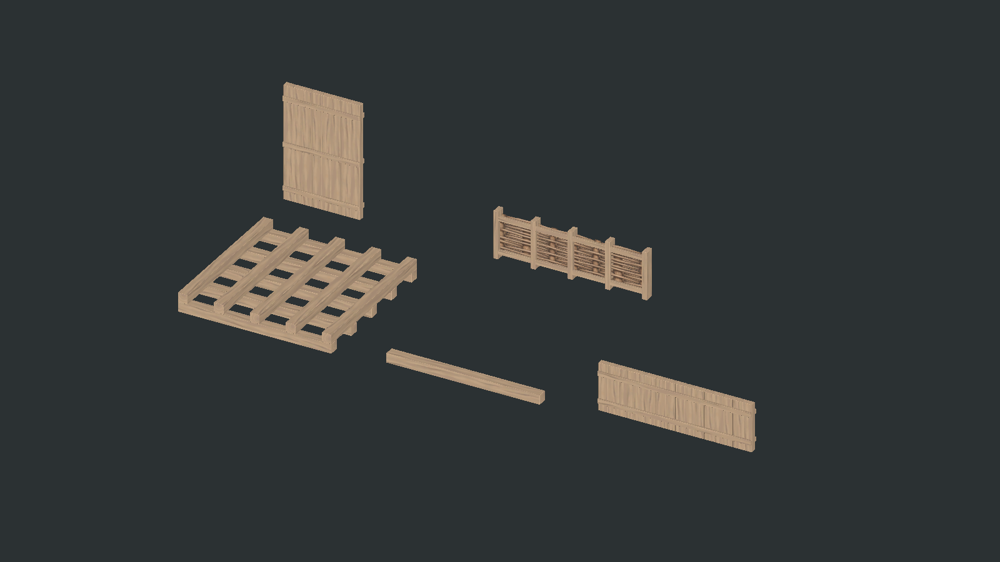

# W05, W06, W07, W08 and W12

Five ordinary-wood additions are installed in the building catalog. Restart Play mode after importing to reload the catalog.

| ID | Part | Native Unity dimensions | Build menu | Triangles |
| --- | --- | --- | --- | ---: |
| W05 | Sleeper footing | 4 × 0.5 × 4 m | Foundations | 440 |
| W06 | Horizontal beam | 4 × 0.25 × 0.25 m | Posts | 44 |
| W07 | Low plank wall | 4 × 1.25 × 0.25 m | Walls | 880 |
| W08 | Narrow wall | 2 × 3 × 0.25 m | Walls | 616 |
| W12 | Wattle fence | 4 × 1.25 × 0.25 m | Walls | 312 |

Dimensions use X width/length, Y height/depth and Z thickness/footprint. These follow the current full-span standard, superseding the older concept sheets' 3.5 m and 1.5 m panel widths and 2.75 m wall height. No extra post cells are added to panel lengths. The grid remains 0.25 m with eight yaw headings.

## Source and materials

[WoodExtensionKit.blend](../ArtReferences/IronAgeWood/Extension/WoodExtensionKit.blend) is an independent editable native source. Individual boards, rails, stakes and sleepers remain editable; joined export copies are in a separate collection. It does not modify the existing BuildComponents.blend or existing wood artwork.

`Tools/BuildWoodExtensionKit.py` rebuilds the source, six FBXs (five selectable parts and one derived low junction cover), Blender previews and [authoring manifest](../ArtReferences/IronAgeWood/Extension/wood-extension-models.json). The asset definitions directly reference the imported FBX meshes. Wood uses the existing SplitPlankWood material; W12 uses the existing instanced, double-sided WattleWood cutout material. No new texture or material is required. Grain follows each member's long axis; end faces use the shared trim's end-grain regions.

The 0.26 m square low-junction cover has the same small visual relief as the full-height post. It is derived rendering, with no independent menu entry, health or collider. Mixed low/full-height junctions select the taller cover, independent of insertion order.

## Footing and flooring

W05 has a top-surface anchor: local X/Z=0..4 and Y=-0.5..0. Five lower sleepers run along X; five upper sleepers run along Z. Its ten authored box colliders retain the visible gaps. It grounds as a foundation and carries supported construction through actual occupied contact.

A timber floor at the same top datum reversibly suppresses covered sleeper sections, preventing coplanar visible surfaces. The floor bears on the remaining lower sleepers. Partial floor openings preserve the appropriate exposed sleepers; removing flooring restores the original authored footing mesh and solids. Original timber UV reference bounds and seeds are retained for fitted sections.

The open footing alone cannot supply complete solid bedding for stone paving. A timber floor is also not solid bedding for stone paving; existing full-bearing rules still apply.

## Beam placement

W06 has a top-surface anchor, local X=0..4, Y=-0.25..0 and Z=-0.125..0.125. Beam is appended to BuildPartKind as value 8; prior enum values and content IDs remain unchanged.

Aim at an upper wall/post to seat the beam within its top 0.25 m band, retaining that support's storey datum. Aim at a beam end to continue its span. Aiming at a floor underside places the beam immediately below it; top-surface placement puts it above the receiving surface. Context rotation, locked world heading and quarter-metre nudges remain available. Roof eaves can seat on the beam's upper datum. Beams require structural support and cannot ground themselves directly on terrain.

## Wall and fence placement

W07 and W12 use 4 m spans, 1.25 m stack rises and centred 0.25 m thickness. Both can start directly on terrain or attach to supported pieces. Rigid panels remain level; they do not bend to slopes. W08 uses a 2 m span and the existing 3 m storey, and requires supported construction.

All three declare endpoint/interior wall sockets and use the existing wall snapping and support paths. Low pieces use the low junction cover; W08 reuses full-height post UV variants. W12's visual weave is cut out, but its physical panel remains solid, matching the installed full-height wattle wall's collision policy.

## Installation and validation

Use **Tools → Building → Install W05 W06 W07 W08 W12** for the scoped importer. Full-span kit rebuilding also includes these pieces when their source assets exist. Reinstallation preserves definition GUIDs and does not duplicate menu entries.

`Tools/ValidateWoodExtensionKit.ps1 -Install` compiles runtime/editor code, prepares an isolated Unity project, installs twice, validates and captures the imported assets, runs the existing wood and stone regressions, then copies only the five new definitions/prefabs/icons, extension models and low cover mesh into the main project. It appends missing references to the current catalog; the installed change adds exactly five catalog lines. No saved world scene is opened or rewritten.

Passed:

- [12,457 extension checks](../ArtReferences/IronAgeWood/Extension/unity-validation.json), including eight headings, mesh attributes, prefab/runtime colliders, terrain grounding, boundary snapping/stacking, mixed-height junction order, beam continuation, roof bearing, support removal, open sleeper gaps, full-bearing rejection and reversible floor fitting.
- [28,311 modular wood regression checks](../ArtReferences/IronAgeWood/Extension/modular-regression.json), including 192 real CharacterMotor stair walks.
- [3,570 stone regression checks](../ArtReferences/IronAgeWood/Extension/stone-regression.json), including 16 real gate traversals.

Actual URP front/reverse views of all five components and the overview were visually inspected. These are isolated correctness and rendering checks, not live-world performance measurements.
