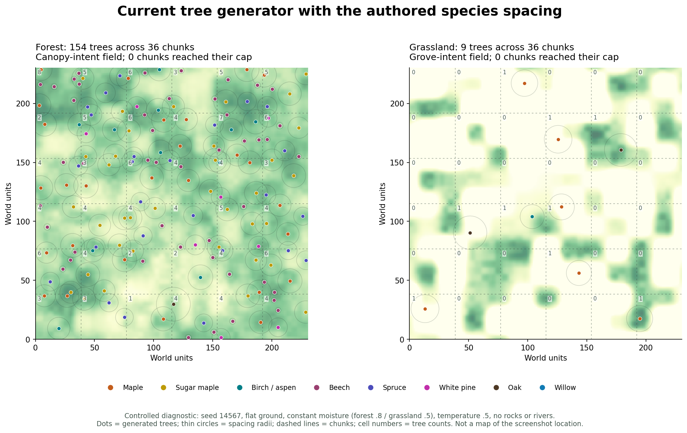

# Shore tuning and tree distribution

The layered stand design is now implemented and active. See
[the current tree-stand controls, density tests and performance results](TREE_STANDS.md).
The tree analysis and recommendation below document the previous generator for
comparison; the shore tuning still applies.

## Narrower shores

`TerrainWaterSettings.ShoreBand` is now **0.003333333** normalized height units,
down from 0.01. On a constant slope this retains one third of the old sand width.
With the current height multiplier (200) and world scale (0.3), the vertical sand
band is 0.2 world units, down from 0.6. Tested planar banks:

| Slope | Former sand width | New sand width |
| --- | ---: | ---: |
| 0.5° | 68.75 m | 22.90 m |
| 1° | 34.35 m | 11.45 m |
| 2° | 17.18 m | 5.73 m |
| 5° | 6.85 m | 2.28 m |
| 10° | 3.40 m | 1.13 m |

The river mud-bank threshold moves from 0.71 to **0.78**. Relative to a typical
waterline near river-mask 0.82, the dry mask interval shrinks from .11 to .04
(about 64%). The actual bank width depends on basin height and mask gradient.
The existing wet-soil height band stays .01; terrain carving, water height and
underwater mesh coverage are unchanged. Near/far surfaces use the same classifier.

This is a relative width reduction, not a fixed horizontal-distance cap. Extremely
flat terrain can still have a long beach. A future strict maximum would require
distance to the actual waterline, sampled consistently across chunks and LODs;
an elevation cutoff alone cannot guarantee that maximum.

## What the current tree generator does

`WorldFeaturePlanGenerator` uses seeded, quintic-smoothed **analytic value noise**
for local stand fields. Climate uses separate fractal noise. The steps are:

1. Classify the biome and surface from height, climate, slope and water.
2. Sample continuous world-space habitat fields. Forest/grassland membership
   blends around the moisture threshold .65 (half-width approximately .015).
3. Try a deterministic shuffled set of jittered candidates: 81 in forest/Taiga,
   49 in grassland/snow, per chunk. Candidates near chunk edges are clamped inward.
4. Accept each candidate probabilistically from habitat suitability.
5. Select a species using climate, habitat and species-patch weights.
6. Reject candidates that overlap existing placements in that chunk's feature
   plan, using the sum of authored exclusion radii.
7. Stop at the placement cap if it is reached: 18 forest/Taiga, 6 grassland in
   SmearScene, 8 snow. These are upper bounds, not target populations.

Near and distant trees use the same placement rules. `distantTreeDensity` only
changes distant rendering retention.

## Noise layers

Frequencies below multiply terrain-sample coordinates. The span is one noise
lattice cell, **not a repeating wavelength**, converted with worldScale .3.

| Forest field | Frequency | Approximate span | Role |
| --- | ---: | ---: | --- |
| Canopy macro | .0075 | 40 m | Broad density variation |
| Tree cluster | .024 | 12.5 m | Local stand variation |
| Clearing | .012 | 25 m | Openings; thresholded above .62 |
| Rockiness | .018 | 16.7 m | Reduces tree suitability |
| Fine breakup | .067 | 4.5 m | Small variation |
| Species patches | .019 | 15.8 m | Biases species weights |

Ignoring clamping for readability, canopy intent is
`(.52 * macro + .36 * cluster + .12 * fine) * slopeSuitability * riverSuitability * (1 - .72 * clearing)`.
Tree acceptance remaps canopy .30–.84 to 0–1, then multiplies by a .72–1.18
cluster factor, `(1 - .82 * clearing)`, `(1 - .28 * rockiness)`, and forest
membership. Slopes fade from 25° to 45°; forest river-mask acceptance ends at .64.
Taiga uses the same stand pattern with spruce-only species selection. Snow has
separate elevation/treeline/climate filters and .012-frequency stand variation.

| Grassland field | Frequency | Approximate span | Role |
| --- | ---: | ---: | --- |
| Open grass | .0065 | 46.2 m | Preserves open areas |
| Grove | .015 | 20 m | Thresholded grove patches |
| Grove fine breakup | .052 | 5.8 m | Varies grove strength |
| Regional rockiness | .0035 | 85.7 m | Rock-region/placement context |
| Rock patches / fine | .011 / .047 | 27.3 / 6.4 m | Rockiness and suppression |
| Species patches | .017 | 17.6 m | Oak, birch/aspen and maple weighting |

Grassland grove intent starts above grove-noise .62, with fine modulation. River
proximity and forest edges increase it. Tree intent combines `.48 * riparian +
.34 * grove + .18 * adjacentForest + .08 * meadowMoisture`, then reduces it for
rock influence and open grass. That intent is remapped over .22–.80. A separate
2.5–5.5% lone-tree chance supports occasional isolated trees in open habitat.
Willow currently uses the forest species-patch frequency .019 through its seed
dispatch, with strong river/moisture weighting.

Climate operates on much larger scales: moisture uses sampleScale × 10 and seed
+1000, temperature sampleScale × 12 and seed +2000. With sampleScale 600 these
base spans are approximately 1,800 and 2,160 world units. The current scene has
one effective climate octave (`max(1, octaves - 2)` with scene octaves = 2).

## What the diagnostic shows

This is a **controlled diagnostic**, not the screenshot's location: seed 14567,
6 × 6 chunks at chunkSize 128, worldScale .3, actual species-card spacing,
constant temperature .5, flat grass surfaces, no rocks or rivers. Forest moisture
is .8; grassland moisture .5. Each panel spans 230.4 × 230.4 world units.

- Forest: **154 trees**, averaging 4.28 per chunk; **0/36** chunks reached 18.
- Grassland: **9 trees**; **0/36** chunks reached 6.
- The forest example has **89 cross-chunk tree pairs** closer than their summed
  spacing radii. The spacing check only sees the current plan, so this does not
  contradict within-chunk rejection. The circles depict those spacing radii,
  not rendered crown widths.

Thus the generator already creates noise-shaped openings rather than filling
every chunk to its cap. But large authored spacing (maple alone needs 18–21 m
between two centres) removes much of the smaller 12.5 m clustering detail.
Candidates, edge clamping and spacing are still chunk-based. Species patches
only bias probabilities: they never strictly zero out a forest species, so
species can remain mixed throughout a forest instead of forming distinct stands.

White pine is now absent from grassland species selection. Forest selection also
gives it zero weight where the categorical biome is Grassland, including mixed
forest/grassland transition samples. Forest white pine remains available.

## Recommended next design

This is a proposed redesign, not part of the current behavior change:

1. **World-space stands first.** Seed stable grove/stand centres independently
   of chunk borders. Give each an irregular footprint, dominant species palette
   and age/size cohort. Combine these into a continuous density field.
2. **Habitat controls population.** Let moisture, drainage, slope, elevation and
   disturbance modify that field. Use a low background rate for solitary meadow
   trees, richer bands near suitable water, and strong open patches.
3. **Density-driven placement with local competition.** Sample the density field,
   then apply species/age-dependent spacing. Do not use maximal packing as the
   population model. Poisson-disc sampling is useful for minimum spacing, but
   a uniform Poisson-disc field alone will not create groves. The
   [Bridson paper](https://www.cs.ubc.ca/~rbridson/docs/bridson-siggraph07-poissondisk.pdf)
   describes an efficient minimum-distance sampler.
4. **Evaluate a neighbour halo deterministically.** Resolve priorities among
   world-space candidates on both sides of chunk boundaries, then assign output
   ownership. Chunks should partition streaming/storage, not stand ecology.
5. **Make wood types geographically legible.** Use one or two dominant species
   plus occasional associates per stand, with explicit biome eligibility. Permit
   canopy overlap where appropriate rather than requiring uniformly empty crown
   circles. Keep the chunk count cap as an exceptional resource safeguard.

This borrows the environmental suitability and plant-competition ideas of
[plant ecosystem modeling](https://doi.org/10.1145/280814.280898), while keeping
the runtime deterministic and simpler than a full growth simulation. For this
game, stand identity and readable wood resources are more useful controls than
allowing every biologically plausible species in every habitat.

## Validation

`Tools/ValidateRocks.ps1 -Exclusions` runs an isolated Unity project. The contact
hull tests compare tapered and actual rock shapes, transformed grass roots,
embed/scale/rotation, whole-chunk/tiled job results, and fallback circles. The
shore tests cover five slope profiles. Habitat tests compare **449** detailed
and sparse/distant placements across pure and transition habitats: no grassland
white pine, **23** retained forest white pines. Existing global-water coverage,
sampling, near/far, mesh LOD and chunk-border regressions also pass.

The footprint images are numerical diagnostics; the original live screenshot
has not been recaptured after regeneration.
